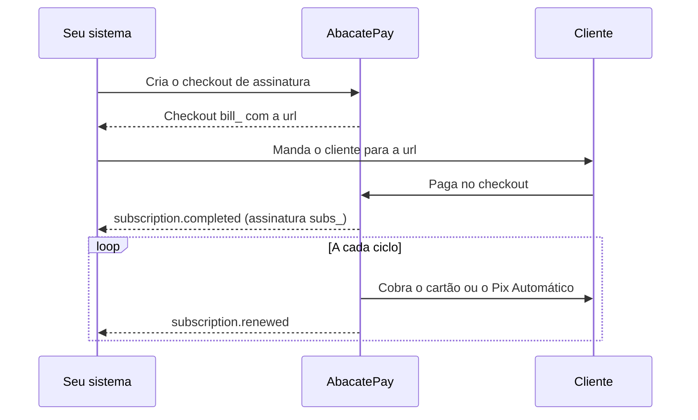
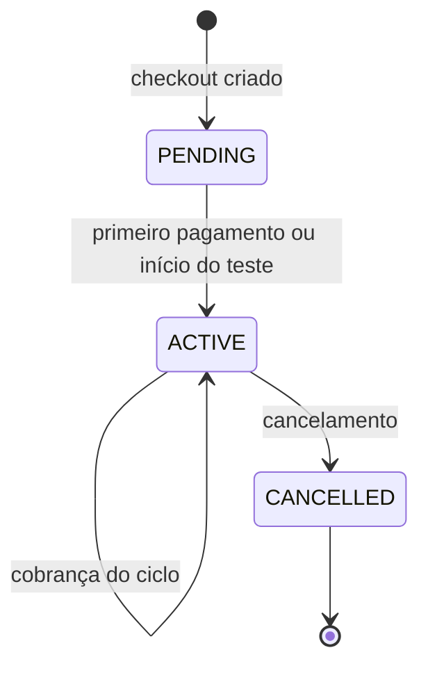
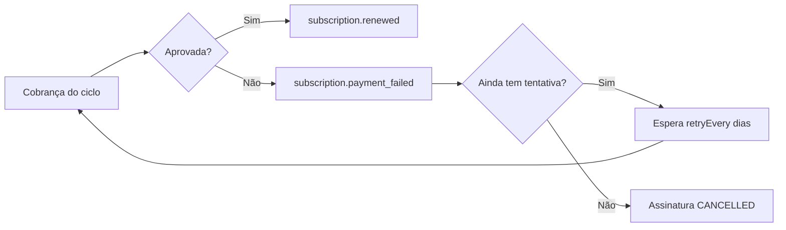
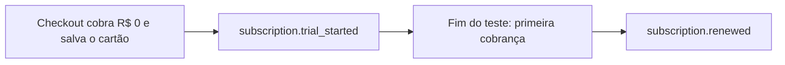
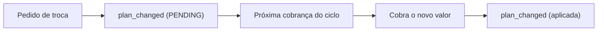

import { Video } from '/snippets/video.jsx'

Uma assinatura cobra o cliente sozinha a cada ciclo: toda semana, todo mês, a cada trimestre, semestre ou ano. O cliente paga a primeira vez no checkout, e a AbacatePay cobra os ciclos seguintes no cartão de crédito ou no [Pix Automático](/pages/cobrar/pix-automatico).

<Video id="https://youtu.be/6lKw-MQGhJM" title="Assinaturas - AbacatePay" />

O vídeo também está em [Assinaturas](/pages/videos/assinaturas).

## Quando usar

Use assinatura para mensalidades e planos: cursos e mentorias, SaaS, comunidades, clubes de assinatura.

| Você quer | Use |
|---|---|
| Cobrar o mesmo cliente a cada ciclo, sem ele pagar de novo | Assinatura |
| Cobrar uma vez | [Checkout](/pages/cobrar/checkout) |
| Um link que vários clientes pagam, uma vez cada | [Link de pagamento](/pages/cobrar/link-de-pagamento) |
| Guardar o cartão e decidir você quando cobrar | [Cartão salvo](/pages/pagamentos/cartao-de-credito) |

## Como funciona uma assinatura



São dois recursos, com IDs e rotas próprias:

| Recurso | ID | Quando existe |
|---|---|---|
| Checkout de assinatura | `bill_...` | Desde a criação. É a página onde o cliente paga a primeira vez. |
| Assinatura | `subs_...` | Depois do primeiro pagamento (ou do início do teste grátis). |

As regras:

- **O produto precisa ter ciclo.** Só produto criado com `cycle` entra numa assinatura. O valor de cada cobrança é o preço do produto vezes a quantidade.
- **Um produto por checkout.** Mais de um produto no mesmo checkout de assinatura precisa ser liberado na sua conta pelo suporte, e todos os produtos têm que ter o mesmo ciclo.
- **Um checkout, um cliente.** Depois do pagamento, o checkout de assinatura fica `PAID` e o link não aceita outro pagamento. Para cada cliente, crie um checkout.
- **A data se repete.** A próxima cobrança cai na mesma data da contratação, a cada ciclo. Com teste grátis, a contagem começa no fim do teste. O campo `nextChargeAt` da assinatura traz a data da próxima cobrança.
- **Sem parcelamento.** A assinatura no cartão é sempre à vista, e não aceita [repasse de taxa](/pages/pagamentos/repasse-de-taxa).
- **Liberação.** Em produção, a conta precisa ter assinaturas liberadas. No [Modo Teste](/pages/comecar/modo-teste), elas funcionam sem liberação.

## Formas de pagamento

O campo `methods` aceita:

| `methods` | Como cobra |
|---|---|
| `CARD` (padrão) | Cartão de crédito. O cartão fica salvo na contratação e é cobrado a cada ciclo, sem o cliente fazer nada. |
| `PIX` | [Pix Automático](/pages/cobrar/pix-automatico). O cliente autoriza uma vez no app do banco, e cada ciclo é debitado da conta dele. Precisa ser liberado na sua conta. |

Com `["CARD", "PIX"]`, o cliente escolhe no checkout.

## Ciclos de cobrança

| Ciclo | `cycle` | No dashboard |
|---|---|---|
| Semanal | `WEEKLY` | Sim |
| Mensal | `MONTHLY` | Sim |
| Trimestral | `QUARTERLY` | Sim |
| Semestral | `SEMIANNUALLY` | Só pela API |
| Anual | `ANNUALLY` | Sim |

O ciclo é definido no [produto](/pages/vender/produtos) e não muda depois que a assinatura começa.

## Status da assinatura



| Status | O que significa |
|---|---|
| `PENDING` | O checkout de assinatura (`bill_`) espera o primeiro pagamento. A assinatura ainda não existe. |
| `ACTIVE` | A assinatura (`subs_`) está valendo e é cobrada a cada ciclo. Inclui o período de teste grátis. |
| `CANCELLED` | Encerrada. Nenhuma cobrança nova é feita, e ela não volta a ficar ativa. |

Enquanto a AbacatePay tenta cobrar um ciclo recusado, a assinatura continua `ACTIVE`. Quando as tentativas acabam, ela vira `CANCELLED`.

## Pagamento recusado e retentativas

No cartão, uma cobrança recusada é tentada de novo conforme a `retryPolicy` do checkout de assinatura:

| Campo | O que define | Padrão | Mínimo | Máximo |
|---|---|---|---|---|
| `maxRetry` | Tentativas no total, **contando a primeira** | `3` | `1` | `10` |
| `retryEvery` | Dias entre uma tentativa e a próxima | `1` | `1` | `30` |



- Cada tentativa que falha dispara `subscription.payment_failed`.
- Com `maxRetry: 3` e `retryEvery: 2`, a AbacatePay tenta no dia do ciclo, 2 dias depois e mais 2 dias depois.
- Quando a última tentativa falha, a assinatura é cancelada com `cancelledDueTo: "max_payment_retries_exceeded"`, e sai o `subscription.cancelled`.
- Enquanto a assinatura está ativa, o cliente pode trocar o cartão pelo [Portal do cliente](/pages/vender/portal-do-cliente). Se uma cobrança estiver em retentativa, ela é cobrada no cartão novo na hora.

A `retryPolicy` só pode ser definida pela API. Checkouts criados pelo dashboard usam o padrão. No Pix Automático, quem debita é o banco do cliente, e a `retryPolicy` não se aplica: veja [cobrança recusada no Pix Automático](/pages/cobrar/pix-automatico#cobrança-recusada-no-pix-automático).

## Período de teste grátis

O teste grátis deixa o cliente usar antes de pagar. Ele é configurado no produto, com `trialDays` (de 1 a 90 dias), ao [criar o produto](/pages/products/create) pela API. O campo só tem efeito em produto com `cycle`: num produto avulso, ele é aceito e não faz nada.



- No checkout, o cliente digita o cartão, e o valor cobrado é **R$ 0,00**. O cartão fica salvo para as próximas cobranças.
- A assinatura nasce `ACTIVE`, com `trialDays` e `trialEndsAt` preenchidos.
- Na contratação sai `subscription.trial_started`, **no lugar** de `subscription.completed`. A primeira cobrança, no fim do teste, chega como `subscription.renewed`. Se você libera o acesso no `completed`, libere também no `trial_started`.
- Se a assinatura for cancelada durante o teste, nada é cobrado.
- O teste grátis é do cartão. Com teste, o checkout não aceita cupom.

## Cupom em assinatura

O cupom vale só em assinatura cobrada **só no cartão** (`methods: ["CARD"]`) e com produto **sem teste grátis**.

- O desconto vale na primeira cobrança. As renovações cobram o preço cheio.
- Os cupons aceitos vão em `coupons` na criação do checkout. Depois, não há como aplicar ou trocar o cupom de uma assinatura.
- Com `PIX` em `methods` ou com `trialDays` no produto, o campo de cupom some do checkout e o cupom é recusado. A criação pela API aceita `coupons` mesmo assim; a regra vale na hora do pagamento.

Veja como criar cupons em [Cupons](/pages/vender/cupons).

## Trocar o plano da assinatura

Para fazer upgrade ou downgrade, chame [Alterar plano](/pages/subscriptions/change-plan) com os novos produtos em `items`.



- **A troca fica pendente** até a próxima cobrança do ciclo. O ciclo atual não muda, e não há cobrança proporcional.
- **Uma troca pendente por vez.** Uma chamada nova substitui a troca que ainda não foi aplicada.
- **Mesmo ciclo.** Os produtos novos precisam ter o mesmo ciclo da assinatura.
- **Valor mínimo de R$ 1,00** para o novo plano.
- **Só assinatura ativa.** Mais de um produto no plano precisa de liberação, como na criação.
- **Pix Automático:** a troca só é aceita se o valor continuar o mesmo.

O `subscription.plan_changed` dispara duas vezes: no pedido, com `pendingUpdateId`, `newAmount` e `status: "PENDING"`; e quando a troca é aplicada, já com o novo `amount` na assinatura.

## Cobrança por uso

Além do valor fixo do plano, a assinatura pode cobrar o que o cliente consumiu no ciclo, como chamadas de API, SMS ou créditos. É o modelo pay-as-you-go.

1. Crie um produto **sem** `cycle` para a unidade de uso, com o preço de cada unidade.
2. A cada consumo, chame [Registrar uso](/pages/subscriptions/record-usage) com o produto, as unidades e `action: "add"`. Para estornar unidades do mesmo ciclo, use `action: "subtract"`.
3. Na próxima cobrança, a AbacatePay soma o uso ao valor do plano.

O valor da cobrança é o plano, mais as unidades adicionadas, menos as estornadas, cada uma pelo preço que o produto tinha no registro. A cobrança nunca fica abaixo de R$ 1,00. Por exemplo: plano de R$ 49,90 e 120 unidades de R$ 0,10 dão uma cobrança de R$ 61,90.

O uso só pode ser registrado em assinatura ativa, e o Pix Automático não aceita cobrança por uso.

## Cancelar uma assinatura

O momento em que o cancelamento vale depende de quem cancela:

| Quem cancela | Onde | Quando vale | `cancelPolicy` |
|---|---|---|---|
| Você | [API](/pages/subscriptions/cancel) ou dashboard | Na hora. As cobranças pendentes são canceladas. | `NOW` |
| O cliente | [Portal do cliente](/pages/vender/portal-do-cliente) | No fim do ciclo já pago. Nenhuma cobrança nova é feita. | `NEXT_CYCLE` |

Nos dois casos, o status vira `CANCELLED` e o `subscription.cancelled` sai na hora. No cancelamento pelo portal, o cliente já pagou o ciclo em curso: corte o acesso só depois do fim dele (`currentPeriodEnd` em [Buscar assinatura](/pages/subscriptions/get)), e não no recebimento do evento.

O `subscription.cancelled` dispara por estas causas, indicadas em `cancelledDueTo`:

| Causa | `cancelledDueTo` | `cancelPolicy` |
|---|---|---|
| Você cancelou pela API ou pelo dashboard | `null` | `NOW` |
| O cliente cancelou pelo Portal do cliente | Texto que começa com `Cancelada pelo cliente no portal`, com o motivo | `NEXT_CYCLE` |
| O cliente pediu reembolso pelo Portal do cliente | `Cancelada pelo reembolso pedido pelo cliente no portal` | `NOW` |
| As tentativas de cobrança acabaram | `max_payment_retries_exceeded` | `NOW` |
| Foi aberta uma disputa (chargeback) numa cobrança de cartão | `dispute_opened` | `NOW` |
| A autorização do Pix Automático foi cancelada no banco | `pix_automatic_authorization_refused` | `NOW` |
| A conta da loja foi encerrada | `Conta encerrada` | `NOW` |

Excluir o checkout de assinatura não cancela a assinatura que ele gerou.

## Pelo dashboard

1. Em **Sua Loja → Produtos**, crie o produto. Em **Tipo de cobrança**, escolha **Assinatura** e ative os ciclos com o preço de cada um (Mensal, Trimestral, Anual ou Semanal). Cada ciclo ativado vira um produto.
2. Em **Sua Loja → Assinaturas**, clique em **Criar checkout**.
3. Escolha o **Produto de assinatura**, o **Cliente** (opcional) e os **Métodos de pagamento**. Se quiser, preencha a **URL de finalização** e a **URL de retorno**. Clique em **Cadastrar**.
4. Na aba **Checkouts**, abra o checkout em **Ver detalhes** e copie a URL para mandar ao cliente.
5. Depois do pagamento, a assinatura aparece na aba **Assinaturas**. Para cancelar, abra a assinatura e clique em **Cancelar assinatura** no menu de ações.

Se o menu **Assinaturas** não aparece em produção, a sua conta ainda não tem assinaturas liberadas. Fale com o suporte em ajuda@abacatepay.com.

Algumas opções existem só pela API:

| Recurso | Dashboard | API |
|---|---|---|
| Ciclos semanal, mensal, trimestral e anual | Sim | Sim |
| Ciclo semestral | Não | Sim |
| Teste grátis (`trialDays`) | Não | Sim |
| Retentativas (`retryPolicy`) | Não, usa o padrão | Sim |
| Cupom | Não | Sim |
| Criar checkout e cancelar | Sim | Sim |
| Trocar o plano | Não | Sim |
| Cobrança por uso | Não | Sim |

## Pela API

1. **Crie o produto com ciclo** em [Criar produto](/pages/products/create), com `cycle` e, se quiser teste grátis, `trialDays`.

2. **Crie o checkout de assinatura** em [Criar checkout de assinatura](/pages/subscriptions/create):

   ```json
   POST /v2/subscriptions/create
   {
     "items": [{ "id": "prod_abc123xyz", "quantity": 1 }],
     "customerId": "cust_abc123xyz",
     "externalId": "assinatura-123",
     "completionUrl": "https://seusite.com/sucesso",
     "methods": ["CARD"],
     "retryPolicy": { "maxRetry": 3, "retryEvery": 2 }
   }
   ```

   Se já existir um checkout com o mesmo `externalId`, a API devolve esse checkout em vez de criar outro.

3. **Mande o cliente para a `url`** da resposta. É lá que ele paga a primeira vez.

4. **Espere o webhook** `subscription.completed` (ou `subscription.trial_started`, com teste grátis) para liberar o acesso. O `data.subscription.id` é o `subs_...` da assinatura.

5. **Gerencie a assinatura** com os endpoints abaixo.

| Para | Checkout de assinatura (`bill_`) | Assinatura (`subs_`) |
|---|---|---|
| Criar | [Criar checkout de assinatura](/pages/subscriptions/create) | Nasce do pagamento |
| Buscar | [Buscar checkout de assinatura](/pages/subscriptions/checkouts-get) | [Buscar assinatura](/pages/subscriptions/get) |
| Listar | [Listar checkouts de assinatura](/pages/subscriptions/checkouts-list) | [Listar assinaturas](/pages/subscriptions/list) |
| Encerrar | [Excluir checkout de assinatura](/pages/subscriptions/checkouts-delete) | [Cancelar assinatura](/pages/subscriptions/cancel) |
| Mudar | | [Alterar plano](/pages/subscriptions/change-plan) e [Registrar uso](/pages/subscriptions/record-usage) |

A assinatura aponta o checkout que a originou em `checkoutId`. Para achar a assinatura de um checkout, use `GET /v2/subscriptions/list?checkoutId=bill_...`.

## Notificações

| Evento | Quando dispara |
|---|---|
| `subscription.completed` | O primeiro pagamento foi aprovado e a assinatura começou (sem teste grátis). |
| `subscription.trial_started` | A assinatura começou com teste grátis. Sai no lugar do `completed`. |
| `subscription.renewed` | Cada cobrança paga depois da primeira, inclusive a primeira depois do teste. |
| `subscription.payment_failed` | Cada tentativa de cobrança que falha. |
| `subscription.plan_changed` | No pedido de troca de plano e quando a troca é aplicada. |
| `subscription.cancelled` | Qualquer cancelamento. A causa vem em `cancelledDueTo`. |

Os payloads estão em [Eventos de assinatura](/pages/webhooks/events/subscriptions). Para configurar o recebimento, veja [Webhooks](/pages/notificacoes/webhooks).

<Note>
  Cada contratação e cada cobrança paga de assinatura também disparam `checkout.completed`, com `frequency: "SUBSCRIPTION"`. Se você trata os dois eventos, trate a assinatura num só deles para não processar o mesmo pagamento duas vezes.
</Note>

## Testar no Modo Teste

- No [Modo Teste](/pages/comecar/modo-teste), as assinaturas funcionam sem liberação. O Pix Automático precisa estar liberado também no Modo Teste.
- No checkout, use os [cartões de teste](/pages/comecar/modo-teste#cartões-de-teste) para aprovar ou recusar o primeiro pagamento.
- As cobranças dos próximos ciclos acontecem na data do ciclo, também no Modo Teste. Não há como adiantar uma renovação.

## Perguntas frequentes

<AccordionGroup>
  <Accordion title="Como o cliente cancela a assinatura?">
    Pelo [Portal do cliente](/pages/vender/portal-do-cliente). O cancelamento pelo portal vale no fim do ciclo já pago. Você também pode cancelar pela API ou pelo dashboard, e aí vale na hora.
  </Accordion>

  <Accordion title="O cliente pode trocar o cartão da assinatura?">
    Sim, pelo [Portal do cliente](/pages/vender/portal-do-cliente), enquanto a assinatura estiver ativa. Se houver uma cobrança em retentativa, ela é cobrada no cartão novo.
  </Accordion>

  <Accordion title="Como mudo o valor de uma assinatura?">
    Troque o plano com [Alterar plano](/pages/subscriptions/change-plan). O novo valor vale a partir da próxima cobrança do ciclo.
  </Accordion>

  <Accordion title="Posso reativar uma assinatura cancelada?">
    Não. Crie um checkout de assinatura novo e mande para o cliente.
  </Accordion>

  <Accordion title="Posso reembolsar uma cobrança de assinatura?">
    Pela API, não: as rotas de reembolso recusam cobrança de assinatura. O cliente pode pedir o reembolso pelo [Portal do cliente](/pages/vender/portal-do-cliente), e isso cancela a assinatura na hora. Veja [Reembolsos](/pages/vender/reembolsos).
  </Accordion>

  <Accordion title="Por que não recebi o subscription.completed?">
    Se o produto tem teste grátis, a contratação dispara `subscription.trial_started` no lugar do `completed`, e a primeira cobrança chega como `subscription.renewed`.
  </Accordion>

  <Accordion title="Posso usar o mesmo checkout para vários clientes?">
    Não. Depois do primeiro pagamento, o checkout de assinatura fecha. Crie um checkout para cada cliente.
  </Accordion>
</AccordionGroup>
