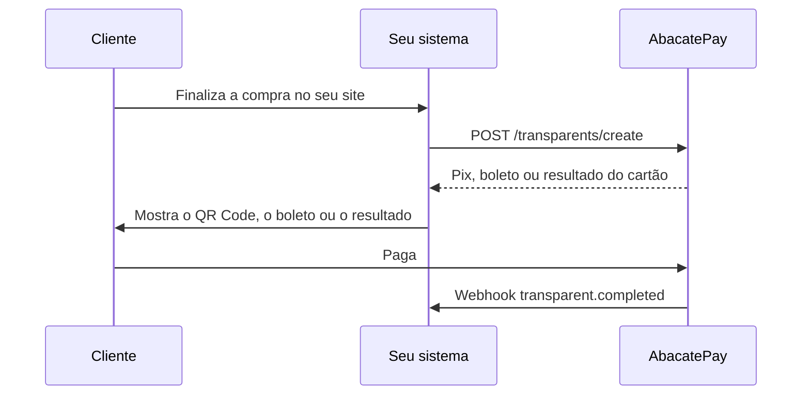

import { Video } from '/snippets/video.jsx'

No checkout transparente, o pagamento acontece dentro do seu site ou app. Você monta a tela de compra, a AbacatePay processa o Pix, o boleto ou o cartão por trás, e o cliente não sai da sua página.

## Quando usar o checkout transparente

Use quando você já tem a sua tela de compra e quer a sua marca do começo ao fim, com menos cliques e sem redirecionamento. Ele exige desenvolvimento: tudo é feito pela API. Se você ainda não tem time de tecnologia, comece pelo [checkout](/pages/cobrar/checkout).

| | Checkout | Checkout transparente |
|---|---|---|
| Onde o cliente paga | Na página da AbacatePay | No seu site ou app |
| Precisa de programador | Não: dá para criar pelo dashboard | Sim: só pela API |
| Visual | O da AbacatePay, com a sua [personalização](/pages/cobrar/checkout#como-personalizar-o-checkout) | O seu |
| O que você cobra | Produtos cadastrados | Um valor (`amount`) |
| Formas de pagamento | Pix, cartão, boleto, Apple Pay e Google Pay | Pix, boleto e cartão |
| Rota para criar | `POST /checkouts/create` | `POST /transparents/create` |
| Webhooks | `checkout.*` | `transparent.*` |

## Como funciona o checkout transparente

Os três métodos usam a mesma rota, `POST /transparents/create`, e mudam no campo `method`:

| `method` | O que a AbacatePay devolve | Detalhes |
|---|---|---|
| `PIX` | O QR Code em imagem e o código copia e cola, para mostrar na sua página | [Pix](/pages/pagamentos/pix) |
| `BOLETO` | O boleto, com um Pix junto para o cliente pagar como preferir | [Boleto](/pages/pagamentos/boleto) |
| `CARD` | O resultado da cobrança no cartão, à vista ou parcelado | [Cartão de crédito](/pages/pagamentos/cartao-de-credito) |

No cartão, o número nunca passa pelo seu servidor. O formulário de cartão é um campo seguro da AbacatePay dentro da sua página, o [abacatepay.js](/pages/transparents/abacatepay-js). Ele gera um token, e o seu backend cobra com esse token. O cartão precisa estar liberado na sua conta e aceita Visa e Mastercard. O passo a passo completo está em [Checkout transparente com cartão](/pages/cobrar/checkout-transparente-cartao).

Para cobrar de novo um cartão que o cliente já usou, sem ele digitar nada, veja [One click buy](/pages/pagamentos/one-click-buy). Para rastrear campanhas e guardar dados do seu sistema na cobrança, veja [UTM e metadados](/pages/vender/utm-e-metadados).

## Pelo dashboard

O checkout transparente só é criado pela API. No dashboard, as cobranças aparecem em **Sua Loja → Cobranças**, na aba **Checkout Transparente**. A chave pública do cartão fica em **Integração → Checkout próprio**.

## Pela API

Crie uma chave de API com a permissão `TRANSPARENT:CREATE` em **Integração → API**. Veja [Chaves de API](/pages/comecar/chaves-de-api).

| Endpoint | O que faz |
|---|---|
| [Criar cobrança Pix](/pages/transparents/create) | `POST /transparents/create` com `method: "PIX"` |
| [Criar cobrança Boleto](/pages/transparents/boleto) | `POST /transparents/create` com `method: "BOLETO"` |
| [Criar cobrança Cartão](/pages/transparents/card) | `POST /transparents/create` com `method: "CARD"` |
| [Checar status](/pages/transparents/check) | `GET /transparents/check`, para cobranças Pix |
| [Listar cobranças](/pages/transparents/list) | `GET /transparents/list` |
| [Reembolsar](/pages/transparents/refund) | `POST /transparents/refund`. Veja [Reembolsos](/pages/vender/reembolsos) |

`GET /transparents/get` e `GET /transparents/list` trazem só as cobranças do checkout transparente. Checkouts, links de pagamento e assinaturas ficam nas rotas deles.

Depois que o pagamento confirma, `receiptUrl` traz o link do comprovante. No dashboard, o botão **Ver comprovante** abre o mesmo recibo.

<Video id="https://youtu.be/TwEArVdl-SE" title="Comprovante - AbacatePay" />

O vídeo também está em [Comprovante](/pages/videos/comprovante).

## Notificações

| Evento | Quando dispara |
|---|---|
| `transparent.completed` | O pagamento foi confirmado. |
| `transparent.refunded` | O pagamento foi reembolsado. |
| `transparent.disputed` | O pagamento entrou em disputa. |
| `transparent.lost` | A disputa foi perdida. |

Os exemplos de cada evento estão em [Eventos do checkout transparente](/pages/webhooks/events/transparent). Para cadastrar o endereço que recebe os eventos, veja [Webhooks](/pages/notificacoes/webhooks).

## Testar no Modo Teste

Use uma chave de API do [Modo Teste](/pages/comecar/modo-teste), que começa com `abc_dev_`. No Pix, chame [Simular pagamento](/pages/transparents/simulate-payment) com o `id` da cobrança. No cartão, use a chave pública de teste e os [cartões de teste](/pages/comecar/modo-teste#cartões-de-teste).

## Perguntas frequentes

<AccordionGroup>
  <Accordion title="Preciso de programador para usar o checkout transparente?">
    Sim. A tela de compra é sua e a cobrança é criada pela API. Sem desenvolvimento, use o [checkout](/pages/cobrar/checkout) ou o [link de pagamento](/pages/cobrar/link-de-pagamento), que você cria pelo dashboard.
  </Accordion>

  <Accordion title="O número do cartão passa pelo meu servidor?">
    Não. O cliente digita o cartão num campo seguro da AbacatePay dentro da sua página, e o seu servidor recebe só um token.
  </Accordion>

  <Accordion title="Dá para parcelar no cartão?">
    Sim, em até 12x. Veja [Parcelamento no cartão](/pages/pagamentos/parcelamento).
  </Accordion>

  <Accordion title="Consigo cobrar o mesmo cartão de novo?">
    Sim. A primeira cobrança devolve um `cardToken`, que cobra o mesmo cartão sem o cliente digitar nada. Veja [One click buy](/pages/pagamentos/one-click-buy).
  </Accordion>
</AccordionGroup>
