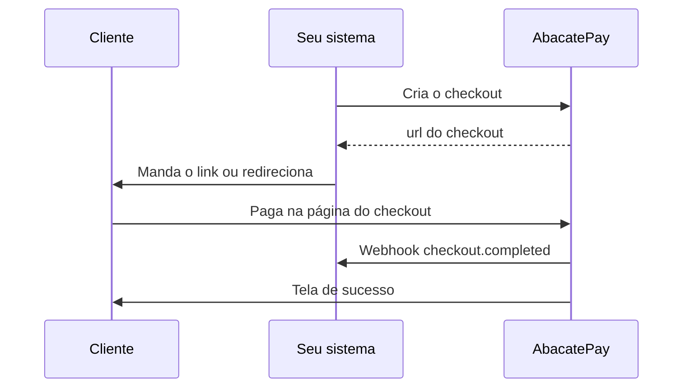
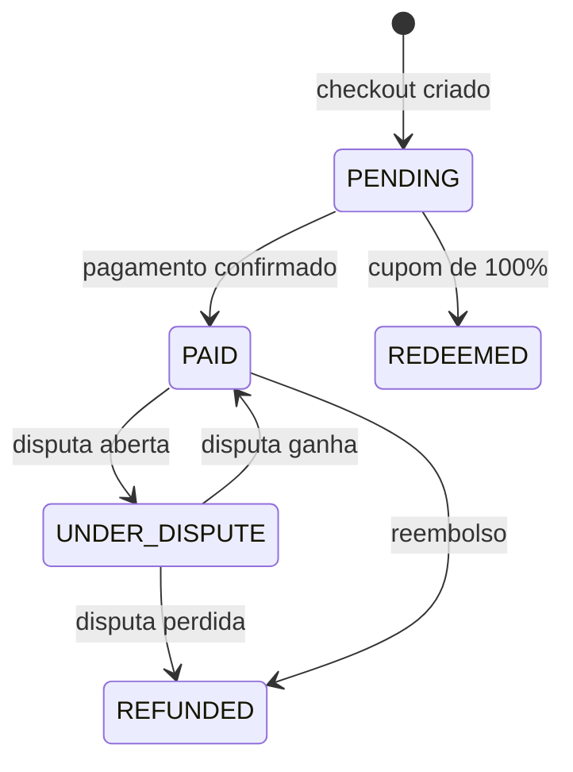

import { Video } from '/snippets/video.jsx'

O checkout é a página de pagamento pronta da AbacatePay. Você escolhe os produtos, manda o link ao cliente e ele paga por Pix, cartão de crédito, boleto, Apple Pay ou Google Pay, sem você montar nenhuma tela.

<Video id="https://youtu.be/a0szadN5rcQ" title="Checkout Cobranças - AbacatePay" />

O vídeo também está em [Checkout](/pages/videos/checkout).

## Quando usar o checkout

Use o checkout para cobrar um pedido uma vez. Cada checkout aceita um pagamento. Para outros jeitos de cobrar, cada tipo tem a sua rota:

| Você quer | Use | Rota da API |
|---|---|---|
| Cobrar um pedido, uma vez, numa página pronta | Checkout | `POST /checkouts/create` |
| Um link que vários clientes pagam | [Link de pagamento](/pages/cobrar/link-de-pagamento) | `POST /payment-links/create` |
| Cobrar o cliente a cada ciclo | [Assinatura](/pages/cobrar/assinaturas) | `POST /subscriptions/create` |
| Receber dentro do seu site, sem redirecionar | [Checkout transparente](/pages/cobrar/checkout-transparente) | `POST /transparents/create` |

O tipo de cobrança é definido pela rota. O campo `frequency` aparece só na resposta e mostra o tipo: `ONE_TIME` no checkout, `MULTIPLE_PAYMENTS` no link de pagamento e `SUBSCRIPTION` na assinatura.

## Como funciona o checkout



A `url` tem o formato `https://app.abacatepay.com/pay/bill_...`. Você pode mandar o link pelo WhatsApp ou por e-mail, ou redirecionar o cliente do seu site.

### Regras

- **Um pagamento por checkout.** Depois de pago, o checkout não aceita outro pagamento. Para receber várias vezes pelo mesmo link, use um [link de pagamento](/pages/cobrar/link-de-pagamento).
- **Valor mínimo.** O total é a soma de preço × quantidade dos itens e precisa ser de pelo menos R$ 1,00. Com boleto entre as formas de pagamento, o mínimo é R$ 3,00.
- **Itens.** Em `items[].id`, use o `id` do produto (`prod_...`) ou o `externalId` dele. `quantity` é opcional e vale 1 se você não mandar. Se o mesmo produto vier duas vezes, vale só o primeiro item.
- **Formas de pagamento.** `methods` aceita `PIX`, `CARD`, `BOLETO`, `APPLE_PAY` e `GOOGLE_PAY`. Sem `methods`, o checkout oferece Pix e cartão. Em produção, só valem as formas liberadas na sua conta: as outras dão erro, como `BOLETO is not available for this store`.
- **Cupons.** O checkout só aceita os cupons listados em `coupons`, com até 50 códigos. Sem a lista, a página não mostra o campo de cupom. Veja [Cupons de desconto](/pages/vender/cupons).
- **Idempotência por `externalId`.** Se a loja já tem um checkout com o mesmo `externalId`, e ele não foi excluído, a API devolve esse checkout e ignora os dados novos. Use o id do pedido no seu sistema para não criar duas cobranças do mesmo pedido.
- **Sem prazo de validade.** O checkout fica `PENDING` até ser pago. O que vence são o Pix e o boleto gerados dentro dele. Se vencerem, o cliente abre o link de novo e gera outro.
- **Cliente cadastrado.** Com o `customerId` de um [cliente](/pages/vender/clientes) que tem nome, e-mail e CPF/CNPJ, o checkout cobra esse cliente e não pede os dados pessoais.
- **Exclusão.** Um checkout pendente pode ser excluído com `POST /checkouts/delete`, e o link para de abrir. Checkout pago não pode ser excluído.

### Status do checkout



| Status | Significado |
|---|---|
| `PENDING` | Criado, esperando o pagamento. |
| `PAID` | Pago. No cartão, vale para pagamento à vista e parcelado. |
| `REDEEMED` | Fechado com um cupom de 100%. Nada foi cobrado. |
| `UNDER_DISPUTE` | O pagamento está em disputa e o resultado ainda não saiu. |
| `REFUNDED` | O pagamento foi reembolsado ou a disputa foi perdida. |

O link de pagamento tem status próprios, `ACTIVE` e `CANCELLED`. Veja [Link de pagamento](/pages/cobrar/link-de-pagamento).

O campo `paidAmount` começa `null` e é preenchido no pagamento, com o valor pago. Se o cliente aceitar um [upsell](/pages/vender/upsell), o valor dele é somado.

### Pular as etapas de dados do cliente

Antes do pagamento, o checkout pede os dados pessoais (nome, e-mail, CPF/CNPJ e celular) e, quando aceita cartão, o endereço. Para tirar essas etapas, acrescente uma ou as duas flags à `url` do checkout:

| Flag | O que faz |
|---|---|
| `skip_customer=true` | Tira a etapa de dados pessoais. A cobrança sai sem os dados do cliente. |
| `skip_address=true` | Tira a etapa de endereço. |

```
https://app.abacatepay.com/pay/bill_abc123xyz?skip_customer=true&skip_address=true
```

As flags aceitam `true` ou `1`, são independentes e valem no checkout e no link de pagamento. A etapa some de vez: não aparece no topo da página e o cliente não volta para ela.

| Forma de pagamento | Com `skip_customer` | Com `skip_address` |
|---|---|---|
| Pix | A cobrança sai sem cliente. Nome e CPF/CNPJ de quem pagou chegam pelo banco, em `payerInformation` no webhook. | Não usa endereço. |
| Cartão | O cliente da cobrança é o titular do cartão: o checkout continua pedindo o CPF do titular no formulário do cartão. | A cobrança sai sem endereço. |
| Boleto, Apple Pay e Google Pay | Somem do checkout, porque precisam dos dados de quem paga. Se só sobrarem essas formas, a flag é ignorada. | Não usam endereço. |

As flags não valem em checkout de assinatura, porque a cobrança recorrente precisa dos dados e do endereço do cliente. Também não valem em contas em que o cartão ainda passa pelo processador antigo, que exige os dados do titular. Com `skip_customer`, o checkout não mostra a oferta de [upsell](/pages/vender/upsell) e o cliente não recebe o e-mail de confirmação da compra.

### Para onde o cliente vai depois

| Campo | No dashboard | O que faz |
|---|---|---|
| `completionUrl` | URL de finalização | Para onde o cliente vai depois de pagar. A tela de sucesso redireciona sozinha em 5 segundos. Com [upsell](/pages/vender/upsell), só quando o cliente toca em **Continuar**. |
| `returnUrl` | URL de retorno | Para onde o cliente vai se clicar em voltar antes de pagar. |
| `receiptUrl` | **Ver comprovante** | O link do comprovante, preenchido depois do pagamento. |

`completionUrl` e `returnUrl` precisam usar `http` ou `https`.

<Video id="https://youtu.be/TwEArVdl-SE" title="Comprovante - AbacatePay" />

O vídeo do comprovante também está em [Comprovante](/pages/videos/comprovante).

## Formas de pagamento no checkout

- **Pix:** QR Code e copia e cola na própria página. Veja [Pix](/pages/pagamentos/pix).
- **Cartão de crédito:** à vista ou parcelado com `card.maxInstallments`. Veja [Cartão de crédito](/pages/pagamentos/cartao-de-credito) e [Parcelamento no cartão](/pages/pagamentos/parcelamento).
- **Repasse de taxa:** com `card.passFeesToCustomer: true`, o cliente paga a taxa do cartão. Veja [Repasse de taxa](/pages/pagamentos/repasse-de-taxa).
- **Boleto:** `dueDate`, `interest` e `fine` exigem `BOLETO` em `methods`. Veja [Boleto](/pages/pagamentos/boleto) e [Juros e multa no boleto](/pages/pagamentos/juros-e-multa-boleto).
- **Apple Pay e Google Pay:** só no checkout, nunca no link de pagamento ou na assinatura. Veja [Apple Pay e Google Pay](/pages/pagamentos/apple-pay-google-pay).

## Como personalizar o checkout

Em **Sua Loja → Personalizar checkout**, você muda a aparência de todos os checkouts da loja, inclusive dos links de pagamento:

| Opção | O que muda |
|---|---|
| **Layout** | **AbacatePay**, o padrão, ou **Shopify**, que mostra tudo numa página só, com entrega e frete, para pedidos da sua [loja Shopify](/pages/guides/shopify). |
| **Logo** | A logo da sua marca na página. |
| **Botão Principal** | A cor do botão. |
| **Textos** | A cor dos textos. |
| **Background** | A cor de fundo. |
| **Cantos** | **Arredondado** ou **Reto**. |
| **Tema** | **Claro** ou **Escuro**. |

A prévia mostra o resultado na hora. Clique em **Salvar** para aplicar. A personalização do Modo Teste é separada da de produção: configure as duas.

## Como criar um checkout pelo dashboard

<Steps>
  <Step title="Abra as cobranças">
    No menu, vá em **Sua Loja → Cobranças** e clique em **Criar cobrança**.
  </Step>

  <Step title="Preencha o checkout">
    - **Cliente (opcional):** um cliente cadastrado. Com o cadastro completo, ele não preenche os dados na página.
    - **Produtos:** os produtos avulsos da loja. Produto com ciclo vai em [Assinaturas](/pages/cobrar/assinaturas).
    - **Métodos de pagamento:** Pix, cartão, boleto, Apple Pay e Google Pay, conforme o que a sua conta tem liberado.
    - **Parcelas no cartão** e **Repassar a taxa do cartão ao cliente:** aparecem quando a sua conta tem esses recursos.
    - **Cupons (opcional)**, **URL de finalização (opcional)** e **URL de retorno (opcional)**.

    Clique em **Cadastrar**.
  </Step>

  <Step title="Mande o link">
    O checkout aparece na aba **Checkout Abacate**. No menu da linha, **Ir para checkout** abre a página de pagamento. Mande esse endereço ao cliente.
  </Step>
</Steps>

No mesmo menu, **Ver detalhes** mostra os dados do checkout. Depois do pagamento, aparecem **Ver comprovante** e **Reembolsar**.

## Como criar um checkout pela API

<Steps>
  <Step title="Crie uma chave de API">
    Em **Integração → API**, crie uma chave com a permissão `CHECKOUT:CREATE`. Veja [Chaves de API](/pages/comecar/chaves-de-api).
  </Step>

  <Step title="Crie o checkout">
    ```bash
    curl -X POST https://api.abacatepay.com/v2/checkouts/create \
      -H "Authorization: Bearer SUA_CHAVE" \
      -H "Content-Type: application/json" \
      --data '{
        "items": [{ "id": "prod_abc123xyz", "quantity": 1 }],
        "methods": ["PIX", "CARD"],
        "externalId": "pedido-123",
        "completionUrl": "https://seusite.com/obrigado",
        "returnUrl": "https://seusite.com/carrinho"
      }'
    ```

    Só `items` é obrigatório. A resposta traz o checkout. Este trecho mostra os principais campos, e todos estão em [Criar um checkout](/pages/payment/create):

    ```json
    {
      "data": {
        "id": "bill_abc123xyz",
        "externalId": "pedido-123",
        "url": "https://app.abacatepay.com/pay/bill_abc123xyz",
        "amount": 10000,
        "paidAmount": null,
        "items": [{ "id": "prod_abc123xyz", "quantity": 1 }],
        "status": "PENDING",
        "methods": ["PIX", "CARD"],
        "frequency": "ONE_TIME",
        "returnUrl": "https://seusite.com/carrinho",
        "completionUrl": "https://seusite.com/obrigado",
        "receiptUrl": null,
        "devMode": false
      },
      "success": true,
      "error": null
    }
    ```
  </Step>

  <Step title="Mande o cliente para a url">
    Redirecione o cliente para `data.url` ou mande o link. Os valores da API são sempre em centavos: `10000` = R$ 100,00.
  </Step>

  <Step title="Confirme o pagamento">
    Libere o pedido quando chegar o webhook `checkout.completed`. Para conferir o status a qualquer momento, use [Buscar um checkout](/pages/payment/one).
  </Step>
</Steps>

| Endpoint | O que faz |
|---|---|
| [Criar um checkout](/pages/payment/create) | `POST /checkouts/create` |
| [Buscar um checkout](/pages/payment/one) | `GET /checkouts/get`, por `id`, `externalId` ou `customerId` |
| [Listar checkouts](/pages/payment/list) | `GET /checkouts/list`, com filtro por status e data |
| [Reembolsar um checkout](/pages/payment/refund) | `POST /checkouts/refund`. Veja [Reembolsos](/pages/vender/reembolsos) |
| Excluir um checkout | `POST /checkouts/delete?id=bill_...`, só para checkout que não foi pago |

## Notificações

| Evento | Quando dispara |
|---|---|
| `checkout.completed` | O pagamento foi confirmado. Parcelado no cartão, sai um evento só, pela venda inteira. Se o cliente aceitar o [upsell](/pages/vender/upsell), sai um segundo evento. |
| `checkout.refunded` | O pagamento foi reembolsado. |
| `checkout.disputed` | O pagamento entrou em disputa. |
| `checkout.lost` | A disputa foi perdida. |

Os exemplos de cada evento estão em [Eventos de checkout](/pages/webhooks/events/checkout). Para cadastrar o endereço que recebe os eventos, veja [Webhooks](/pages/notificacoes/webhooks).

## Testar no Modo Teste

Crie o checkout com o [Modo Teste](/pages/comecar/modo-teste) ligado ou com uma chave `abc_dev_`. Na página, o botão final vira **Simular Pagamento**. Em **Sua Loja → Cobranças**, o menu da linha também tem **Simular pagamento**. No cartão, use os [cartões de teste](/pages/comecar/modo-teste#cartões-de-teste).

## Perguntas frequentes

<AccordionGroup>
  <Accordion title="O checkout tem prazo de validade?">
    Não. Ele fica `PENDING` até ser pago. O Pix e o boleto gerados dentro dele vencem, mas o cliente pode abrir o link de novo e gerar outro.
  </Accordion>

  <Accordion title="O cliente pode pagar duas vezes o mesmo checkout?">
    Não. Depois do pagamento, o checkout não aceita outro. Para um link que vários clientes pagam, use um [link de pagamento](/pages/cobrar/link-de-pagamento).
  </Accordion>

  <Accordion title="Mandei o mesmo externalId duas vezes. O que acontece?">
    A API devolve o checkout que já existe, com os dados da primeira chamada. Os itens e campos da segunda chamada são ignorados.
  </Accordion>

  <Accordion title="Consigo colocar a minha marca na tela de pagamento?">
    Sim. Em **Sua Loja → Personalizar checkout**, mude a logo, as cores, os cantos e o tema. Vale para todos os checkouts e links de pagamento da loja.
  </Accordion>

  <Accordion title="Dá para o cliente ir direto para o pagamento, sem preencher dados?">
    Sim. Crie o checkout com o `customerId` de um cliente com cadastro completo, ou acrescente `?skip_customer=true` ao link. Veja [como cada forma de pagamento se comporta](#pular-as-etapas-de-dados-do-cliente).
  </Accordion>

  <Accordion title="O que acontece se o cliente não pagar?">
    O checkout continua `PENDING` e o link continua funcionando. Você pode reenviar o link ou excluir o checkout.
  </Accordion>

  <Accordion title="Posso excluir um checkout pago?">
    Não. Para devolver o dinheiro ao cliente, faça um [reembolso](/pages/vender/reembolsos).
  </Accordion>
</AccordionGroup>
