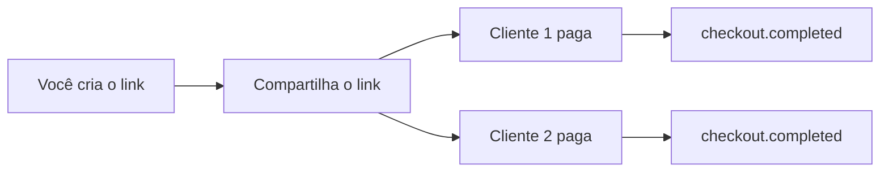
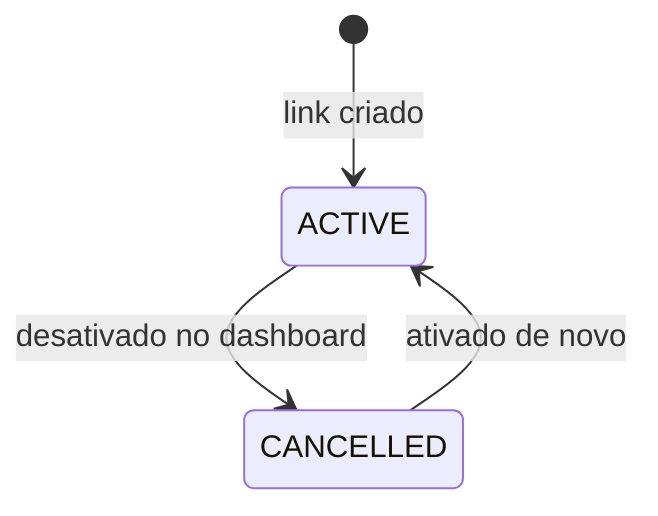

import { Video } from '/snippets/video.jsx'

O link de pagamento é um checkout que aceita vários pagamentos. Você cria uma vez, compartilha onde quiser e cada cliente que abrir o link faz o próprio pagamento, por Pix, cartão de crédito ou boleto.

<Video id="https://youtu.be/3a1nscZ-XC8" title="Link de Pagamento - AbacatePay" />

O vídeo também está em [Link de pagamento](/pages/videos/link-de-pagamento).

## Quando usar o link de pagamento

Use o link quando o mesmo valor vai ser pago por muitas pessoas: inscrições, doações, uma venda divulgada no WhatsApp ou no Instagram. Para cobrar um pedido específico, uma vez, use o [checkout](/pages/cobrar/checkout).

No dashboard, os dois ficam em telas diferentes: o link em **Sua Loja → Links de pagamento** e o checkout em **Sua Loja → Cobranças**.

| | Link de pagamento | Checkout |
|---|---|---|
| Pagamentos | Vários, de clientes diferentes | Um |
| No dashboard | **Links de pagamento** | **Cobranças** |
| Rota da API | `POST /payment-links/create` | `POST /checkouts/create` |
| Status | `ACTIVE` ou `CANCELLED` | `PENDING`, `PAID`, `REDEEMED`, `UNDER_DISPUTE` ou `REFUNDED` |
| Cliente definido na criação (`customerId`) | Não | Sim |
| Apple Pay e Google Pay | Não | Sim |
| [Upsell](/pages/vender/upsell) | Não | Sim, pela API |
| [Parcelamento](/pages/pagamentos/parcelamento) e [repasse de taxa](/pages/pagamentos/repasse-de-taxa) | Sim | Sim |
| `paidAmount` | Fica `null` | O valor pago |

## Como funciona o link de pagamento



O link nasce **Ativo** (`ACTIVE`) e aceita pagamentos até você desativá-lo. Cada pagamento aparece dentro do link no dashboard e gera um webhook `checkout.completed`.



Desativado (`CANCELLED`), o link para de abrir e não aceita novos pagamentos. Os pagamentos que já entraram continuam no dashboard.

### Regras

- **Mesmas regras do checkout.** Valor mínimo, itens, cupons, idempotência por `externalId`, URLs de finalização e de retorno e as flags `skip_customer` e `skip_address` funcionam como no [checkout](/pages/cobrar/checkout#regras).
- **Sem cliente fixo.** Cada cliente preenche os próprios dados na página. Mandar `customerId` dá erro: `You cannot pass a customer for a checkout with multiple payments frequency`.
- **Sem Apple Pay e Google Pay.** As carteiras só valem no checkout. Mandar `APPLE_PAY` ou `GOOGLE_PAY` em `methods` dá erro: `Apple Pay and Google Pay are only available for one-time checkouts`.
- **Sem upsell.** A oferta de [upsell](/pages/vender/upsell) depois da compra só existe no checkout.
- **Parcelamento e repasse de taxa.** O link aceita `card.maxInstallments` e `card.passFeesToCustomer`, como o checkout. Veja [Parcelamento no cartão](/pages/pagamentos/parcelamento) e [Repasse de taxa](/pages/pagamentos/repasse-de-taxa).
- **Boleto.** `dueDate`, `interest` e `fine` exigem `BOLETO` em `methods`. Veja [Boleto](/pages/pagamentos/boleto).
- **Sem prazo de validade.** O link não expira. Ele fica ativo até você desativá-lo.
- **`paidAmount` fica `null`.** O link não acumula o total recebido. Para acompanhar os pagamentos, use o dashboard ou os webhooks.
- **Cupom de 100%.** Quando um cliente fecha a compra com um cupom que zera o valor, o link continua `ACTIVE` para os próximos.

## Como criar um link de pagamento pelo dashboard

<Steps>
  <Step title="Abra os links de pagamento">
    No menu, vá em **Sua Loja → Links de pagamento** e clique em **Criar link de pagamento**.
  </Step>

  <Step title="Preencha o link">
    - **Produtos:** os produtos avulsos da loja. Cada produto entra com quantidade 1.
    - **Métodos de pagamento:** Pix, cartão ou boleto, conforme o que a sua conta tem liberado.
    - **Parcelas no cartão** e **Repassar a taxa do cartão ao cliente:** aparecem quando a sua conta tem esses recursos.
    - **Cupons (opcional)**.
    - **URL de finalização (opcional):** para onde o cliente vai depois de pagar.
    - **URL de retorno (opcional):** para onde ele volta se desistir.

    Clique em **Cadastrar**.
  </Step>

  <Step title="Compartilhe o link">
    Abra o link na lista e copie a URL. Ela tem o formato `https://app.abacatepay.com/pay/bill_...`.
  </Step>

  <Step title="Acompanhe os pagamentos">
    Na tela do link, você vê **Total arrecadado (bruto)**, **Total de compradores** e a lista de pagamentos. Ali também dá para editar os métodos de pagamento e os cupons, e desativar ou ativar o link pelo botão ao lado do status.
  </Step>
</Steps>

## Como criar um link de pagamento pela API

<Steps>
  <Step title="Crie uma chave de API">
    Em **Integração → API**, crie uma chave com a permissão `CHECKOUT:CREATE`. Veja [Chaves de API](/pages/comecar/chaves-de-api).
  </Step>

  <Step title="Crie o link">
    ```bash
    curl -X POST https://api.abacatepay.com/v2/payment-links/create \
      -H "Authorization: Bearer SUA_CHAVE" \
      -H "Content-Type: application/json" \
      --data '{
        "items": [{ "id": "prod_abc123xyz", "quantity": 1 }],
        "methods": ["PIX", "CARD"],
        "externalId": "link-campanha-123",
        "completionUrl": "https://seusite.com/obrigado"
      }'
    ```

    O corpo é o mesmo do checkout, sem `customerId` e sem `upSellProductId`. A rota já cria o link: não mande `frequency`. A resposta traz `status: "ACTIVE"`, `frequency: "MULTIPLE_PAYMENTS"` e a `url` para compartilhar.
  </Step>

  <Step title="Receba os pagamentos">
    Cada pagamento gera um `checkout.completed`. Grave o `id` de cada evento para não processar o mesmo pagamento duas vezes.
  </Step>
</Steps>

| Endpoint | O que faz |
|---|---|
| [Criar um link de pagamento](/pages/payment-links/create) | `POST /payment-links/create` |
| [Buscar um link de pagamento](/pages/payment-links/one) | `GET /payment-links/get`, por `id` ou `externalId` |
| [Listar links de pagamento](/pages/payment-links/list) | `GET /payment-links/list` |
| [Reembolsar um pagamento do link](/pages/payment-links/refund) | `POST /payment-links/refund`. Veja [Reembolsos](/pages/vender/reembolsos) |
| Excluir um link | `POST /payment-links/delete?id=bill_...` |

As rotas de checkout (`/checkouts/get` e `/checkouts/list`) não trazem links de pagamento.

## Notificações

Cada pagamento do link gera um `checkout.completed`, com `checkout.frequency: "MULTIPLE_PAYMENTS"` e `checkout.status: "ACTIVE"`. O `checkout.amount` do evento é o valor daquele pagamento: para saber quanto o link arrecadou, some os eventos.

Reembolsos e disputas dos pagamentos do link chegam pelos mesmos eventos do checkout. Veja [Eventos de checkout](/pages/webhooks/events/checkout) e [Webhooks](/pages/notificacoes/webhooks).

## Testar no Modo Teste

Crie o link com o [Modo Teste](/pages/comecar/modo-teste) ligado ou com uma chave `abc_dev_`. Abra o link e clique em **Simular Pagamento**, o botão final da página. Repita quantas vezes quiser: cada simulação conta como um pagamento novo do link.

## Perguntas frequentes

<AccordionGroup>
  <Accordion title="O link de pagamento expira?">
    Não. Ele aceita pagamentos até você desativá-lo em **Sua Loja → Links de pagamento**.
  </Accordion>

  <Accordion title="Qual a diferença entre link de pagamento e checkout?">
    O link aceita vários pagamentos, de clientes diferentes. O checkout aceita um pagamento só e pode ter o cliente definido na criação. No dashboard, o link fica em **Links de pagamento** e o checkout em **Cobranças**.
  </Accordion>

  <Accordion title="Dá para parcelar no cartão pelo link?">
    Sim. Escolha o número máximo de parcelas em **Parcelas no cartão**, no dashboard, ou mande `card.maxInstallments` na API. Veja [Parcelamento no cartão](/pages/pagamentos/parcelamento).
  </Accordion>

  <Accordion title="Como sei quanto o link já recebeu?">
    Na tela do link, em **Total arrecadado (bruto)**. Pela API, some o `checkout.amount` de cada `checkout.completed`. O campo `paidAmount` do link fica `null`.
  </Accordion>

  <Accordion title="Posso definir o cliente que vai pagar?">
    Não. Para cobrar um cliente específico, crie um [checkout](/pages/cobrar/checkout) com `customerId`.
  </Accordion>

  <Accordion title="Dá para mudar o link depois de criado?">
    No dashboard, você edita os métodos de pagamento e os cupons, e desativa ou ativa o link. Para mudar os produtos, crie um link novo.
  </Accordion>
</AccordionGroup>
