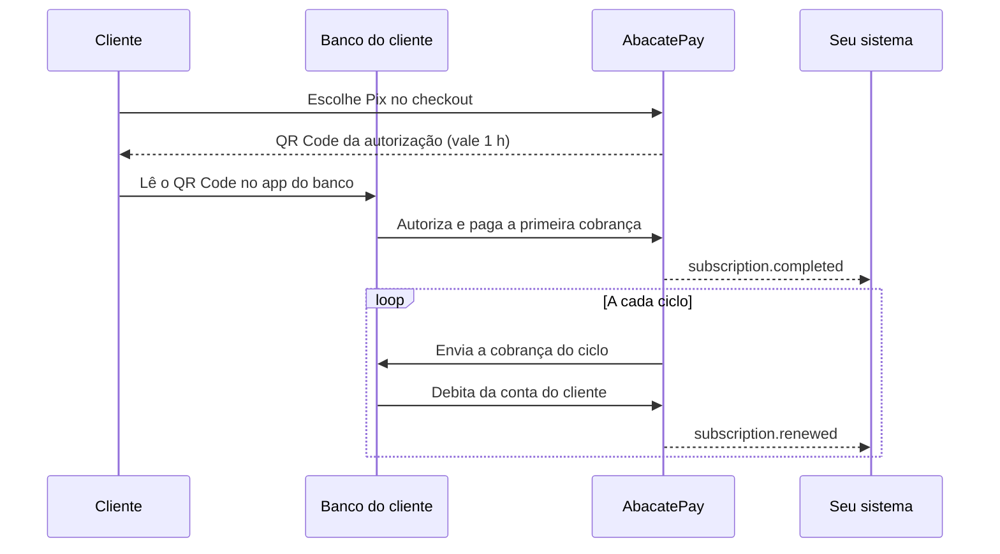

O Pix Automático é o débito automático do Pix. O cliente autoriza a assinatura uma vez, no app do banco, e cada ciclo é debitado da conta dele sem precisar ler um QR Code de novo. Na AbacatePay, é a forma de cobrar [assinaturas](/pages/cobrar/assinaturas) no Pix.

## Quando usar

Use o Pix Automático quando o seu cliente prefere Pix ou não tem cartão de crédito. Para oferecer as duas opções, crie o checkout com Pix e cartão, e o cliente escolhe.

| | Pix Automático | Cartão |
|---|---|---|
| Primeiro pagamento | O cliente lê um QR Code e autoriza no app do banco | O cliente digita o cartão no checkout |
| Ciclos seguintes | Débito automático na conta do cliente | Cobrança no cartão salvo |
| Retentativas com `retryPolicy` | Não se aplica | Sim |
| Teste grátis | Não | Sim |
| Cupom | Não | Sim, na primeira cobrança |
| Trocar de plano | Só para um plano de mesmo valor | Sim |
| Cobrança por uso | Não | Sim |

## Como funciona o Pix Automático



1. **O cliente informa os dados.** O checkout pede nome, CPF ou CNPJ, e-mail e endereço. Se você criar o checkout com um `customerId` que já tem esses dados completos, o checkout não pede de novo.
2. **O checkout mostra um QR Code.** Ele pode ser lido no app do banco ou copiado como Pix Copia e Cola.
3. **O cliente autoriza no banco.** No mesmo passo, ele aprova o Pix Automático e paga a primeira cobrança.
4. **A assinatura começa.** Com a primeira cobrança paga, a assinatura (`subs_...`) nasce `ACTIVE` e você recebe `subscription.completed`.
5. **Os ciclos seguintes são automáticos.** A AbacatePay envia cada cobrança ao banco do cliente antes da data do ciclo, e o banco debita sem o cliente fazer nada.

O valor fica fixo na autorização. Os ciclos são os mesmos das assinaturas no cartão: semanal, mensal, trimestral, semestral e anual.

## Quanto tempo vale a autorização

O QR Code da autorização vale **1 hora**. Se o cliente não autorizar nesse prazo, ele volta ao checkout e gera um QR Code novo.

Depois de aprovada, a autorização vale enquanto a assinatura estiver ativa. Quando a assinatura é cancelada, pela API, pelo dashboard ou pelo [Portal do cliente](/pages/vender/portal-do-cliente), a AbacatePay cancela a autorização no banco também.

Se o cliente cancelar a autorização no app do banco, a AbacatePay cancela a assinatura e envia `subscription.cancelled` com `cancelledDueTo: "pix_automatic_authorization_refused"`. Se ele recusar antes de autorizar, a assinatura não chega a existir, e o checkout continua esperando o pagamento.

## Cobrança recusada no Pix Automático

No Pix Automático, quem debita é o banco do cliente, na data do ciclo. A `retryPolicy` da assinatura não se aplica: ela vale só para o cartão.

Cada cobrança recusada pelo banco dispara `subscription.payment_failed`, com o código da recusa em `rejectCode`. A recusa não cancela a assinatura: ela continua `ACTIVE`. Se quiser encerrar, [cancele a assinatura](/pages/subscriptions/cancel) pela API ou pelo dashboard.

## O que o Pix Automático não aceita

- **Teste grátis.** A autorização já cobra a primeira parcela. Para oferecer teste grátis, use o cartão.
- **Cupom.** Com `PIX` em `methods`, o campo de cupom some do checkout e o cupom é recusado.
- **Mudar o valor.** [Alterar plano](/pages/subscriptions/change-plan) só aceita um plano com o mesmo valor. Para cobrar outro valor, cancele a assinatura e crie outra.
- **Cobrança por uso.** [Registrar uso](/pages/subscriptions/record-usage) é recusado em assinatura no Pix Automático.

## Como habilitar o Pix Automático

O Pix Automático é liberado conta a conta. Para usar, fale com o suporte em ajuda@abacatepay.com. A liberação vale para a produção e para o [Modo Teste](/pages/comecar/modo-teste).

Sem a liberação, a opção **Pix** não aparece no formulário de checkout de assinatura do dashboard, e a API recusa `PIX` em `methods` com `PIX Automático is not available for this store`. Em produção, a conta também precisa ter assinaturas liberadas.

## Pelo dashboard

1. Crie um produto de assinatura em **Sua Loja → Produtos**, com **Tipo de cobrança** em **Assinatura** e o ciclo com o preço.
2. Em **Sua Loja → Assinaturas**, clique em **Criar checkout**.
3. Escolha o **Produto de assinatura** e, em **Métodos de pagamento**, marque **Pix**. Marque também **Cartão** se quiser deixar o cliente escolher.
4. Clique em **Cadastrar**, abra o checkout na aba **Checkouts** e copie a URL para mandar ao cliente.

## Pela API

Crie o checkout com `PIX` em `methods` no [Criar checkout de assinatura](/pages/subscriptions/create):

```json
POST /v2/subscriptions/create
{
  "items": [{ "id": "prod_abc123xyz", "quantity": 1 }],
  "customerId": "cust_abc123xyz",
  "methods": ["PIX"]
}
```

Com `"methods": ["PIX", "CARD"]`, o cliente escolhe no checkout. Mande o cliente para a `url` da resposta e espere o `subscription.completed` para liberar o acesso.

Depois, a assinatura é gerenciada como qualquer outra: [Buscar assinatura](/pages/subscriptions/get), [Listar assinaturas](/pages/subscriptions/list) e [Cancelar assinatura](/pages/subscriptions/cancel). Na resposta, `method: "PIX"` indica o Pix Automático.

## Notificações

| Evento | Quando dispara |
|---|---|
| `subscription.completed` | O cliente autorizou e pagou a primeira cobrança. |
| `subscription.renewed` | Cada débito pago nos ciclos seguintes. |
| `subscription.payment_failed` | Cada cobrança recusada pelo banco, com o motivo em `rejectCode`. |
| `subscription.cancelled` | Qualquer cancelamento. Com `cancelledDueTo: "pix_automatic_authorization_refused"`, a autorização foi cancelada no banco. |

Cada cobrança paga também dispara `checkout.completed`, com `frequency: "SUBSCRIPTION"`. Os payloads estão em [Eventos de assinatura](/pages/webhooks/events/subscriptions).

## Testar no Modo Teste

Com o Pix Automático liberado, crie o checkout no [Modo Teste](/pages/comecar/modo-teste). No checkout, o botão **Simular Pagamento** aprova a autorização e a primeira cobrança, e a assinatura é criada.

## Perguntas frequentes

<AccordionGroup>
  <Accordion title="O cliente precisa pagar um QR Code a cada ciclo?">
    Não. Ele lê o QR Code só na contratação. Depois, cada ciclo é debitado da conta dele pelo banco.
  </Accordion>

  <Accordion title="O cliente pode cancelar pelo banco?">
    Sim. Se ele cancelar a autorização no app do banco, a assinatura é cancelada e você recebe `subscription.cancelled` com `cancelledDueTo: "pix_automatic_authorization_refused"`.
  </Accordion>

  <Accordion title="Posso mudar o valor de uma assinatura no Pix Automático?">
    Não. O valor fica fixo na autorização. Para cobrar outro valor, cancele a assinatura e crie um checkout novo.
  </Accordion>

  <Accordion title="Por que a opção Pix não aparece no checkout de assinatura?">
    O Pix Automático ainda não foi liberado na sua conta. Fale com o suporte em ajuda@abacatepay.com.
  </Accordion>

  <Accordion title="Posso oferecer teste grátis no Pix Automático?">
    Não. A autorização já cobra a primeira parcela. O teste grátis existe só no cartão.
  </Accordion>
</AccordionGroup>
