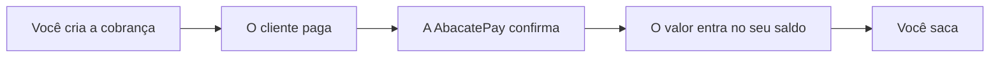

A AbacatePay é uma plataforma de pagamentos para empresas. Você cobra seus clientes por Pix, cartão de crédito ou boleto, o dinheiro entra no seu saldo na AbacatePay e você saca para a sua conta quando quiser.

Tudo pode ser feito pelo dashboard, sem programar, ou pela API, se você quer automatizar as cobranças no seu sistema.

## Como um pagamento funciona

1. Você cria uma cobrança pelo dashboard ou pela API.
2. O cliente paga na tela de pagamento da AbacatePay ou no seu próprio site.
3. A confirmação aparece no dashboard e, se você integrou, chega ao seu sistema por [webhook](/pages/notificacoes/webhooks).
4. O valor, já sem a [taxa](/pages/comecar/taxas), entra no seu saldo.
5. Você saca para a sua conta pelo dashboard ou pela API.

## Formas de cobrar

<CardGroup cols={2}>
  <Card icon="cart-shopping" title="Checkout" href="/pages/cobrar/checkout">
    Uma tela de pagamento pronta, hospedada pela AbacatePay. Você manda o link ao cliente ou redireciona ele do seu site.
  </Card>
  <Card icon="link" title="Link de pagamento" href="/pages/cobrar/link-de-pagamento">
    Um link que vários clientes podem pagar, quantas vezes quiserem. Bom para compartilhar no WhatsApp ou no Instagram.
  </Card>
  <Card icon="code" title="Checkout transparente" href="/pages/cobrar/checkout-transparente">
    O pagamento acontece dentro do seu site ou app, sem levar o cliente para outra página. Exige desenvolvimento.
  </Card>
  <Card icon="rotate" title="Assinaturas" href="/pages/cobrar/assinaturas">
    Cobrança recorrente no cartão ou por Pix Automático: a AbacatePay cobra o cliente a cada ciclo.
  </Card>
</CardGroup>

O cliente pode pagar por [Pix](/pages/pagamentos/pix), [cartão de crédito](/pages/pagamentos/cartao-de-credito) (à vista ou [parcelado](/pages/pagamentos/parcelamento)), [boleto](/pages/pagamentos/boleto) e, no checkout, [Apple Pay e Google Pay](/pages/pagamentos/apple-pay-google-pay), conforme as formas que você liberar.

## Por onde começar

<CardGroup cols={2}>
  <Card icon="rocket" title="Sem código" href="/pages/comecar/primeiros-passos">
    Crie um produto, gere um link de pagamento e teste uma venda pelo dashboard.
  </Card>
  <Card icon="terminal" title="Com código" href="/pages/comecar/chaves-de-api">
    Crie uma chave de API, teste no Modo Teste e integre pela API, pelos SDKs, pela CLI ou por um agente de IA.
  </Card>
</CardGroup>

Vende na Shopify? Use o [plugin da AbacatePay](/pages/guides/shopify). Para integrar, veja também a [Referência da API](/pages/reference/introduction), os [SDKs](/pages/sdks/sdks), a [CLI](/pages/cli/overview) e o [servidor MCP](/pages/ai/overview) para agentes de IA.

## Quem usa a AbacatePay

- **Infoprodutores** que vendem cursos e mentorias
- **SaaS e startups** que cobram assinatura
- **E-commerces** que precisam de um checkout rápido
- **Prestadores de serviço** com CNPJ que querem um jeito simples de cobrar

Você pode testar tudo sem verificar a conta. Para receber pagamentos reais, a AbacatePay precisa verificar a sua empresa: veja [Conta e verificação](/pages/comecar/conta-e-verificacao).
