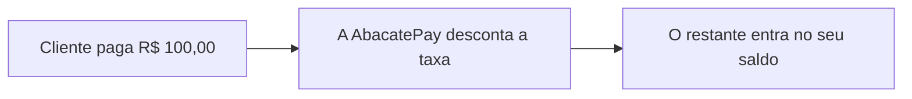

A AbacatePay **não cobra mensalidade**. Você paga só quando recebe ou movimenta dinheiro, e a taxa já sai descontada: nada é cobrado à parte.

## Valores

Os valores das taxas de Pix, cartão de crédito, boleto, saque e TED estão na [página de preços](https://www.abacatepay.com/pricing). As taxas da sua conta aparecem no dashboard em **Perfil → Taxas**.

## Como as taxas são cobradas

Nas cobranças do [checkout transparente](/pages/cobrar/checkout-transparente), nos [saques](/pages/dinheiro/saques) e no [Enviar Pix](/pages/dinheiro/enviar-pix), o campo `platformFee` mostra a taxa descontada, em centavos.

- **Cartão:** a taxa muda com o número de parcelas. As taxas da sua conta para cada parcela estão em **Perfil → Taxas**. Se quiser que o cliente pague a taxa, veja [Repasse de taxa](/pages/pagamentos/repasse-de-taxa).
- **Saque e Enviar Pix:** a taxa sai do valor enviado. A conta de destino recebe `amount` menos `platformFee`.
- **TED:** a taxa é somada ao valor da transferência.
- **Reembolso:** quando você reembolsa uma venda, a taxa cobrada nela não é devolvida.

## Perguntas frequentes

<AccordionGroup>
  <Accordion title="Pago taxa sobre boletos não pagos?">
    Não. A taxa do boleto é cobrada apenas quando o boleto é **pago**, nunca por boleto gerado. Se o cliente pagar o boleto pelo QR Code Pix, vale a taxa de Pix; se pagar pelo código de barras, vale a taxa de boleto.
  </Accordion>

  <Accordion title="Existe taxa para criar uma conta ou usar o dashboard?">
    Não. Criar conta, acessar o dashboard, criar produtos, cupons e links de pagamento são gratuitos. Você só paga quando há movimentação financeira.
  </Accordion>

  <Accordion title="Minhas taxas podem ser diferentes das da página de preços?">
    Sim. A página de preços mostra as taxas padrão. Dependendo do volume de transações da sua loja, as taxas podem ser negociadas. Fale com o suporte em ajuda@abacatepay.com.
  </Accordion>
</AccordionGroup>
