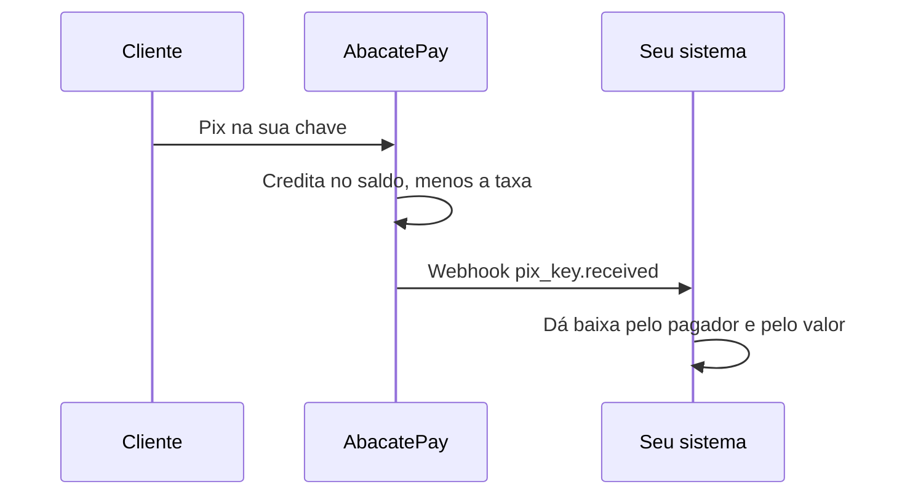
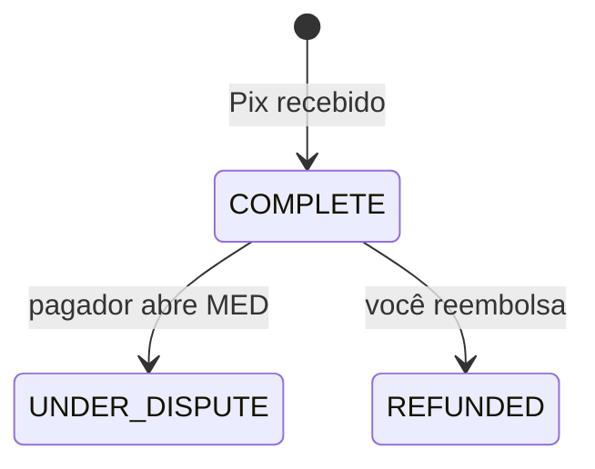
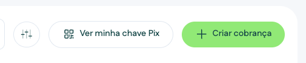
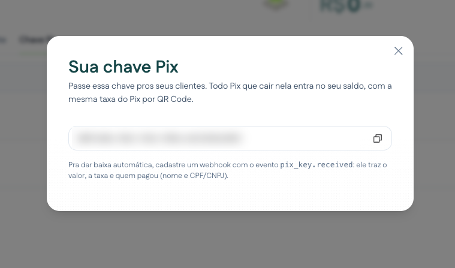
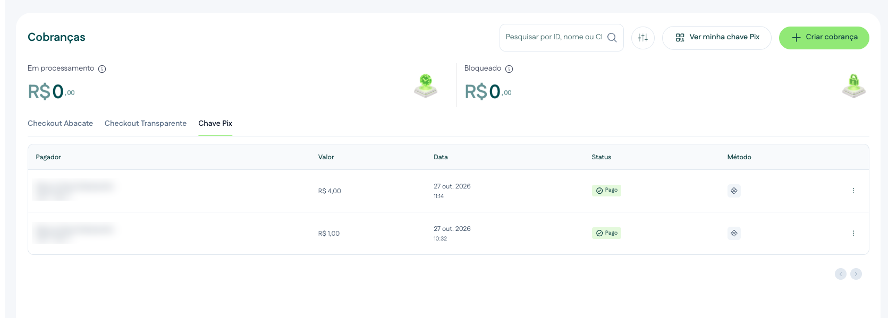
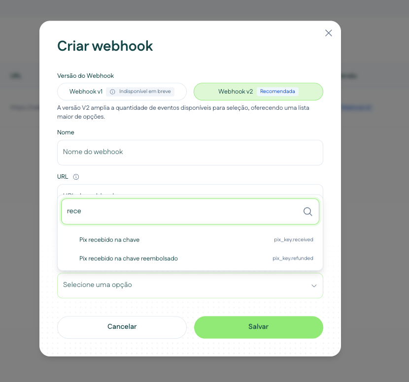

import { Video } from '/snippets/video.jsx'

Com a chave Pix fixa, seus clientes pagam numa chave Pix da sua conta AbacatePay, sem cobrança nem boleto. Funciona como um Pix estático: a chave não muda e não tem valor nem vencimento. Cada Pix que cai nela entra no seu saldo e dispara um webhook para você dar baixa.

<Video id="https://youtu.be/XcW95Ax9hxQ" title="Chave PIX Aleatória - AbacatePay" />

O vídeo também está em [Chave Pix](/pages/videos/chave-pix).

## Quando usar

| Situação | Use |
|---|---|
| Clientes que pagam “por chave”, sem cobrança, e você quer automatizar a baixa | Chave Pix fixa |
| Cobrança com valor, vencimento e o pedido identificado | [Pix](/pages/pagamentos/pix) no checkout ou no checkout transparente |

## Como funciona



- Todo Pix que cai na chave entra no saldo disponível, com a mesma [taxa](/pages/comecar/taxas) do Pix por QR Code da sua conta. A taxa nunca passa do valor recebido.
- Não existe cobrança por trás. O pagamento é identificado por quem pagou e pelo `endToEndId` do Pix.
- Os Pix recebidos na chave contam no faturamento do dashboard e aparecem no [extrato](/pages/dinheiro/saldo-e-extrato) como venda no Pix.
- O recurso é liberado conta a conta pela equipe AbacatePay. Para usar, fale com o suporte pelo chat do dashboard ou em ajuda@abacatepay.com.
- Funciona só em produção.

Cada Pix recebido passa por estes status:



No dashboard, `COMPLETE` aparece como **Pago**, `UNDER_DISPUTE` como **Em disputa** e `REFUNDED` como **Reembolsado**.

## Como receber Pix na chave pelo dashboard

<Steps>
  <Step title="Pegue a sua chave">
    Com o recurso liberado, a aba **Chave Pix** aparece em **Sua Loja → Cobranças**. Nela, clique em **Ver minha chave Pix**:

    <Frame>
      
    </Frame>

    Copie a chave. É ela que você passa para os seus clientes.

    <Frame>
      
    </Frame>
  </Step>

  <Step title="Acompanhe os Pix recebidos">
    A aba **Chave Pix** lista cada Pix recebido na chave, com o pagador (nome e CPF/CNPJ mascarado), o valor, a data, o status e as ações **Ver comprovante**, **Reembolsar** e **Copiar ID**. Dá para buscar por ID, nome ou CPF/CNPJ e filtrar por status.

    <Frame>
      
    </Frame>
  </Step>

  <Step title="Cadastre o webhook">
    Em **Integração → Webhooks**, clique em **Criar webhook**, escolha **Webhook v2** e selecione os eventos **Pix recebido na chave** (`pix_key.received`) e **Pix recebido na chave reembolsado** (`pix_key.refunded`). Os dois eventos só aparecem nas contas com o recurso liberado.

    <Frame>
      
    </Frame>

    Assinatura, retentativas e formato de entrega são os mesmos dos outros webhooks. Veja [Webhooks](/pages/notificacoes/webhooks).
  </Step>
</Steps>

## Pela API

Não há endpoint para listar os Pix recebidos na chave nem para reembolsar: a integração é pelo webhook. Para dar baixa, use o `pix_key.received`:

```json
{
  "id": "log_uRuGjMfQhP1nCPt5kuLBMWqn",
  "event": "pix_key.received",
  "apiVersion": 2,
  "devMode": false,
  "data": {
    "pixKey": {
      "id": "tran_64cYncueN5DNF24FQgGJUyqZ",
      "amount": 100,
      "fee": 80,
      "status": "COMPLETE",
      "endToEndId": "E18236120202610271332s06f8c6bb99",
      "receiptUrl": "https://app.abacatepay.com/receipt/tran_64cYncueN5DNF24FQgGJUyqZ",
      "createdAt": "2026-10-27T13:32:34.077Z"
    },
    "payer": {
      "name": "Maria da Silva",
      "taxId": "123.***.789-**",
      "bank": { "ispb": "18236120", "name": "NU PAGAMENTOS - IP" }
    }
  }
}
```

- `data.pixKey.amount`: o que o cliente pagou, em centavos.
- `data.pixKey.fee`: a taxa, em centavos. Você recebe `amount` menos `fee`.
- `data.pixKey.id`: o ID do Pix na AbacatePay. Guarde para não dar baixa duas vezes.
- `data.payer`: quem pagou. Use para saber de qual cliente é o Pix. O CPF/CNPJ vem mascarado; para receber o documento completo no webhook, fale com o suporte.

Todos os campos estão em [Eventos de Pix por chave](/pages/webhooks/events/pix-key).

## Notificações

| Evento | Quando é disparado |
|---|---|
| `pix_key.received` | Um Pix caiu na sua chave |
| `pix_key.refunded` | Um Pix recebido na chave foi reembolsado. O motivo vem em `data.reason`: o texto informado no reembolso ou `Refund completed` |

A contestação (MED) de um Pix na chave não gera webhook. Acompanhe pela aba **Chave Pix**.

## Reembolso

<Video id="https://youtu.be/YBwg0A1ib1o" title="Reembolso - AbacatePay" />

O reembolso é feito só pelo dashboard: na aba **Chave Pix**, clique em **Reembolsar** no Pix. O vídeo também está em [Reembolso](/pages/videos/reembolso).

- O valor volta para quem pagou e o webhook `pix_key.refunded` é disparado.
- O reembolso sai do saldo disponível e exige saldo suficiente.
- A taxa do Pix recebido não é devolvida. Veja [Reembolsos](/pages/vender/reembolsos).

## Testar no Modo Teste

Não dá: a chave Pix fixa só existe em produção, e webhooks criados no [Modo Teste](/pages/comecar/modo-teste) não recebem esses eventos.

## Perguntas frequentes

<AccordionGroup>
  <Accordion title="Como sei de qual cliente é o Pix?">
    Como não há cobrança, a conciliação é pelo pagador (`payer.name` e `payer.taxId`) e pelo valor. Oriente seus clientes a pagar de uma conta no nome deles: um Pix feito da conta de outra pessoa chega com os dados dessa outra pessoa.
  </Accordion>

  <Accordion title="Como evito dar baixa duas vezes?">
    O mesmo Pix nunca gera dois `data.pixKey.id` diferentes, mas o webhook pode ser reentregue. Antes de dar baixa, confira se aquele `data.pixKey.id` já foi processado para o mesmo evento.
  </Accordion>

  <Accordion title="E se o Pix for menor que a taxa?">
    A taxa nunca passa do valor recebido. Um Pix menor que a taxa resulta em líquido zero, sem saldo negativo.
  </Accordion>

  <Accordion title="O pagador pode contestar o Pix?">
    Sim, pelo MED. Enquanto a contestação está aberta, o Pix fica **Em disputa** e o valor fica bloqueado no seu saldo. A contestação de um Pix na chave não gera webhook: acompanhe pela aba **Chave Pix**.
  </Accordion>

  <Accordion title="Recebo o CPF/CNPJ completo de quem pagou?">
    Por padrão, o webhook traz o CPF/CNPJ mascarado, como `123.***.789-**`. Para receber o documento completo, fale com o suporte.
  </Accordion>

  <Accordion title="Dá para listar ou reembolsar pela API?">
    Não. A lista e o reembolso ficam só no dashboard, na aba **Chave Pix**. Na sua integração, use os webhooks.
  </Accordion>
</AccordionGroup>
