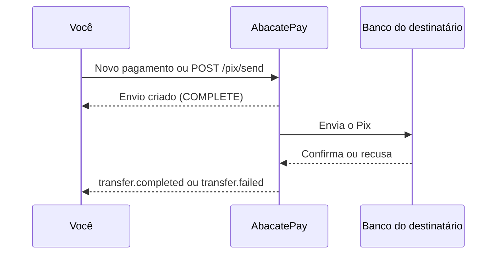

import { Video } from '/snippets/video.jsx'

O Enviar Pix manda dinheiro do seu saldo na AbacatePay para a chave Pix de outra pessoa ou empresa: fornecedores, parceiros, colaboradores ou sócios. No dashboard, ele fica em **Financeiro → Pagamentos**. Na API, é o `POST /pix/send`.

## Quando usar

| Você quer | Use |
|---|---|
| Pagar outra pessoa ou empresa | Enviar Pix |
| Levar o saldo para uma conta no CPF ou CNPJ da sua empresa | [Saque](/pages/dinheiro/saques) |
| Repassar a parte de um vendedor do seu marketplace | [Saque da subconta](/pages/dinheiro/subcontas-e-split) |

## Como funciona o Enviar Pix



O envio nasce com status `COMPLETE` e o valor sai do saldo na hora. Quando o banco confirma, sai o webhook `transfer.completed`. Se o banco recusar, o envio passa para `FAILED`, o valor volta para o seu saldo e sai o `transfer.failed`.

### Regras do Enviar Pix

- **Mesmo saldo e mesmos limites do saque:** o valor sai do saldo disponível (um saldo só por envio, se a conta recebe cartão), conta no limite diário e no limite noturno, das 20h às 8h, e respeita o intervalo de 30 segundos junto com os saques. As regras estão em [Saques](/pages/dinheiro/saques#regras-do-saque).
- **Destino:** qualquer chave Pix de outra pessoa ou empresa. Para mandar para uma conta no CPF ou CNPJ da sua própria empresa, use o [saque](/pages/dinheiro/saques).
- **Taxa:** sai do valor enviado. O destinatário recebe `amount` menos `platformFee`. Para entregar um valor exato pela API, some a taxa ao `amount`. No dashboard, você digita quanto o destinatário recebe, e a tela soma a taxa. Os valores estão na [página de preços](https://www.abacatepay.com/pricing) e em **Perfil → Taxas**.
- **Valor mínimo na API:** R$ 1,00 (`100`).
- **Ativação:** o Enviar Pix vem ativo nas contas. Se estiver desativado na sua, a API responde `Função não habilitada`; fale com o suporte.
- **Ambiente:** só existe em produção.

### Tipos de chave Pix

| `pix.type` | Exemplo |
|---|---|
| `CPF` | `12345678901` |
| `CNPJ` | `12345678000190` |
| `PHONE` | `11987654321` |
| `EMAIL` | `contato@fornecedor.com` |
| `RANDOM` | Chave aleatória (UUID) |
| `BR_CODE` | Pix Copia e Cola completo |

Com `BR_CODE`, o Pix vai para a chave que está dentro do código, com o `amount` que você enviar: o valor gravado no código não é usado. Só o Pix Copia e Cola estático funciona. O de cobrança (dinâmico) não traz a chave e é recusado.

### Idempotência pelo `externalId`

Na API, o `externalId` é obrigatório e funciona como chave de idempotência. Se você repetir o `POST` com o mesmo `externalId` e o mesmo `amount`, por exemplo depois de um timeout, a API devolve o envio que já existe e não manda outro Pix. Com o mesmo `externalId` e outro `amount`, a API responde `externalId já usado em outro envio com valor diferente`.

## Como enviar Pix pelo dashboard

<Steps>
  <Step title="Abra a tela de pagamentos">
    Vá em **Financeiro → Pagamentos** e clique em **Novo pagamento** no saldo de onde o dinheiro vai sair. A conta precisa ter a verificação em duas etapas (2FA) ativa.
  </Step>

  <Step title="Digite o valor">
    Em **Valor do pagamento**, digite quanto o destinatário vai receber. A tela mostra quanto você pode pagar agora, já com o saldo e os limites.
  </Step>

  <Step title="Informe o destinatário">
    Escolha o **Tipo de chave Pix** (CPF, CNPJ, e-mail, telefone, aleatória ou Pix Copia e Cola), preencha a chave e, se quiser, uma descrição de até 140 caracteres.
  </Step>

  <Step title="Confirme">
    Confira o resumo: quem recebe, **O destinatário recebe**, **Taxa** e **Sai do seu saldo**. Digite o código do autenticador (2FA) e clique em **Realizar pagamento**.
  </Step>
</Steps>

O **Histórico** fica na mesma tela. Os pagamentos também aparecem no histórico de **Financeiro → Saques**, com o tipo **Pagamento**. O botão **Baixar recibo** abre o comprovante.

<Video id="https://youtu.be/TwEArVdl-SE" title="Comprovante - AbacatePay" />

O vídeo também está em [Comprovante](/pages/videos/comprovante).

## Como enviar Pix pela API

Chame [Enviar Pix](/pages/pix/create) com uma chave de API que tenha a permissão `WITHDRAW:CREATE`:

```bash
curl -X POST https://api.abacatepay.com/v2/pix/send \
  -H "Authorization: Bearer SUA_CHAVE" \
  -H "Content-Type: application/json" \
  --data '{
    "amount": 10000,
    "externalId": "pagamento-fornecedor-42",
    "description": "NF 1234",
    "pix": { "type": "EMAIL", "key": "contato@fornecedor.com" }
  }'
```

A resposta traz o `id` (`tran_...`), o `status`, o `amount`, a taxa em `platformFee` e o link do comprovante em `receiptUrl`. A `description` não aceita emoji.

Para acompanhar, use [Buscar Pix](/pages/pix/get), pelo `id` ou pelo `externalId`, e [Listar Pix](/pages/pix/list), as duas com a permissão `WITHDRAW:READ`. Os erros de cada rota estão na página dela.

## Notificações

| Evento | Quando é disparado |
|---|---|
| `transfer.completed` | O banco do destinatário confirmou o Pix |
| `transfer.failed` | O envio falhou e o valor voltou para o seu saldo |

Os eventos valem para os envios do dashboard e da API e trazem o mesmo `id` e `externalId` da resposta. O formato está em [Eventos de transferência](/pages/webhooks/events/transfers). Para receber, configure um [webhook](/pages/notificacoes/webhooks).

## Testar no Modo Teste

O Enviar Pix não tem simulação: ele só funciona em produção. No [Modo Teste](/pages/comecar/modo-teste), o botão **Novo pagamento** abre um aviso explicando como passar para produção.

## Perguntas frequentes

<AccordionGroup>
  <Accordion title="Posso pagar um sócio da empresa?">
    Sim. O sócio é outra pessoa, então use o Enviar Pix. O saque vai só para contas no CPF ou CNPJ da própria conta.
  </Accordion>

  <Accordion title="Como faço o destinatário receber um valor exato?">
    No dashboard, digite o valor que ele deve receber: a tela soma a taxa. Na API, some a taxa ao `amount`, porque ela sai do valor enviado.
  </Accordion>

  <Accordion title="O que acontece se eu repetir a requisição?">
    Com o mesmo `externalId` e o mesmo `amount`, a API devolve o envio que já existe e não manda outro Pix. Com outro valor, a API recusa.
  </Accordion>

  <Accordion title="Posso pagar um QR Code de cobrança?">
    Não. O Enviar Pix aceita só o Pix Copia e Cola estático, que traz a chave do destinatário. Para um código de cobrança, peça a chave Pix ao destinatário.
  </Accordion>

  <Accordion title="Onde fica o comprovante?">
    No dashboard, no botão **Baixar recibo** do histórico. Na API, no `receiptUrl` da resposta.
  </Accordion>
</AccordionGroup>
