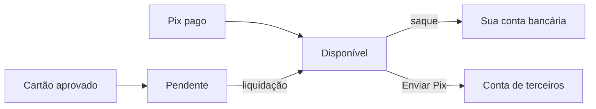

O dinheiro das suas vendas entra primeiro no seu **saldo** na AbacatePay. Do saldo, você saca para a sua conta bancária ou envia Pix para outras pessoas. O **extrato** mostra cada movimentação desse saldo: vendas, taxas, saques, reembolsos e bloqueios.

## Como funciona o saldo



O saldo tem três partes:

| Saldo | O que é | No dashboard | Na API (`balance`) |
|---|---|---|---|
| Disponível | Pode ser sacado ou enviado agora | Disponível para saque | `available` |
| Pendente | Venda paga que ainda não liquidou, como o cartão antes do prazo de recebimento | Em processamento | `pending` |
| Bloqueado | Valor retido por disputa ou MED, por análise de segurança ou pela reserva preventiva de cartão. Não pode ser sacado até ser liberado | Bloqueado | `blocked` |

A API traz ainda `processingAnticipation`: o valor de recebíveis de cartão com antecipação pedida que ainda não entrou no disponível. No dashboard, ele aparece como **Antecipação em processamento**, em **Financeiro → Antecipações**.

Todos os valores da API são em centavos (`1000` = R$ 10,00).

## Quando o dinheiro fica disponível

| Forma de pagamento | Quando entra no disponível |
|---|---|
| Pix | Assim que o pagamento é confirmado |
| Cartão de crédito | Na liquidação, no prazo de recebimento da sua conta. Até lá, o valor fica pendente. O prazo aparece em **Perfil → Taxas** |
| Boleto | Pago pelo Pix do boleto: na hora. Pago pelo código de barras: pode ficar pendente até o banco compensar o pagamento |

A taxa de cada venda já sai descontada quando o valor entra no saldo. Veja [Taxas](/pages/comecar/taxas).

## Saldo de Pix e boleto e saldo de cartão

Se a sua conta recebe cartão, o disponível fica separado em dois: o saldo de **Pix e boleto** e o saldo de **cartão**. Em **Financeiro → Saques** e em **Financeiro → Pagamentos**, cada um aparece com o próprio botão.

- Cada [saque](/pages/dinheiro/saques) ou [envio de Pix](/pages/dinheiro/enviar-pix) sai de um saldo só. Não dá para juntar os dois na mesma operação.
- O TED sai só do saldo de Pix e boleto.
- Na API, o `balance` de [Obter detalhes da loja](/pages/store/get) mostra a soma dos dois.

Se a sua conta tem um débito de disputa em aberto, ele é descontado do disponível na hora do saque.

## Extrato da conta

O extrato lista o que já mexeu no seu saldo, da movimentação mais recente para a mais antiga. Ficam de fora:

- transações ainda pendentes: um Pix aguardando pagamento só aparece depois de pago;
- movimentações internas que não mudam o disponível, como a solicitação de antecipação. A antecipação creditada aparece normalmente;
- os saques das [subcontas](/pages/dinheiro/subcontas-e-split), que saem do saldo do vendedor. Quando um Pix com split é pago, a parte de cada subconta aparece no seu extrato como saída **Split para subconta**.

### Pelo dashboard

Em **Financeiro → Extrato** você encontra:

- no topo, o saldo **Disponível para saque**, **Em processamento** e **Bloqueado**;
- o período (**Hoje**, **Esse mês**, **Últimos 30 dias** ou **Últimos 90 dias**), com o gráfico **Evolução do saldo** e o **Resumo do período**: entradas, saídas, taxas pagas e variação do saldo;
- o **Histórico**, com filtros por meio de pagamento (Pix, cartão, boleto), status (Concluído, Em processamento, Em disputa) e tipo (Vendas, Saques, Reembolsos, Disputas);
- o botão **Exportar**, que baixa o extrato do período em CSV, Excel, PDF ou OFX.

### Pela API

Use [Listar extrato](/pages/bank-statement/list), com a permissão `BANK_STATEMENT:READ`. Cada item é uma transação e traz uma ou mais movimentações em `movements`. Um pagamento recebido, por exemplo, gera duas: a entrada do valor e a saída da taxa.

```json
{
  "id": "tran_abc123xyz",
  "movements": [
    { "amount": 10000, "kind": "DEPOSIT", "method": "PIX", "description": "Pagamento PIX", "category": "transaction", "balanceEffect": "credit" },
    { "amount": 80, "kind": "WITHDRAW", "method": "INTERNAL", "description": "Taxa da transação", "category": "fee", "balanceEffect": "debit" }
  ],
  "currency": "BRL",
  "createdAt": "2026-09-29T14:32:10.000Z",
  "checkoutId": "bill_abc123xyz",
  "paymentIntentId": "char_abc123xyz",
  "referenceId": null,
  "customer": { "name": "Maria Silva", "taxId": "11144477735" }
}
```

O `amount` de cada movimentação é sempre positivo. O sentido vem de `balanceEffect`:

| `balanceEffect` | Efeito no saldo disponível |
|---|---|
| `credit` | Soma |
| `debit` | Subtrai |
| `none` | Não altera. É o caso do recebível de cartão aprovado (`CARD_APPROVED`): o valor entra no disponível na liquidação, que aparece como outra transação |

Para saber o efeito de uma transação no disponível, some os `amount` com `credit` e subtraia os que têm `debit`.

O `category` diz o tipo da movimentação:

| `category` | O que é |
|---|---|
| `transaction` | Entrada ou movimentação ligada a um pagamento |
| `withdrawal` | Saque ou envio de Pix |
| `refund` | Reembolso de um pagamento |
| `fee` | Taxa cobrada pela AbacatePay |
| `reversal` | Desfazimento de uma movimentação anterior |

Outros campos úteis:

- `referenceId`: o `externalId` que você mandou no saque ou no Enviar Pix.
- `checkoutId` e `paymentIntentId`: o checkout e a cobrança de origem. Vêm `null` nos saques.
- `customer`: o cliente da cobrança. Num Pix sem cliente cadastrado, como o [Pix na chave fixa](/pages/dinheiro/chave-pix), traz só o nome e o CPF/CNPJ de quem pagou. É `null` quando não há nenhum dado.

Os filtros `status`, `method` e `kind` aceitam um valor por vez e valem para a transação. Sem `status`, a API esconde as transações `PENDING`; sem `kind`, esconde as movimentações internas. Ao informar o filtro, a regra padrão dele deixa de valer: `status=PENDING` traz as pendentes.

Para ler o saldo atual, use [Obter detalhes da loja](/pages/store/get), com a permissão `STORE:READ`:

```json
{
  "data": {
    "id": "store_abc123xyz",
    "name": "Minha Loja",
    "balance": {
      "available": 50000,
      "pending": 10000,
      "blocked": 0,
      "processingAnticipation": 0
    }
  },
  "success": true,
  "error": null
}
```

## Perguntas frequentes

<AccordionGroup>
  <Accordion title="Por que a venda no cartão não está no saldo disponível?">
    O cartão fica pendente até a liquidação, no prazo de recebimento da sua conta. O prazo aparece em **Perfil → Taxas**. Quando liquida, o valor passa para o disponível.
  </Accordion>

  <Accordion title="O que é o saldo bloqueado?">
    É o valor retido por uma disputa ou MED em aberto, por análise de segurança ou pela reserva preventiva de cartão. Ele não pode ser sacado até ser liberado. Para saber o motivo de um bloqueio, fale com o suporte em ajuda@abacatepay.com.
  </Accordion>

  <Accordion title="Por que não consigo sacar a soma do saldo de Pix com o de cartão?">
    Os dois saldos são separados, e cada saque sai de um só. Faça um saque de cada saldo.
  </Accordion>

  <Accordion title="Um Pix aguardando pagamento aparece no extrato?">
    Não. O extrato mostra só o que já mexeu no saldo. O Pix aparece depois de pago.
  </Accordion>

  <Accordion title="Os saques das subcontas aparecem no meu extrato?">
    Não, porque saem do saldo da subconta. No seu extrato aparece a parte que foi para a subconta quando o Pix com split é pago, como **Split para subconta**.
  </Accordion>
</AccordionGroup>
