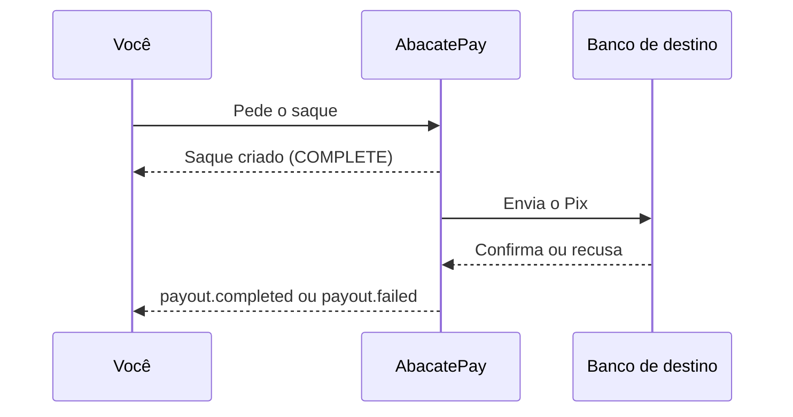
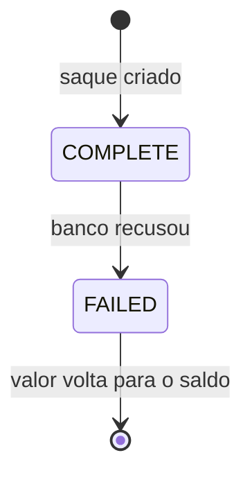

O saque transfere o saldo disponível da sua conta AbacatePay para uma conta bancária no mesmo CPF ou CNPJ da conta, por Pix ou TED. O Pix cai em instantes, e o saque pode ser feito pelo dashboard ou pela API.

## Quando usar

| Você quer | Use |
|---|---|
| Levar o saldo para uma conta no CPF ou CNPJ da sua empresa | Saque |
| Pagar um fornecedor, um parceiro, um sócio ou outra pessoa | [Enviar Pix](/pages/dinheiro/enviar-pix) |
| Repassar a parte de um vendedor do seu marketplace | [Saque da subconta](/pages/dinheiro/subcontas-e-split) |

## Como funciona o saque



O saque nasce com status `COMPLETE` assim que a AbacatePay envia o Pix, e o valor sai do saldo na hora. A confirmação do banco chega depois, pelo webhook `payout.completed`. Se o banco recusar, o saque passa para `FAILED`, o valor volta para o seu saldo e sai o `payout.failed`.



### Regras do saque

- **Destino:** chave Pix ou conta (no TED) no mesmo CPF ou CNPJ da sua conta AbacatePay. Para mandar dinheiro a outra pessoa ou empresa, inclusive sócios, use o [Enviar Pix](/pages/dinheiro/enviar-pix).
- **Valor mínimo:** R$ 3,50 (`350` na API).
- **De onde sai:** do saldo disponível, já descontado o débito de disputa em aberto, se houver. Se a conta recebe cartão, cada saque sai de um saldo só: o de Pix e boleto ou o de cartão. Veja [Saldo e extrato](/pages/dinheiro/saldo-e-extrato#saldo-de-pix-e-boleto-e-saldo-de-cartão).
- **Taxa:** no Pix, a taxa sai do valor do saque: a conta de destino recebe `amount` menos `platformFee`. No TED, a taxa é somada: sai do saldo o valor mais a taxa. Os valores estão na [página de preços](https://www.abacatepay.com/pricing) e em **Perfil → Taxas**.
- **Intervalo:** a conta faz um saque a cada 30 segundos. O intervalo é o mesmo do [Enviar Pix](/pages/dinheiro/enviar-pix): depois de um saque ou de um envio, espere 30 segundos para o próximo. Antes disso, a API responde `400` com `Aguarde alguns segundos antes de solicitar outro saque`.
- **Limite diário:** soma os saques, os envios de Pix e os saques das subcontas do dia, no horário de Brasília, e renova à meia-noite. O limite da sua conta aparece no dashboard, na hora do saque. Para aumentar, fale com o suporte.
- **Limite noturno:** das 20h às 8h (horário de Brasília), vale também um limite para o que sai nessa janela, de R$ 1.000 por padrão.
- **Ambiente:** o saque só existe em produção.

### TED

O TED precisa ser liberado na sua conta: fale com o suporte. Com ele liberado:

- o destino é uma conta corrente ou poupança no CPF ou CNPJ da sua conta;
- o valor sai só do saldo de Pix e boleto;
- o dinheiro cai no mesmo dia ou no próximo dia útil, dependendo do horário do pedido;
- o pedido é feito só pelo dashboard. A API faz saques só por Pix.

## Como sacar pelo dashboard

<Steps>
  <Step title="Abra a tela de saques">
    Vá em **Financeiro → Saques**. A tela mostra o saldo disponível. Se a conta recebe cartão, aparecem dois saldos, **Disponível no PIX e boleto** e **Disponível no cartão**, cada um com o seu botão.
  </Step>

  <Step title="Comece o saque">
    Clique em **Realizar saque** no saldo de onde o dinheiro vai sair. Para sacar, a conta precisa ter a verificação em duas etapas (2FA) ativa; se não tiver, o dashboard pede para ativar. Se o TED estiver liberado, escolha **PIX** ou **TED**.
  </Step>

  <Step title="Digite o valor">
    A tela mostra quanto você pode sacar agora, já com o saldo e os limites. Em **Ver limites**, você vê o limite diário e o noturno que ainda restam.
  </Step>

  <Step title="Informe o destino">
    No Pix, escolha a chave **CNPJ da empresa** ou **Outra chave Pix da empresa** (e-mail, telefone ou chave aleatória). No TED, preencha o código do banco, o nome do titular, a agência, o tipo de conta, a conta e o dígito. O CPF/CNPJ do titular é sempre o da sua conta.
  </Step>

  <Step title="Confirme">
    Confira o resumo, digite o **Código do autenticador (2FA)** e clique em **Realizar saque**.
  </Step>
</Steps>

O **Histórico** fica na mesma tela, com o tipo (Saque ou Pagamento), o valor bruto, a taxa, o valor recebido e o status. O botão **Baixar recibo** abre o comprovante.

## Como sacar pela API

Chame [Criar um saque](/pages/payouts/create) com uma chave de API que tenha a permissão `WITHDRAW:CREATE`. O destino vai dentro de `pix`, com `type` e `key`:

```bash
curl -X POST https://api.abacatepay.com/v2/payouts/create \
  -H "Authorization: Bearer SUA_CHAVE" \
  -H "Content-Type: application/json" \
  --data '{
    "amount": 10000,
    "externalId": "saque-2026-11-10",
    "pix": { "type": "CNPJ", "key": "12345678000190" }
  }'
```

```json
{
  "data": {
    "id": "tran_abc123xyz",
    "status": "COMPLETE",
    "devMode": false,
    "receiptUrl": "https://app.abacatepay.com/receipt/tran_abc123xyz",
    "amount": 10000,
    "platformFee": 80,
    "externalId": "saque-2026-11-10",
    "createdAt": "2026-11-10T18:38:28.573Z",
    "updatedAt": "2026-11-10T18:38:28.573Z"
  },
  "success": true,
  "error": null
}
```

- `pix.type` aceita `CPF`, `CNPJ`, `PHONE`, `EMAIL`, `RANDOM` e `BR_CODE`.
- `externalId` é opcional: use para achar o saque no seu sistema.
- `receiptUrl` é o link do comprovante.
- Pela API, você não escolhe o saldo. A AbacatePay usa o de Pix e boleto quando ele cobre o valor; senão, o de cartão. Se nenhum dos dois cobre sozinho, a API responde `Não é possível sacar os saldos de PIX e cartão no mesmo saque`.

Para acompanhar, use [Buscar saque](/pages/payouts/get), pelo `id` ou pelo `externalId`, e [Listar saques](/pages/payouts/list), as duas com a permissão `WITHDRAW:READ`. Os erros de cada rota estão na página dela.

## Notificações

| Evento | Quando é disparado |
|---|---|
| `payout.completed` | O banco confirmou o saque. O evento traz o `endToEndIdentifier` do Pix |
| `payout.failed` | O saque falhou e o valor voltou para o seu saldo |

O formato está em [Eventos de saque](/pages/webhooks/events/payouts). Os envios para terceiros e os saques de subconta disparam os eventos de [transferência](/pages/webhooks/events/transfers). Para receber, configure um [webhook](/pages/notificacoes/webhooks).

## Testar no Modo Teste

O saque não tem simulação: ele só funciona em produção, depois da [verificação da conta](/pages/comecar/conta-e-verificacao). No [Modo Teste](/pages/comecar/modo-teste), o botão **Realizar saque** abre um aviso explicando como passar para produção.

## Perguntas frequentes

<AccordionGroup>
  <Accordion title="Existe um valor mínimo para sacar?">
    Sim. O mínimo é R$ 3,50.
  </Accordion>

  <Accordion title="Posso sacar para a conta de outra pessoa ou de um sócio?">
    Não. O saque vai só para uma conta no CPF ou CNPJ da sua conta AbacatePay. Para pagar outra pessoa ou empresa, inclusive sócios, use o [Enviar Pix](/pages/dinheiro/enviar-pix), em **Financeiro → Pagamentos**.
  </Accordion>

  <Accordion title="Quanto tempo o dinheiro demora para chegar?">
    O saque por Pix cai em instantes. O TED cai no mesmo dia ou no próximo dia útil, dependendo do horário do pedido.
  </Accordion>

  <Accordion title="Por que recebi “Aguarde alguns segundos antes de solicitar outro saque”?">
    Houve um saque ou um envio de Pix na sua conta há menos de 30 segundos. Espere e tente de novo.
  </Accordion>

  <Accordion title="Por que o saque foi recusado à noite?">
    Das 20h às 8h (horário de Brasília), vale o limite noturno, de R$ 1.000 por padrão. A partir das 8h, vale só o limite diário.
  </Accordion>

  <Accordion title="O que acontece se o saque falhar?">
    O saque passa para `FAILED`, o valor volta para o seu saldo e o webhook `payout.failed` é disparado. Você pode pedir o saque de novo.
  </Accordion>

  <Accordion title="Posso sacar o saldo de Pix e o de cartão juntos?">
    Não. Cada saque sai de um saldo só. Faça um saque de cada saldo.
  </Accordion>
</AccordionGroup>
