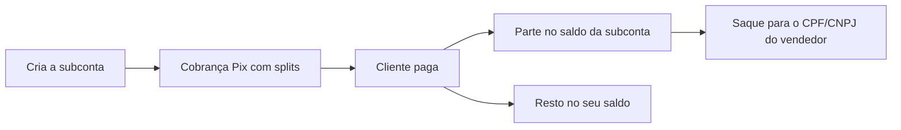

Subcontas guardam, dentro da sua conta AbacatePay, um saldo separado para cada vendedor do seu marketplace. Com o **split de pagamento**, parte de cada Pix vai para a subconta do vendedor, e você paga o vendedor por Pix na chave CPF/CNPJ dele.

## Quando usar

| Você quer | Use |
|---|---|
| Dividir cada venda entre a sua loja e vendedores, com o saldo de cada um separado | Subcontas e split |
| Pagar alguém sem guardar um saldo separado para ele | [Enviar Pix](/pages/dinheiro/enviar-pix) |

## Como funciona o split de pagamento



1. **Cadastre o vendedor** como subconta, com nome e CPF ou CNPJ.
2. **Divida o pagamento** com o campo `data.splits` ao criar uma cobrança Pix no [checkout transparente](/pages/cobrar/checkout-transparente). Quando o Pix é pago, cada parte vai para o saldo da subconta indicada, e o restante fica no seu saldo.
3. **Pague o vendedor** com o saque da subconta. O Pix sai para a chave CPF/CNPJ igual ao documento da subconta.

### Regras das subcontas

- **Um titular, uma subconta:** a subconta é identificada pelo CPF ou CNPJ do vendedor. Criar de novo com o mesmo documento devolve a subconta que já existe, com o saldo atual, e ignora os outros campos. O CPF/CNPJ não pode ser o da sua loja.
- **Saldo separado:** o saldo das subcontas não entra no saldo da sua loja e não pode ser sacado por [saque](/pages/dinheiro/saques) nem por [Enviar Pix](/pages/dinheiro/enviar-pix). Cada subconta tem saldo disponível e bloqueado.
- **Extrato:** no extrato da loja, cada parte enviada aparece como saída **Split para subconta**. Os saques das subcontas não aparecem no extrato nem em [Listar saques](/pages/payouts/list).
- **Liberação:** as subcontas são liberadas conta a conta. Fale com o suporte. Sem a liberação, as rotas respondem `Função não habilitada`.

### Regras do split

- Só no Pix do checkout transparente (`method: "PIX"`).
- De 1 a 10 subcontas por cobrança, sem repetir a mesma subconta.
- Cada parte tem no mínimo `1` centavo.
- A soma das partes cabe no valor da cobrança menos a taxa. Toda cobrança Pix tem uma tarifa mínima: em cobranças de valor baixo, o espaço para o split pode ser menor que o valor menos a sua taxa percentual.
- As partes só são creditadas quando o Pix é pago. Cobrança expirada ou cancelada não credita nada.
- **Reembolso e MED:** o valor de um reembolso ou de uma contestação (MED) sai sempre do saldo da sua loja, mesmo quando a cobrança teve split. O que já foi creditado na subconta não volta sozinho.

### Regras do saque da subconta

- O destino é sempre a chave Pix CPF/CNPJ igual ao documento da subconta. O vendedor precisa ter essa chave cadastrada no banco dele.
- O valor mínimo é R$ 1,00 (`100`). O `amount` sai do saldo da subconta, com a taxa incluída: o vendedor recebe `amount` menos `platformFee`.
- A taxa e os limites diário e noturno são os da sua conta, e os saques das subcontas contam no mesmo limite diário. Veja [Saques](/pages/dinheiro/saques#regras-do-saque).
- Cada subconta faz um saque a cada 30 segundos. Subcontas diferentes podem sacar em sequência, e o saque de uma subconta não trava o saque da sua loja.
- Enquanto a sua conta tiver débito de contestação em aberto, ele é descontado do saldo disponível para saque das subcontas.
- Se o envio falhar, o valor volta para o saldo da subconta.

### Permissões

| Permissão | Rotas |
|---|---|
| `SUB_ACCOUNT:CREATE` | `POST /sub-accounts/create` |
| `SUB_ACCOUNT:READ` | `GET /sub-accounts/get`, `GET /sub-accounts/list` |
| `SUB_ACCOUNT:WITHDRAW` | `POST /sub-accounts/withdraw` |

Para criar cobranças com `splits`, a chave também precisa de `TRANSPARENT:CREATE`. Veja [Chaves de API](/pages/comecar/chaves-de-api).

## Pelo dashboard

Com as subcontas liberadas, o menu **Financeiro → Subcontas** mostra o total guardado em subcontas e a lista com nome, CPF/CNPJ, saldo disponível e data de criação. Dá para buscar por ID, nome ou CPF/CNPJ. Em **Ver detalhes**, você vê o saldo disponível, o bloqueado e as movimentações da subconta.

Criar subcontas, dividir cobranças e sacar das subcontas é só pela API.

## Pela API

<Steps>
  <Step title="Crie a subconta">
    Chame [Criar subconta](/pages/sub-accounts/create):

    ```json
    {
      "name": "João da Silva",
      "taxId": "111.444.777-35",
      "externalId": "vendedor-42",
      "metadata": { "loja": "centro" }
    }
    ```

    A resposta traz o `id` da subconta (`sacc_...`) e o saldo em `balance.available` e `balance.blocked`. Para achar a subconta depois, use [Buscar subconta](/pages/sub-accounts/get) ou [Listar subcontas](/pages/sub-accounts/list), que filtra por `taxId` ou `externalId`.
  </Step>

  <Step title="Crie a cobrança Pix com split">
    Em [Criar cobrança Pix](/pages/transparents/create), informe as partes em `data.splits`:

    ```json
    {
      "method": "PIX",
      "data": {
        "amount": 10000,
        "splits": [
          { "subAccountId": "sacc_9f8Kq2LmX4vTzR7pWn3bYc1H", "amount": 7000 },
          { "subAccountId": "sacc_2Hq7Lm9XpR4vTzK8sWn3bYc5", "amount": 1500 }
        ]
      }
    }
    ```

    Depois do pagamento, uma subconta recebe R$ 70,00, a outra R$ 15,00, e o seu saldo recebe R$ 100,00 menos a taxa e menos as duas partes.
  </Step>

  <Step title="Saque para o vendedor">
    Chame [Sacar da subconta](/pages/sub-accounts/withdraw). Não há campo de chave Pix: o destino é sempre o CPF/CNPJ da subconta.

    ```json
    {
      "id": "sacc_9f8Kq2LmX4vTzR7pWn3bYc1H",
      "amount": 7000,
      "externalId": "repasse-vendedor-42-out",
      "description": "Repasse de outubro"
    }
    ```

    A resposta tem o mesmo formato do [Enviar Pix](/pages/dinheiro/enviar-pix), com o campo `subAccountId` a mais.
  </Step>
</Steps>

Se o split não passar nas regras, a cobrança não é criada e a API responde:

| `error` | Motivo |
|---|---|
| `Split para subcontas não está habilitado para esta loja` | As subcontas não estão liberadas na sua conta |
| `Split para subcontas não está disponível para esta loja` | A sua conta ainda não aceita split. Fale com o suporte |
| `Subconta repetida no split` | A mesma subconta aparece duas vezes em `splits` |
| `A soma dos splits passa do valor líquido da cobrança` | A soma passa do valor da cobrança menos a taxa |
| `Subconta sacc_... não encontrada` | O `subAccountId` não é de uma subconta da sua loja |

Os erros de criação e de saque estão nas páginas de cada rota.

## Notificações

O saque da subconta dispara [`transfer.completed` ou `transfer.failed`](/pages/webhooks/events/transfers), com o mesmo `id` e `externalId` da resposta do saque.

O split não tem evento próprio: o pagamento da cobrança dispara o evento de sempre do [checkout transparente](/pages/webhooks/events/transparent).

## Testar no Modo Teste

Com as subcontas liberadas, você cria subcontas e cobranças Pix com `splits` no [Modo Teste](/pages/comecar/modo-teste). Ao [simular o pagamento](/pages/transparents/simulate-payment), cada parte é creditada na subconta. O saque da subconta, como todo saque, só existe em produção.

## Perguntas frequentes

<AccordionGroup>
  <Accordion title="Posso usar split no cartão ou no boleto?">
    Não. O split funciona só nas cobranças Pix do checkout transparente.
  </Accordion>

  <Accordion title="Posso criar duas subcontas para o mesmo vendedor?">
    Não. A subconta é única por CPF ou CNPJ. Criar de novo com o mesmo documento devolve a subconta que já existe.
  </Accordion>

  <Accordion title="Posso mandar o saque da subconta para outra chave Pix?">
    Não. O saque vai sempre para a chave CPF/CNPJ do titular da subconta, o que garante que o dinheiro chega ao próprio vendedor.
  </Accordion>

  <Accordion title="O que acontece com o split se eu reembolsar a venda?">
    O reembolso sai do saldo da sua loja. O valor que já foi para a subconta continua nela.
  </Accordion>

  <Accordion title="Por que recebi “Aguarde alguns segundos antes de solicitar outro saque” no saque da subconta?">
    A mesma subconta fez um saque há menos de 30 segundos. Subcontas diferentes podem sacar em sequência.
  </Accordion>
</AccordionGroup>
