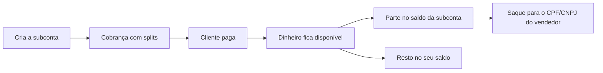

Subcontas guardam, dentro da sua conta AbacatePay, um saldo separado para cada vendedor do seu marketplace. Com o **split de pagamento**, parte de cada venda, por Pix, boleto ou cartão, vai para a subconta do vendedor, e você paga o vendedor por Pix na chave CPF/CNPJ dele.

## Quando usar

| Você quer | Use |
|---|---|
| Dividir cada venda entre a sua loja e vendedores, com o saldo de cada um separado | Subcontas e split |
| Pagar alguém sem guardar um saldo separado para ele | [Enviar Pix](/pages/dinheiro/enviar-pix) |

## Como funciona o split de pagamento



1. **Cadastre o vendedor** como subconta, com nome e CPF ou CNPJ.
2. **Divida o pagamento** com o campo `splits` ao criar a cobrança: no [checkout transparente](/pages/cobrar/checkout-transparente) (Pix, boleto ou cartão), no [checkout](/pages/cobrar/checkout) ou no [link de pagamento](/pages/cobrar/link-de-pagamento). Quando o dinheiro da venda fica disponível, cada parte vai para o saldo da subconta indicada, e o restante fica no seu saldo.
3. **Pague o vendedor** com o saque da subconta. O Pix sai para a chave CPF/CNPJ igual ao documento da subconta.

### Regras das subcontas

- **Um titular, uma subconta:** a subconta é identificada pelo CPF ou CNPJ do vendedor. Criar de novo com o mesmo documento devolve a subconta que já existe, com o saldo atual, e ignora os outros campos. O CPF/CNPJ não pode ser o da sua loja.
- **Saldo separado:** o saldo das subcontas não entra no saldo da sua loja e não pode ser sacado por [saque](/pages/dinheiro/saques) nem por [Enviar Pix](/pages/dinheiro/enviar-pix). Cada subconta tem saldo disponível e bloqueado.
- **Extrato:** no extrato da loja, cada parte enviada aparece como saída **Split para subconta**. No extrato da subconta, cada crédito diz de onde veio, como **Split recebido · Cartão, parcela 2 de 3**. Os saques das subcontas não aparecem no extrato nem em [Listar saques](/pages/payouts/list).
- **Liberação:** as subcontas são liberadas conta a conta. Fale com o suporte. Sem a liberação, as rotas respondem `Função não habilitada`.

### Regras do split

- **Onde:** no checkout transparente (`data.splits` no Pix, no boleto e no cartão), no checkout (`POST /checkouts/create`) e no link de pagamento (`POST /payment-links/create`). Assinaturas não aceitam split.
- **Valor fixo:** cada parte é um valor em centavos, de no mínimo `1`. De 1 a 10 subcontas por cobrança, sem repetir a mesma subconta.
- **No checkout e no link**, o split vale para cada pagamento: cada cliente que paga o link credita as partes de novo.

#### Quando cada parte é creditada

| Pagamento | Quando a parte cai na subconta |
|---|---|
| Pix | Quando o Pix é pago |
| Boleto pago pelo Pix do boleto | Quando o Pix é pago |
| Boleto pago pelo código de barras | Quando o valor do boleto fica disponível no seu saldo |
| Cartão à vista, Apple Pay e Google Pay | Quando o valor da venda fica disponível, no seu prazo de recebimento |
| Cartão parcelado | Em cada parcela, quando ela fica disponível. Cada parcela credita o total do split dividido pelo número de parcelas, arredondado para baixo, e a sobra entra na última |

Por exemplo, um split de R$ 100,00 numa venda em 3x credita R$ 33,33 na primeira parcela, R$ 33,33 na segunda e R$ 33,34 na terceira. Cobrança expirada, cancelada ou recusada não credita nada.

#### Quanto cabe no split

A soma das partes precisa caber no que a sua loja recebe no **pior caso** da cobrança, para que o split nunca deixe o seu saldo negativo:

- **O menor valor possível:** no checkout e no link, o preço com o maior desconto entre os cupons aceitos. Um cupom de 100% não conta, porque não gera pagamento.
- **A maior taxa possível:** entre as formas de pagamento aceitas. No boleto, conta a maior entre a taxa do boleto e a do Pix do boleto.
- **No cartão, parcela por parcela:** em todo número de parcelas oferecido e em qualquer prazo de recebimento, porque a taxa do cartão muda com os dois.

Se você incluir um cupom num checkout ou link que já tem split, e com ele o split deixar de caber, o cupom é recusado.

#### Restrições

- **Boleto com multa ou juros não aceita split:** a multa e os juros mudam o valor pago, e o split é um valor fixo.
- **Boleto e cartão com split** precisam estar liberados na sua conta. Fale com o suporte.
- **Reembolso, MED e chargeback:** o valor sai sempre do saldo da sua loja, mesmo quando a cobrança teve split. O que já foi creditado na subconta não volta sozinho.

### Regras do saque da subconta

- O destino é sempre a chave Pix CPF/CNPJ igual ao documento da subconta. O vendedor precisa ter essa chave cadastrada no banco dele.
- O valor mínimo é R$ 1,00 (`100`). O `amount` sai do saldo da subconta, com a taxa incluída: o vendedor recebe `amount` menos `platformFee`.
- A taxa e os limites diário e noturno são os da sua conta, e os saques das subcontas contam no mesmo limite diário. Veja [Saques](/pages/dinheiro/saques#regras-do-saque).
- Cada subconta faz um saque a cada 30 segundos. Subcontas diferentes podem sacar em sequência, e o saque de uma subconta não trava o saque da sua loja.
- Enquanto a sua conta tiver débito de contestação em aberto, ele é descontado do saldo disponível para saque das subcontas.
- Se o envio falhar, o valor volta para o saldo da subconta.
- O `externalId` é obrigatório e evita saque em dobro. Repetir o saque com o mesmo `externalId` e o mesmo `amount`, por exemplo depois de um timeout, devolve o saque que já existe, em qualquer status, sem mandar outro Pix. Se ele voltou `FAILED`, tente de novo com outro `externalId`.
- Com o mesmo `externalId` e outro `amount`, a API responde `externalId já usado em outro envio com valor diferente`. Se o `externalId` já foi usado num saque ou envio de Pix da sua loja, ou no saque de outra subconta, a API responde `externalId já usado em um envio de outro saldo (da loja ou de outra subconta)`.

### Permissões

| Permissão | Rotas |
|---|---|
| `SUB_ACCOUNT:CREATE` | `POST /sub-accounts/create` |
| `SUB_ACCOUNT:READ` | `GET /sub-accounts/get`, `GET /sub-accounts/list` |
| `SUB_ACCOUNT:WITHDRAW` | `POST /sub-accounts/withdraw` |

Para criar cobranças com `splits`, a chave também precisa de `TRANSPARENT:CREATE` (checkout transparente) ou `CHECKOUT:CREATE` (checkout e link de pagamento). Veja [Chaves de API](/pages/comecar/chaves-de-api).

## Pelo dashboard

Com as subcontas liberadas, o menu **Financeiro → Subcontas** mostra o total guardado em subcontas e a lista com nome, CPF/CNPJ, saldo disponível e data de criação. Dá para buscar por ID, nome ou CPF/CNPJ. Em **Ver detalhes**, você vê o saldo disponível, o bloqueado e as movimentações da subconta.

Criar subcontas, dividir cobranças e sacar das subcontas é só pela API.

## Pela API

<Steps>
  <Step title="Crie a subconta">
    Chame [Criar subconta](/pages/sub-accounts/create):

    ```json
    {
      "name": "João da Silva",
      "taxId": "111.444.777-35",
      "externalId": "vendedor-42",
      "metadata": { "loja": "centro" }
    }
    ```

    A resposta traz o `id` da subconta (`sacc_...`) e o saldo em `balance.available` e `balance.blocked`. Para achar a subconta depois, use [Buscar subconta](/pages/sub-accounts/get) ou [Listar subcontas](/pages/sub-accounts/list), que filtra por `taxId` ou `externalId`.
  </Step>

  <Step title="Crie a cobrança com split">
    Em [Criar cobrança Pix](/pages/transparents/create), informe as partes em `data.splits`. O boleto e o cartão do checkout transparente aceitam o mesmo campo, e o [checkout](/pages/payment/create) e o [link de pagamento](/pages/payment-links/create) aceitam `splits` na raiz do corpo:

    ```json
    {
      "method": "PIX",
      "data": {
        "amount": 10000,
        "splits": [
          { "subAccountId": "sacc_9f8Kq2LmX4vTzR7pWn3bYc1H", "amount": 7000 },
          { "subAccountId": "sacc_2Hq7Lm9XpR4vTzK8sWn3bYc5", "amount": 1500 }
        ]
      }
    }
    ```

    Depois do pagamento, uma subconta recebe R$ 70,00, a outra R$ 15,00, e o seu saldo recebe R$ 100,00 menos a taxa e menos as duas partes.
  </Step>

  <Step title="Saque para o vendedor">
    Chame [Sacar da subconta](/pages/sub-accounts/withdraw). Não há campo de chave Pix: o destino é sempre o CPF/CNPJ da subconta.

    ```json
    {
      "id": "sacc_9f8Kq2LmX4vTzR7pWn3bYc1H",
      "amount": 7000,
      "externalId": "repasse-vendedor-42-out",
      "description": "Repasse de outubro"
    }
    ```

    A resposta tem o mesmo formato do [Enviar Pix](/pages/dinheiro/enviar-pix), com o campo `subAccountId` a mais.
  </Step>
</Steps>

Se o split não passar nas regras, a cobrança não é criada e a API responde:

| `error` | Motivo |
|---|---|
| `Split para subcontas não está habilitado para esta loja` | As subcontas não estão liberadas na sua conta |
| `Split para subcontas não está disponível para esta loja` | A sua conta ainda não aceita split. Fale com o suporte |
| `Subconta repetida no split` | A mesma subconta aparece duas vezes em `splits` |
| `A soma dos splits passa do valor líquido da cobrança (PIX)` | A soma não cabe no pior caso da cobrança. O final diz o caso: `(PIX)`, `(BOLETO)` ou `(CARD em 3x)` |
| `Split não aceita multa nem juros no boleto` | A cobrança tem `interest` ou `fine` |
| `Split no boleto exige o boleto emitido pela Woovi` | O boleto com split ainda não está liberado na sua conta. Fale com o suporte |
| `Split no cartão exige o recebimento do cartão na Woovi` | O cartão com split ainda não está liberado na sua conta. Fale com o suporte |
| `Split não está disponível para assinaturas` | Assinaturas não aceitam split |
| `Subconta sacc_... não encontrada` | O `subAccountId` não é de uma subconta da sua loja |

Os erros de criação e de saque estão nas páginas de cada rota.

## Notificações

O saque da subconta dispara [`transfer.completed` ou `transfer.failed`](/pages/webhooks/events/transfers), com o mesmo `id` e `externalId` da resposta do saque.

O split não tem evento próprio: o pagamento da cobrança dispara o evento de sempre do [checkout transparente](/pages/webhooks/events/transparent).

## Testar no Modo Teste

Com as subcontas liberadas, você cria subcontas e cobranças com `splits` no [Modo Teste](/pages/comecar/modo-teste). Ao [simular o pagamento](/pages/transparents/simulate-payment) de um Pix, cada parte é creditada na subconta. O saque da subconta, como todo saque, só existe em produção.

## Perguntas frequentes

<AccordionGroup>
  <Accordion title="Posso usar split no cartão ou no boleto?">
    Sim, no checkout transparente, no checkout e no link de pagamento, depois de liberado na sua conta. No cartão parcelado, cada parcela credita a parte dela quando fica disponível. Boleto com multa ou juros não aceita split.
  </Accordion>

  <Accordion title="Posso dividir em porcentagem?">
    Ainda não. Cada parte é um valor fixo em centavos.
  </Accordion>

  <Accordion title="Posso criar duas subcontas para o mesmo vendedor?">
    Não. A subconta é única por CPF ou CNPJ. Criar de novo com o mesmo documento devolve a subconta que já existe.
  </Accordion>

  <Accordion title="Posso mandar o saque da subconta para outra chave Pix?">
    Não. O saque vai sempre para a chave CPF/CNPJ do titular da subconta, o que garante que o dinheiro chega ao próprio vendedor.
  </Accordion>

  <Accordion title="O que acontece com o split se eu reembolsar a venda?">
    O reembolso sai do saldo da sua loja. O valor que já foi para a subconta continua nela.
  </Accordion>

  <Accordion title="Por que recebi “Aguarde alguns segundos antes de solicitar outro saque” no saque da subconta?">
    A mesma subconta fez um saque há menos de 30 segundos. Subcontas diferentes podem sacar em sequência.
  </Accordion>
</AccordionGroup>
