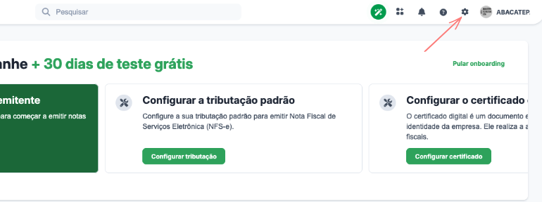
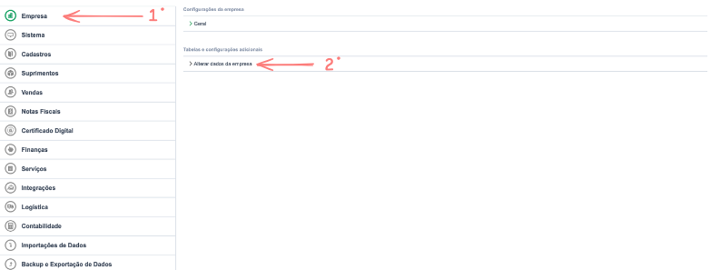
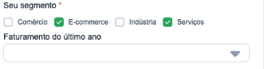
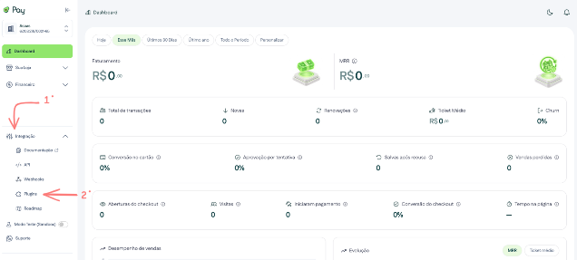
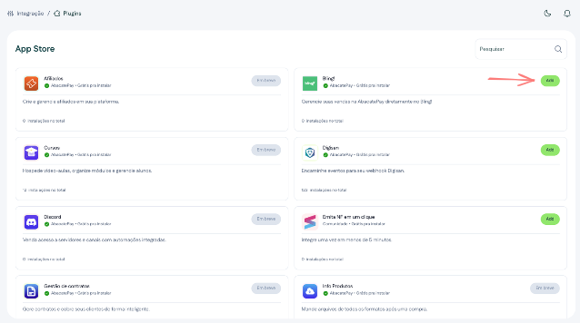
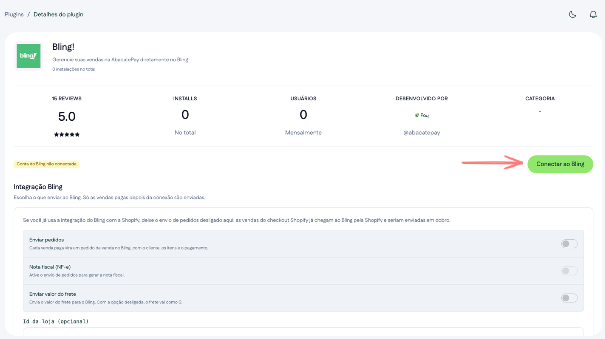
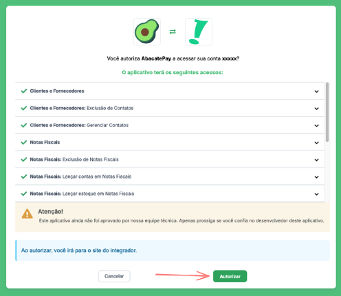
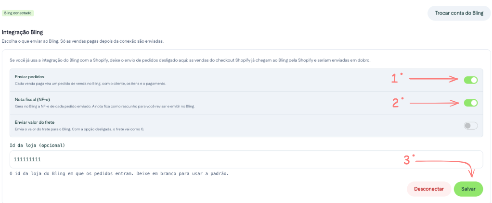

Com o plugin Bling, cada venda paga na AbacatePay vira um **pedido de venda no Bling**, com o cliente, os produtos e o pagamento. Se quiser, o Bling também gera a **NF-e** de cada pedido, pronta para você revisar e emitir.

<Tip>
  A conexão leva poucos minutos e **não exige código**. Você autoriza a AbacatePay na sua conta do Bling e escolhe o que enviar.
</Tip>

---

## Como funciona a integração

- **Só entram as vendas pagas depois da conexão.** Vendas anteriores, ou feitas enquanto o envio de pedidos estava desligado, não são enviadas.
- **Vendas de checkout viram pedido**: os checkouts criados pelo dashboard, pela API ou pelo plugin da Shopify. Links de pagamento de uso múltiplo, assinaturas e cobranças Pix por QR Code direto não são enviados.
- **O cliente é encontrado pelo CPF ou CNPJ.** Se ele já existe no seu Bling, o pedido usa o cadastro existente; se não, a AbacatePay cria o contato com nome, documento, e-mail, celular e endereço. Uma venda sem cliente entra como **Consumidor Final**.
- **A NF-e fica como rascunho.** A AbacatePay gera a nota a partir do pedido, mas **não transmite para a SEFAZ**: você confere os dados e emite pelo Bling.
- **O pedido chega em alguns minutos.** O envio é feito em segundo plano depois que o pagamento é confirmado, com novas tentativas se o Bling estiver fora do ar.

---

## O que você vai precisar

- Uma conta na AbacatePay ([criar conta grátis](https://app.abacatepay.com)).
- Uma conta no Bling com permissão para autorizar aplicativos.
- **Formas de pagamento ativas no Bling** para os meios que você recebe: **PIX dinâmico**, **cartão de crédito** e **boleto**. A AbacatePay usa a forma padrão de cada tipo, ou a primeira ativa.

<Warning>
  Deixe o **Bling e a AbacatePay logados no mesmo navegador**. Ao autorizar, o Bling devolve você para o dashboard da AbacatePay, e a conexão só é concluída se a sua sessão estiver aberta.
</Warning>

---

## Passo a passo

<Steps>
  <Step title="Prepare a sua conta do Bling">
    1. No Bling, clique na **engrenagem** no canto superior direito.

    <Frame>
      
    </Frame>

    2. Em **Empresa**, abra **Alterar dados da empresa**.

    <Frame>
      
    </Frame>

    3. Em **Seu segmento**, deixe marcados **E-commerce** e **Serviços** e salve.

    <Frame>
      
    </Frame>

    <Note>
      Aproveite para conferir em **Cadastros → Formas de pagamento** se existe uma forma ativa para cada meio de pagamento que você recebe. Sem ela, os pedidos daquele meio não são enviados: a AbacatePay tenta de novo por cerca de dois dias, e eles entram assim que você criar a forma.
    </Note>
  </Step>

  <Step title="Abra o plugin na AbacatePay">
    1. No dashboard da AbacatePay, abra **Integração** e clique em **Plugins**.

    <Frame>
      
    </Frame>

    2. Na App Store, encontre o **Bling** e clique em **Add**.

    <Frame>
      
    </Frame>

    <Warning>
      A conexão vale para o modo em que você está no dashboard. Conecte com o **Modo Teste desligado** para enviar as vendas reais. O Bling não tem ambiente de teste: uma conexão feita no Modo Teste envia os pedidos de teste para a sua conta real, marcados com `(dev mode)` nas observações.
    </Warning>
  </Step>

  <Step title="Conecte a sua conta do Bling">
    Clique em **Conectar ao Bling**. Você vai para a tela de login do Bling.

    <Frame>
      
    </Frame>
  </Step>

  <Step title="Autorize a AbacatePay">
    Entre com o seu usuário do Bling, confira os acessos que a AbacatePay pede e clique em **Autorizar**.

    <Frame>
      
    </Frame>

    Você volta para a página do plugin com a mensagem **Bling conectado à AbacatePay**, e o status muda para **Bling conectado**.
  </Step>

  <Step title="Escolha o que enviar">
    1. Ligue **Enviar pedidos** para que cada venda paga vire um pedido de venda no Bling.
    2. Ligue **Nota fiscal (NF-e)** se quiser que o Bling gere a nota de cada pedido. Essa opção só fica disponível com o envio de pedidos ligado.
    3. Ligue **Enviar valor do frete** para que o frete pago pelo cliente vá no pedido. Com a opção desligada, o frete vai como R$ 0,00.
    4. Em **Id da loja**, informe o id da loja do Bling em que os pedidos devem entrar, se você separa as vendas por loja. Deixe em branco para usar a loja padrão.
    5. Clique em **Salvar**.

    <Frame>
      
    </Frame>

    <Warning>
      Se você já usa a **integração do Bling com a Shopify**, deixe **Enviar pedidos** desligado aqui. As vendas do checkout da AbacatePay na Shopify já viram pedido na Shopify, chegam ao Bling por lá e seriam enviadas em dobro.
    </Warning>
  </Step>

  <Step title="Faça uma venda de teste">
    1. Faça uma compra pelo seu checkout da AbacatePay e pague.
    2. Em alguns minutos, o pedido aparece em **Vendas → Pedidos de venda** no Bling. O **número do pedido na loja** é o id da cobrança na AbacatePay (`bill_…`), e as observações trazem `AbacatePay bill_…`.
    3. Com a **Nota fiscal (NF-e)** ligada, a nota aparece em **Notas fiscais** aguardando a sua emissão.
  </Step>
</Steps>

Pronto! Suas vendas da AbacatePay já chegam ao Bling. 🥑

---

## Como o pedido é montado

| No Bling | Vem de |
| --- | --- |
| Cliente | O cliente da cobrança, encontrado pelo CPF ou CNPJ, ou **Consumidor Final** |
| Itens | Os produtos da cobrança, com nome, quantidade e preço. Nas vendas da Shopify, o SKU da variante vai como código do item |
| Pagamento | Uma parcela com o valor recebido, na forma de pagamento do Bling do mesmo tipo (PIX, cartão de crédito ou boleto) |
| Frete | O frete escolhido no checkout, ou R$ 0,00 com **Enviar valor do frete** desligado |
| Desconto e outras despesas | A diferença entre o que foi recebido e a soma dos itens com o frete. Um cupom vira desconto, e os juros do parcelamento repassados ao cliente viram outras despesas |

---

## Considerações finais

- **O estoque não é baixado.** Os itens vão com nome e código, mas sem vínculo com o cadastro de produtos do Bling.
- **Confira o endereço antes de emitir a NF-e.** Fora do checkout da Shopify, o endereço do pedido é o que estiver salvo no cadastro do cliente. Se faltar, complete no Bling antes de emitir.
- **Para trocar de conta do Bling**, clique em **Trocar conta do Bling** e autorize a nova conta. As opções salvas continuam valendo.
- **Desconectar** remove a integração. As vendas pagas depois disso não são enviadas, mesmo que você conecte de novo.

### Se a conexão não for concluída

| Mensagem no dashboard | O que fazer |
| --- | --- |
| A autorização foi recusada no Bling | Clique em **Conectar ao Bling** e, desta vez, clique em **Autorizar** |
| Sua sessão expirou durante a autorização | Entre no dashboard da AbacatePay e conecte de novo, com os dois sistemas no mesmo navegador |
| A autorização expirou ou foi iniciada em outra loja | Confira a loja e o modo selecionados no dashboard e conecte de novo |
| O Bling recusou a autorização | Conecte de novo. Se repetir, fale com a gente |

<Card title="Precisa de ajuda?" icon="headset" color="#25c2a0">
  Nossa equipe pode ajudar na integração com o Bling. Entre em contato pelo e-mail <Icon icon="envelope" type="solid"/> ajuda@abacatepay.com
</Card>
