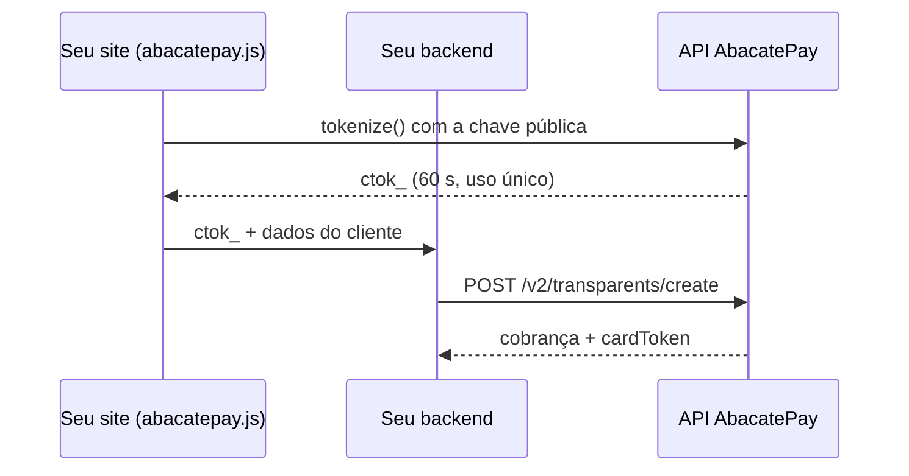

O formulário de cartão fica dentro do seu site: o cliente digita o cartão, paga e não sai da página. Ao final deste guia você tem uma página funcionando no [Dev mode](/pages/devmode).

## Como funciona



1. **O número do cartão nunca passa pelo seu servidor.** O formulário é um iframe seguro; o seu código só recebe um token.
2. **São duas chaves.** A [chave pública](/pages/transparents/public-key) (`pk_...`) vai no navegador. A chave de API (`abc_...`) fica só no backend.
3. **O token `ctok_` vale 60 segundos e uma cobrança.** Para cobrar o mesmo cartão de novo depois, use o `cardToken` da resposta ([veja como](/pages/guides/cartao-salvo)).

Requisitos: conta com cartão de crédito liberado e Node.js 20 ou superior para rodar o exemplo.

---

## Passo 1: pegue as duas chaves

Ligue o **Modo Teste** no dashboard e copie:

| Chave | Onde copiar | Onde usar |
|---|---|---|
| Chave pública (`pk_...`, rótulo **Teste (DEV)**) | **Integração → Checkout próprio** | Na página (passo 2) |
| Chave de API (`abc_dev_...`, permissão `TRANSPARENT:CREATE`) | **Integração → API** | No backend (passo 3) |

<Warning>
  As duas chaves precisam ser do **mesmo ambiente**: as duas de teste ou as duas de produção. Misturar faz a cobrança falhar com `Invalid or expired card token`.
</Warning>

---

## Passo 2: a página

Crie a pasta do projeto:

```bash
mkdir minha-loja && cd minha-loja
npm init -y && npm install express
mkdir public
```

Crie `public/index.html` e troque `pk_SUA_CHAVE_PUBLICA` pela sua chave pública:

```html public/index.html
<!doctype html>
<html lang="pt-BR">
  <head>
    <meta charset="utf-8" />
    <script src="https://abacatepay.com/abacatepay.js"></script>
  </head>
  <body>
    <div id="cartao"></div>
    <button id="pagar" disabled>Pagar R$ 100,00</button>
    <p id="mensagem"></p>

    <script type="module">
      const botao = document.getElementById('pagar')
      const mensagem = document.getElementById('mensagem')

      const checkout = AbacatePay.create({
        publicKey: 'pk_SUA_CHAVE_PUBLICA',
        amount: 10000, // R$ 100,00 em centavos: o MESMO valor que o backend cobra
        onCardChange: ({ canTokenize }) => (botao.disabled = !canTokenize),
      })
      await checkout.mount('#cartao').catch((error) => (mensagem.textContent = error.message))

      botao.onclick = async () => {
        botao.disabled = true // evita cobrança em dobro
        // Na sua loja, estes dados vêm do seu formulário
        const cliente = { name: 'Maria Silva', email: 'maria@exemplo.com', taxId: '529.982.247-25', cellphone: '11999999999' }
        try {
          const { token } = await checkout.tokenize(cliente) // abre o 3DS sozinho se o banco pedir
          const resposta = await fetch('/pagar', {
            method: 'POST',
            headers: { 'Content-Type': 'application/json' },
            body: JSON.stringify({ token, cliente }),
          })
          const { success, status, error } = await resposta.json()
          mensagem.textContent = success ? `Pagamento recebido (${status})` : error
          if (success) return
        } catch (error) {
          mensagem.textContent = error.message
        }
        botao.disabled = !checkout.canTokenize
      }
    </script>
  </body>
</html>
```

---

## Passo 3: o backend

Crie `server.mjs` na pasta `minha-loja`:

```js server.mjs
import express from 'express'

const app = express()
app.use(express.json())
app.use(express.static('public'))

app.post('/pagar', async (req, res) => {
  const { token, cliente } = req.body

  const resposta = await fetch('https://api.abacatepay.com/v2/transparents/create', {
    method: 'POST',
    headers: {
      Authorization: `Bearer ${process.env.ABACATEPAY_API_KEY}`,
      'Content-Type': 'application/json',
    },
    body: JSON.stringify({
      method: 'CARD',
      data: {
        amount: 10000, // o MESMO valor do AbacatePay.create
        token, // ctok_ que veio do navegador
        customer: cliente, // name, email, taxId e cellphone: todos obrigatórios
      },
    }),
  })
  const { success, data, error } = await resposta.json()

  // Guarde data.cardToken no seu banco para cobrar este cartão de novo depois
  if (success) console.log('Cobrança criada:', data.id, data.status, data.cardToken)

  res.json({ success, status: data?.status, error }) // o cardToken não vai para o navegador
})

app.listen(3000, () => console.log('Abra http://localhost:3000'))
```

E o arquivo `.env`, com a chave de API:

```bash .env
ABACATEPAY_API_KEY=abc_dev_sua_chave_de_api
```

---

## Passo 4: teste

```bash
node --env-file=.env server.mjs
```

Abra [http://localhost:3000](http://localhost:3000) e clique em **Pagar**. No Dev mode o formulário já vem preenchido com o cartão de teste `4242 4242 4242 4242`, e nada é cobrado de verdade. No terminal aparece a cobrança aprovada e o `cardToken` (no Dev mode, `dev_card_4242`).

Para testar recusas, troque o número no formulário:

| Número | Resultado |
|---|---|
| `4242 4242 4242 4242` | Aprovado |
| `4000 0000 0000 0002` | Recusado pelo emissor |
| `4000 0000 0000 0069` | Cartão expirado |
| `4000 0000 0000 0127` | CVV inválido |

Toda recusa volta com a mesma mensagem, `Não foi possível processar o pagamento com este cartão`. É de propósito: detalhar o motivo ajudaria quem testa cartão roubado.

---

## Passo 5: produção

O código não muda. Desligue o **Modo Teste**, copie as duas chaves de **Produção** e troque na página e no `.env`.

Em produção o formulário é o seguro de verdade, alguns bancos pedem confirmação (3DS) numa janela que o abacatepay.js abre e fecha sozinho, e são aceitos cartões de crédito **Visa** e **Mastercard**.

Antes de ir ao ar, ajuste o exemplo para a sua loja:

- **O valor vem do seu pedido, no backend.** Não confie no valor que chega do navegador.
- **Os dados do cliente vêm do seu formulário.** CPF ou CNPJ precisa ser válido.
- **Libere o pedido quando o `status` for `APPROVED`.** Se vier `PENDING`, espere o webhook [`transparent.completed`](/pages/webhooks/events/transparent).
- **Timeout não é recusa.** Se a chamada de cobrança der timeout, não repita na hora: confira na [listagem](/pages/transparents/list) ou espere o webhook.

---

## Erros mais comuns

| Mensagem | O que fazer |
|---|---|
| `Invalid or revoked public key` | Copie a chave pública de novo em **Integração → Checkout próprio** |
| `Invalid or expired card token` | O token passou de 60 segundos, já foi usado ou as chaves são de ambientes diferentes. Gere outro com `tokenize()` |
| `amount does not match the tokenized amount` | Use o mesmo `amount` na página e no backend |
| `Property 'data.customer.cellphone' is missing` | Falta um campo na cobrança. A mensagem diz qual (aqui, o celular do cliente) |
| `Não foi possível processar o pagamento com este cartão` | O cartão foi recusado. Peça outro cartão |

Todos os erros estão em [Criar cobrança Cartão](/pages/transparents/card#erros) e em [abacatepay.js](/pages/transparents/abacatepay-js#erros).

## Próximos passos

<CardGroup cols={2}>
  <Card title="Cobrar de novo um cartão salvo" icon="rotate" href="/pages/guides/cartao-salvo">
    Use o `cardToken` para cobrar o mesmo cartão sem o cliente digitar nada.
  </Card>
  <Card title="Parcelar e outros campos" icon="code" href="/pages/transparents/card">
    `installmentCount`, `metadata`, respostas e status.
  </Card>
</CardGroup>
