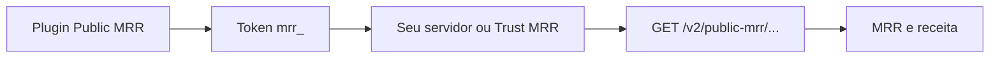

O **Public MRR** expõe as métricas de receita da sua loja em rotas só de leitura: MRR, assinaturas ativas e receita por período. Com ele, você mostra a receita no seu site ou conecta a loja a plataformas de transparência como o Trust MRR, sem entregar a sua chave de API.

## Quando usar

| Você quer | Use |
|---|---|
| Mostrar o MRR no seu site ou numa página pública de métricas | Public MRR |
| Conectar a loja ao Trust MRR ou a outra plataforma que lê o seu MRR | Public MRR, entregando o token `mrr_` |
| Ler cobranças, clientes ou assinaturas da loja | A API com uma [chave de API](/pages/comecar/chaves-de-api) |

## Como funciona



- **O token `mrr_` é só de leitura.** Ele vai no header `Authorization: Bearer mrr_...` e não altera nada na sua conta.
- **O token só vale nas rotas de Public MRR.** Em qualquer outra rota, a API responde `401 Unauthorized`. As rotas de Public MRR também não aceitam a chave de API: com ela, a resposta é o mesmo `401`.
- **Os dados são sempre de produção**, mesmo que o token tenha sido gerado com o Modo Teste ligado.
- **O token não muda** depois de gerado.
- As rotas existem na v1 e na v2. Use a v2: `https://api.abacatepay.com/v2/public-mrr/...`.
- Os valores são em centavos (`129900` = R$ 1.299,00).

### Como o MRR é calculado

- O MRR soma as assinaturas ativas que já pagam, cada uma com o valor de um mês: a anual conta 1/12, a semestral 1/6, a trimestral 1/3, e assim por diante.
- A assinatura em período de teste (trial) conta em `totalActiveSubscriptions`, mas ainda não conta no MRR. Ela entra no MRR quando o trial acaba.
- A assinatura cancelada sai das duas contas na data do cancelamento.
- O MRR por dia é o MRR no fim de cada dia, no horário de Brasília, com até 366 dias por consulta.
- A receita por período soma as vendas de cada dia, no horário de Brasília: o total em `totalRevenue`, a quantidade em `totalTransactions` e o detalhe por dia em `transactionsPerDay`. O período precisa ter pelo menos dois dias: com `startDate` igual a `endDate`, a API responde `End date must be after start date`.

Os resultados ficam em cache: o MRR por até 1 minuto, a receita e o MRR por dia por até 1 hora.

## Como gerar o token no dashboard

<Steps>
  <Step title="Abra os plugins">
    No dashboard, vá em **Integração → Plugins** e abra o **Public MRR**.
  </Step>

  <Step title="Instale o plugin">
    Clique em **Add**. A instalação gera o token.
  </Step>

  <Step title="Copie o token">
    Na seção **Token de Acesso**, clique em **Mostrar** e copie o token (`mrr_...`). A mesma página lista as rotas e tem botões para copiar a URL e o comando cURL de cada uma.
  </Step>
</Steps>

Use o token para conectar o Trust MRR ou para chamar as rotas pelo seu servidor. Não coloque o token no código do navegador.

## Pela API

```bash
curl https://api.abacatepay.com/v2/public-mrr/mrr \
  -H "Authorization: Bearer mrr_SEU_TOKEN"
```

```json
{
  "data": {
    "mrr": { "currency": "BRL", "value": 129900 },
    "totalActiveSubscriptions": { "currency": "BRL", "value": 12 }
  },
  "success": true,
  "error": null
}
```

`mrr.value` é o MRR em centavos, e `totalActiveSubscriptions.value` é a quantidade de assinaturas ativas.

| Rota | O que traz | Referência |
|---|---|---|
| `GET /public-mrr/merchant-info` | ID, nome, site, data de criação e país da loja | [Obter informações da loja](/pages/trustMRR/merchant-info) |
| `GET /public-mrr/mrr` | MRR atual e assinaturas ativas | [Obter MRR](/pages/trustMRR/mrr) |
| `GET /public-mrr/mrr-by-day` | MRR no fim de cada dia entre `startDate` e `endDate` | [Obter MRR por dia](/pages/trustMRR/mrr-by-day) |
| `GET /public-mrr/revenue` | Receita e número de transações do período, por dia | [Obter receita por período](/pages/trustMRR/revenue) |

As datas vão em `startDate` e `endDate`, no formato `YYYY-MM-DD`.

## Perguntas frequentes

<AccordionGroup>
  <Accordion title="O token mrr_ serve para criar cobranças ou ler clientes?">
    Não. Ele só vale nas rotas de Public MRR. Para o resto da API, use uma [chave de API](/pages/comecar/chaves-de-api).
  </Accordion>

  <Accordion title="Por que as assinaturas em trial não entram no MRR?">
    Elas ainda não pagam. Contam em `totalActiveSubscriptions` e entram no MRR quando o trial acaba.
  </Accordion>

  <Accordion title="Por que recebo “End date must be after start date” na receita?">
    A receita por período precisa de pelo menos dois dias. Use um `endDate` depois do `startDate`. O MRR por dia aceita um dia só.
  </Accordion>

  <Accordion title="O token mostra os dados do Modo Teste?">
    Não. As rotas de Public MRR sempre leem os dados de produção.
  </Accordion>

  <Accordion title="O número mudou na loja, mas não na API. Por quê?">
    Os resultados ficam em cache: o MRR por até 1 minuto, a receita e o MRR por dia por até 1 hora.
  </Accordion>
</AccordionGroup>
