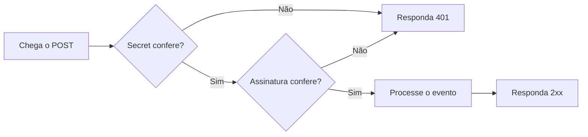

Verificar um webhook é confirmar, antes de processar, que a requisição veio da AbacatePay e que o corpo chegou intacto. Sem isso, qualquer pessoa que descubra a URL do seu webhook pode enviar eventos falsos, como um pagamento que nunca aconteceu.

## Como funciona a verificação

Cada entrega traz duas provas. Confira as duas.

| Prova | Onde vem | O que garante |
|---|---|---|
| Secret | Na URL (`?webhookSecret=`) e no header `X-Webhook-Secret` | Que a requisição veio da AbacatePay, porque só você e ela conhecem o valor. |
| Assinatura | No header `X-Webhook-Signature` | Que o corpo não foi alterado no caminho. |



Uma resposta `401` não gera nova tentativa. As regras de entrega estão em [Webhooks](/pages/notificacoes/webhooks#entrega-e-retentativas).

## Como conferir o secret

O secret é o valor de 32 caracteres ou mais que você definiu ao [criar o webhook](/pages/notificacoes/webhooks#como-criar-um-webhook-pelo-dashboard). Ele chega em cada entrega em dois lugares, com o mesmo valor:

```
POST https://meusite.com/webhooks/abacatepay?webhookSecret=SEU_SECRET
X-Webhook-Secret: SEU_SECRET
```

Leia de um dos dois. O header tem a vantagem de não aparecer nos logs de URL do seu servidor. Compare sempre em tempo constante: uma comparação comum (`===`, `==`, `!==`) responde mais rápido quando os primeiros caracteres não batem, e isso ajuda quem tenta adivinhar o valor.

<CodeGroup>
```ts Node.js
import crypto from "node:crypto";

function safeEqual(a: string, b: string): boolean {
  const A = Buffer.from(a, "utf8");
  const B = Buffer.from(b, "utf8");
  return A.length === B.length && crypto.timingSafeEqual(A, B);
}

// Express
const received = req.get("X-Webhook-Secret") ?? String(req.query.webhookSecret ?? "");

if (!safeEqual(received, process.env.WEBHOOK_SECRET!)) {
  return res.status(401).json({ error: "Unauthorized" });
}
```

```python Python
import hmac
import os

def secret_is_valid(received: str) -> bool:
    expected = os.environ["WEBHOOK_SECRET"]
    return hmac.compare_digest(received.encode("utf-8"), expected.encode("utf-8"))

# Flask
received = request.headers.get("X-Webhook-Secret") or request.args.get("webhookSecret", "")
if not secret_is_valid(received):
    abort(401)
```

```go Go
package webhook

import (
    "crypto/subtle"
    "net/http"
    "os"
)

func SecretIsValid(r *http.Request) bool {
    received := r.Header.Get("X-Webhook-Secret")
    if received == "" {
        received = r.URL.Query().Get("webhookSecret")
    }
    expected := os.Getenv("WEBHOOK_SECRET")
    return subtle.ConstantTimeCompare([]byte(received), []byte(expected)) == 1
}
```
</CodeGroup>

## Como validar a assinatura HMAC

O header `X-Webhook-Signature` traz a assinatura do corpo, em base64:

```
X-Webhook-Signature: <assinatura em base64>
```

Ela é calculada com **HMAC-SHA256** sobre o corpo bruto da requisição, usando a chave pública da AbacatePay que aparece nos exemplos abaixo. A chave é a mesma para todas as contas e não tem relação com o secret do seu webhook nem com a [chave pública](/pages/pagamentos/cartao-de-credito#chave-pública-e-chave-de-api) `pk_` do abacatepay.js. Como ela é pública, a assinatura prova que o corpo está intacto, e quem prova a origem é o secret.

Calcule a assinatura sobre o corpo exatamente como chegou, antes de qualquer parse de JSON. Um JSON lido e serializado de novo muda espaços e ordem, e a assinatura deixa de bater. No Express, use `express.raw({ type: "application/json" })` na rota do webhook.

<CodeGroup>
```ts Node.js
import crypto from "node:crypto";

const ABACATEPAY_PUBLIC_KEY =
  "t9dXRhHHo3yDEj5pVDYz0frf7q6bMKyMRmxxCPIPp3RCplBfXRxqlC6ZpiWmOqj4L63qEaeUOtrCI8P0VMUgo6iIga2ri9ogaHFs0WIIywSMg0q7RmBfybe1E5XJcfC4IW3alNqym0tXoAKkzvfEjZxV6bE0oG2zJrNNYmUCKZyV0KZ3JS8Votf9EAWWYdiDkMkpbMdPggfh1EqHlVkMiTady6jOR3hyzGEHrIz2Ret0xHKMbiqkr9HS1JhNHDX9";

export function verifyAbacateSignature(rawBody: Buffer | string, signatureFromHeader: string): boolean {
  const expectedSig = crypto
    .createHmac("sha256", ABACATEPAY_PUBLIC_KEY)
    .update(rawBody)
    .digest("base64");

  const A = Buffer.from(expectedSig);
  const B = Buffer.from(signatureFromHeader);

  return A.length === B.length && crypto.timingSafeEqual(A, B);
}
```

```python Python
import base64
import hashlib
import hmac

ABACATEPAY_PUBLIC_KEY = "t9dXRhHHo3yDEj5pVDYz0frf7q6bMKyMRmxxCPIPp3RCplBfXRxqlC6ZpiWmOqj4L63qEaeUOtrCI8P0VMUgo6iIga2ri9ogaHFs0WIIywSMg0q7RmBfybe1E5XJcfC4IW3alNqym0tXoAKkzvfEjZxV6bE0oG2zJrNNYmUCKZyV0KZ3JS8Votf9EAWWYdiDkMkpbMdPggfh1EqHlVkMiTady6jOR3hyzGEHrIz2Ret0xHKMbiqkr9HS1JhNHDX9"

def verify_abacate_signature(raw_body: bytes, signature_from_header: str) -> bool:
    expected = hmac.new(
        ABACATEPAY_PUBLIC_KEY.encode("utf-8"),
        raw_body,
        hashlib.sha256,
    ).digest()
    expected_b64 = base64.b64encode(expected).decode("utf-8")
    return hmac.compare_digest(expected_b64, signature_from_header)
```

```go Go
package webhook

import (
    "crypto/hmac"
    "crypto/sha256"
    "encoding/base64"
)

const abacatePublicKey = "t9dXRhHHo3yDEj5pVDYz0frf7q6bMKyMRmxxCPIPp3RCplBfXRxqlC6ZpiWmOqj4L63qEaeUOtrCI8P0VMUgo6iIga2ri9ogaHFs0WIIywSMg0q7RmBfybe1E5XJcfC4IW3alNqym0tXoAKkzvfEjZxV6bE0oG2zJrNNYmUCKZyV0KZ3JS8Votf9EAWWYdiDkMkpbMdPggfh1EqHlVkMiTady6jOR3hyzGEHrIz2Ret0xHKMbiqkr9HS1JhNHDX9"

func VerifySignature(rawBody []byte, signatureFromHeader string) bool {
    mac := hmac.New(sha256.New, []byte(abacatePublicKey))
    mac.Write(rawBody)
    expected := base64.StdEncoding.EncodeToString(mac.Sum(nil))
    return hmac.Equal([]byte(expected), []byte(signatureFromHeader))
}
```
</CodeGroup>

## Checklist de segurança

- A URL do webhook usa **HTTPS**. Uma URL `http://` é recusada em qualquer ambiente.
- O secret é **aleatório**, tem 32 caracteres ou mais e fica numa variável de ambiente, nunca no código.
- O seu endpoint confere o **secret** (header ou URL) em tempo constante.
- O seu endpoint valida a **assinatura HMAC** sobre o corpo bruto.
- Quando algo não confere, o endpoint responde `401` e não processa nada.
- O endpoint descarta **eventos repetidos**. Veja [como evitar processar duas vezes](/pages/notificacoes/webhooks#como-evitar-processar-o-mesmo-evento-duas-vezes).
- O endpoint não valida o payload inteiro com um schema rígido (como Zod), porque campos novos podem ser adicionados.
- Se o secret vazar, crie um webhook novo com outro secret e exclua o antigo.

## Perguntas frequentes

<AccordionGroup>
  <Accordion title="A assinatura nunca bate. O que pode ser?">
    Quase sempre é o corpo: o seu framework leu o JSON e você está assinando o objeto serializado de novo. Calcule o HMAC sobre os bytes exatos que chegaram, antes do parse.
  </Accordion>

  <Accordion title="Preciso validar o secret e a assinatura?">
    Sim. O secret prova que a requisição veio da AbacatePay, e a assinatura prova que o corpo não foi alterado. Uma não substitui a outra.
  </Accordion>

  <Accordion title="Posso usar o secret para calcular a assinatura?">
    Não. A assinatura `X-Webhook-Signature` usa a chave pública da AbacatePay mostrada nos exemplos. O secret só é comparado com o valor que você guardou.
  </Accordion>
</AccordionGroup>
