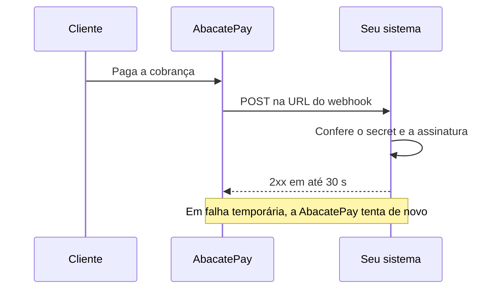

import { Video } from '/snippets/video.jsx'

Um webhook é uma URL do seu sistema que a AbacatePay chama sempre que algo acontece na sua conta, como um pagamento aprovado ou um saque concluído. Com ele, você atualiza o pedido na hora, sem precisar consultar a API de tempos em tempos.

<Video id="https://youtu.be/pUlqyIAb2VQ" title="Webhooks - AbacatePay" />

O vídeo também está em [Webhooks](/pages/videos/webhooks).

## Quando usar

Use webhooks para tudo que depende de um pagamento ou de uma movimentação: liberar acesso, marcar o pedido como pago, enviar um e-mail, registrar no seu financeiro. Libere o pedido pelo evento, e não pelo retorno do cliente à sua página, que pode nunca acontecer.

| Você precisa | Use |
|---|---|
| Saber na hora que algo aconteceu | Webhook |
| Conferir o estado de uma cobrança num momento específico | A API, por exemplo [Buscar checkout](/pages/payment/one) ou [Checar status](/pages/transparents/check) |

## Como funciona



Cada entrega é um `POST` com corpo JSON (`Content-Type: application/json`) e `User-Agent` começando com `AbacatePay/`. Ela traz o secret que você cadastrou, na URL (`?webhookSecret=`) e no header `X-Webhook-Secret`, e a assinatura do corpo no header `X-Webhook-Signature`. Como conferir os dois está em [Segurança dos webhooks](/pages/notificacoes/seguranca).

### Formato do evento

Todo evento chega no mesmo envelope:

```json
{
  "id": "log_Qw8eR2tY4uI6oP1aS3dF5gH7",
  "event": "checkout.completed",
  "apiVersion": 2,
  "devMode": false,
  "data": { }
}
```

| Campo | O que é |
|---|---|
| `id` | Identificador da entrega. É o mesmo em todas as retentativas automáticas, por isso serve para descartar repetidos. |
| `event` | O nome do evento. |
| `apiVersion` | Sempre `2`. |
| `devMode` | `true` nos eventos do [Modo Teste](/pages/comecar/modo-teste). |
| `data` | Os dados do evento. O conteúdo muda por evento e está em cada página da [lista de eventos](#eventos-de-webhook). |

### Cliente, CPF e cartão

- Os eventos de checkout, checkout transparente e assinatura sempre trazem `data.customer`. Quando a cobrança não tem cliente, ele chega assim: `{ "id": "", "name": null, "email": null, "taxId": null }`.
- O CPF ou CNPJ (`taxId`) chega mascarado: `123.***.789-**` no CPF e `12.***.678/0001-**` no CNPJ. O documento completo depende de liberação para a sua conta; fale com o suporte.
- Do cartão, só chegam os 4 últimos dígitos e a bandeira.
- Não valide o payload inteiro com um schema rígido (como Zod): campos novos podem ser adicionados, e o seu endpoint não deve quebrar por isso.

## Eventos de webhook

Escolha os eventos ao criar o webhook. Cada um tem uma página com exemplos de payload.

| Evento | Quando dispara |
|---|---|
| [`checkout.completed`](/pages/webhooks/events/checkout) | Um pagamento de checkout ou de link de pagamento é confirmado. Também sai em cada cobrança paga de assinatura (`frequency: "SUBSCRIPTION"`) e no upsell. |
| [`checkout.refunded`](/pages/webhooks/events/checkout) | Um pagamento de checkout é reembolsado. |
| [`checkout.disputed`](/pages/webhooks/events/checkout) | Uma disputa é aberta, ganha ou perdida num pagamento de checkout. O `status` mostra a fase. |
| [`checkout.lost`](/pages/webhooks/events/checkout) | A disputa de um pagamento de checkout é perdida. |
| [`transparent.completed`](/pages/webhooks/events/transparent) | Uma cobrança do checkout transparente é paga. |
| [`transparent.refunded`](/pages/webhooks/events/transparent) | Uma cobrança do checkout transparente é reembolsada. |
| [`transparent.disputed`](/pages/webhooks/events/transparent) | Uma disputa é aberta, ganha ou perdida numa cobrança do checkout transparente. |
| [`transparent.lost`](/pages/webhooks/events/transparent) | A disputa de uma cobrança do checkout transparente é perdida. |
| [`subscription.completed`](/pages/webhooks/events/subscriptions) | Uma assinatura sem período de teste é contratada e paga. |
| [`subscription.trial_started`](/pages/webhooks/events/subscriptions) | Uma assinatura com período de teste é contratada. Nada é cobrado nesse momento. |
| [`subscription.renewed`](/pages/webhooks/events/subscriptions) | Uma cobrança recorrente é paga, inclusive a primeira depois do período de teste. |
| [`subscription.payment_failed`](/pages/webhooks/events/subscriptions) | Uma tentativa de cobrança da assinatura falha. Sai a cada tentativa. |
| [`subscription.plan_changed`](/pages/webhooks/events/subscriptions) | Uma troca de plano é pedida e, de novo, quando ela é aplicada. |
| [`subscription.cancelled`](/pages/webhooks/events/subscriptions) | A assinatura é cancelada, por você, pelo cliente ou automaticamente. |
| [`payout.completed`](/pages/webhooks/events/payouts) | Um saque para a conta bancária da loja é concluído. |
| [`payout.failed`](/pages/webhooks/events/payouts) | Um saque falha, e o valor volta para o saldo. |
| [`transfer.completed`](/pages/webhooks/events/transfers) | Um Pix enviado para outra pessoa ou empresa é concluído. |
| [`transfer.failed`](/pages/webhooks/events/transfers) | Um Pix enviado para outra pessoa ou empresa falha. |
| [`pix_key.received`](/pages/webhooks/events/pix-key) | Um Pix chega na chave Pix da conta, sem cobrança. Só em contas com o Pix por chave liberado. |
| [`pix_key.refunded`](/pages/webhooks/events/pix-key) | Um Pix recebido na chave é reembolsado. Só em contas com o Pix por chave liberado. |

## Como criar um webhook pelo dashboard

1. Vá em **Integração → Webhooks** e clique em **Criar webhook**.
2. Em **Versão do Webhook**, escolha **Webhook v2**. A v1 cobre só eventos de cobrança e saque, não recebe nenhum evento desta página e vai ficar indisponível em breve.
3. Preencha o **Nome**, a **URL** (HTTPS e pública) e o **Secret**, com 32 caracteres ou mais.
4. Em **Eventos**, marque os eventos que esse webhook deve receber. Os de Pix por chave só aparecem para contas com o recurso liberado.
5. Clique em **Salvar**.

O webhook é criado no ambiente em que o dashboard está: com o Modo Teste ligado, ele só recebe eventos de teste.

### O que é o secret

O secret é um valor que você cria e guarda no seu servidor. A AbacatePay o envia em cada entrega, e o seu sistema confere se ele bate antes de processar o evento. A assinatura do corpo usa outra chave, a da AbacatePay. Gere um valor aleatório, por exemplo com `openssl rand -hex 32` (64 caracteres).

Um webhook não pode ser editado. Para mudar a URL, os eventos ou o secret, crie outro e exclua o antigo.

## Como criar um webhook pela API

Chame [Criar um webhook](/pages/webhooks/create) com uma chave que tenha a permissão `WEBHOOK:CREATE`. O webhook criado pela API é sempre v2 e fica no ambiente da chave.

```bash
curl -X POST https://api.abacatepay.com/v2/webhooks/create \
  -H "Authorization: Bearer SUA_CHAVE" \
  -H "Content-Type: application/json" \
  -d '{
    "name": "Pagamentos da loja",
    "endpoint": "https://meusite.com/webhooks/abacatepay",
    "secret": "f72179170ec5a0c845c0fcd18457e241006d09363b2d2a7d296d7bffbcd027c4",
    "events": ["checkout.completed", "subscription.renewed"]
  }'
```

Para gerenciar os webhooks, use [Listar](/pages/webhooks/list), [Buscar](/pages/webhooks/get) e [Excluir](/pages/webhooks/delete).

## Requisitos da URL

- **HTTPS em qualquer ambiente**, inclusive no Modo Teste. Uma URL `http://` é recusada.
- **Endereço público.** `localhost` e IPs privados ou reservados são recusados na criação. Se o domínio passar a apontar para um IP privado depois, a entrega é bloqueada e não é tentada de novo.
- **URL final.** Redirecionamentos (`3xx`) não são seguidos.
- **Resposta rápida.** Grave o evento (numa fila ou no banco) e responda `2xx` logo em seguida. Processar tudo antes de responder arrisca passar dos 30 segundos.

Para testar no seu computador, use o [`abacatepay listen`](/pages/cli/webhooks) da CLI ou um túnel HTTPS.

## Modo Teste e produção

Os webhooks do Modo Teste e os de produção são separados. Um webhook criado no Modo Teste (ou com uma chave `abc_dev_`) recebe só eventos de teste, e o de produção recebe só os reais. O `id` do webhook mostra o ambiente: `webh_dev_...` ou `webh_prod_...`.

No Modo Teste, os eventos de pagamento, de reembolso e de contratação de assinatura saem normalmente: [simule o pagamento](/pages/comecar/modo-teste#simular-pagamentos) e, se quiser, reembolse a cobrança. Disputas, saques, envios de Pix e Pix por chave não têm simulação.

Ao [ir para produção](/pages/comecar/producao), crie os webhooks de novo com o Modo Teste desligado.

## Entrega e retentativas

A entrega conta como feita quando o seu endpoint responde qualquer status `2xx` em até **30 segundos**. O corpo da resposta é ignorado.

| Resposta do seu endpoint | O que a AbacatePay faz |
|---|---|
| `2xx` | Considera entregue. |
| Sem resposta em 30 s, erro de conexão, DNS ou TLS | Tenta de novo. |
| `5xx`, `408` ou `429` | Tenta de novo. |
| `410 Gone` | Desativa o webhook, que para de receber eventos. |
| `3xx` ou outro `4xx` (como `400`, `401` e `404`) | Não tenta de novo. |

Uma resposta `4xx` costuma indicar URL errada ou secret recusado, e repetir o envio não resolveria.

As novas tentativas seguem estes intervalos, contados a partir da falha anterior:

| Tentativa | Quando |
|---|---|
| 1ª | Assim que o evento acontece |
| 2ª | 5 segundos depois |
| 3ª | 5 minutos depois |
| 4ª | 30 minutos depois |
| 5ª | 2 horas depois |
| 6ª | 5 horas depois |
| 7ª (última) | 10 horas depois |

São até 7 tentativas em cerca de 18 horas. Quando uma recebe `2xx`, as seguintes não acontecem. Se você excluir o webhook ou ele for desativado, as tentativas pendentes são descartadas. As regras são as mesmas no Modo Teste e em produção.

## Como evitar processar o mesmo evento duas vezes

O mesmo evento pode chegar mais de uma vez: numa retentativa, quando a sua resposta se perde no caminho ou num reenvio manual. Por isso:

1. **Guarde o `id` de cada evento processado.** As retentativas automáticas repetem o mesmo `id`. Se ele já foi processado, responda `2xx` sem processar de novo.
2. **Deixe a ação idempotente também pela entidade.** O reenvio manual pelo dashboard chega com um `id` novo. Antes de liberar um pedido, confira se ele já não foi liberado, pelo `id` da cobrança ou da assinatura.

```ts
const eventId = req.body.id; // o mesmo em todas as retentativas automáticas

if (await db.events.findOne({ id: eventId })) {
  return res.status(200).json({ ok: true }); // já processado
}

await processEvent(req.body); // confira também se o pedido já foi liberado
await db.events.insert({ id: eventId, processedAt: new Date() });

return res.status(200).json({ ok: true });
```

Dois casos pedem cuidado:

- **O mesmo `checkout.id` pode ter mais de um `checkout.completed` legítimo:** o do [upsell](/pages/vender/upsell) (`isUpSell: true`) e o de cada venda de um [link de pagamento](/pages/cobrar/link-de-pagamento). Não descarte esses eventos só porque o `checkout.id` se repete.
- **Cada cobrança paga de assinatura dispara dois eventos:** o de assinatura (`subscription.completed` ou `subscription.renewed`) e um `checkout.completed` com `frequency: "SUBSCRIPTION"`. Libere o acesso por um deles só.

## Ordem de chegada

Os eventos não chegam necessariamente na ordem em que aconteceram. Uma retentativa pode chegar depois de um evento mais novo, e dois eventos da mesma compra podem chegar em qualquer ordem. Decida o estado pelo `status` que vem no payload, e consulte a API quando precisar do estado atual.

## Logs, reenvio e desativação

No dashboard, vá em **Integração → Webhooks**, abra o menu do webhook e clique em **Ver Logs**.

- Cada tentativa aparece com o status, o evento, o ID da mensagem e a hora de envio. Clique numa linha para ver o **Payload enviado** e a **Resposta da API**, com o status HTTP e o tempo de resposta.
- Numa entrega que falhou, clique em **Reenviar**. O reenvio faz uma tentativa só, sem retentativas automáticas, e chega com um `id` novo.
- Para parar de receber, abra o menu do webhook e clique em **Excluir**. Não há opção para pausar.
- Um webhook é desativado automaticamente quando o seu endpoint responde `410 Gone`. Para voltar a receber, crie um webhook novo.

Os logs e o reenvio existem só no dashboard. A API não tem rotas para eles.

## Perguntas frequentes

<AccordionGroup>
  <Accordion title="Meu endpoint não recebe os eventos. O que conferir?">
    Veja se o webhook é v2, se ele está no mesmo ambiente da cobrança (Modo Teste ou produção) e se o evento está marcado nele. Depois, abra os logs: eles mostram o status HTTP que o seu endpoint respondeu. Se ele respondeu `410`, o webhook foi desativado e precisa ser criado de novo.
  </Accordion>

  <Accordion title="Posso ter mais de um webhook?">
    Sim. Cada webhook recebe os eventos marcados nele, então você pode separar, por exemplo, um webhook para pagamentos e outro para saques.
  </Accordion>

  <Accordion title="Como mudo a URL ou o secret de um webhook?">
    Não dá para editar. Crie um webhook novo com a URL ou o secret certos e exclua o antigo.
  </Accordion>

  <Accordion title="Por quanto tempo a AbacatePay tenta entregar um evento?">
    Até 7 tentativas em cerca de 18 horas, quando o endpoint não responde, demora mais de 30 segundos ou responde `5xx`, `408` ou `429`. Veja [Entrega e retentativas](#entrega-e-retentativas).
  </Accordion>

  <Accordion title="O secret assina o corpo do evento?">
    Não. O secret serve para você conferir que a requisição veio da AbacatePay, e a assinatura `X-Webhook-Signature` usa a chave da AbacatePay. Veja [Segurança dos webhooks](/pages/notificacoes/seguranca).
  </Accordion>
</AccordionGroup>

<Card title="Precisa de ajuda?" icon="headset" horizontal>
  Fale com a gente em ajuda@abacatepay.com.
</Card>
