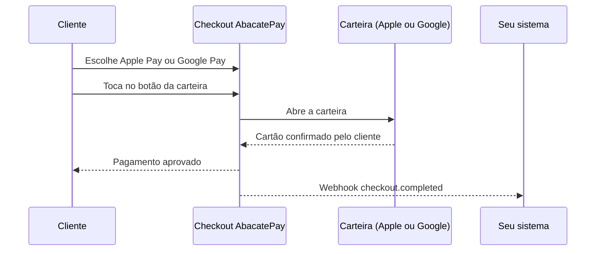

Com Apple Pay e Google Pay, o cliente paga no checkout da AbacatePay com o cartão que já está salvo na carteira do celular ou do navegador, sem digitar o número do cartão. Para você, é uma venda no cartão, à vista.

## Quando usar

Ofereça as carteiras quando muitos clientes compram pelo celular: o pagamento sai com um toque, sem preencher o formulário do cartão.

| Onde | Apple Pay e Google Pay |
|---|---|
| [Checkout](/pages/cobrar/checkout) avulso | Sim |
| [Link de pagamento](/pages/cobrar/link-de-pagamento) | Não |
| [Assinaturas](/pages/cobrar/assinaturas) | Não |
| [Checkout transparente](/pages/cobrar/checkout-transparente) | Não |
| [Parcelamento](/pages/pagamentos/parcelamento) | Não. Sempre à vista |

Para parcelar ou para o formulário dentro do seu site, use o [cartão de crédito](/pages/pagamentos/cartao-de-credito).

## Como funciona o Apple Pay e o Google Pay



- **Só no checkout avulso.** As carteiras aparecem em checkouts de pagamento único. Link de pagamento e assinatura não aceitam.
- **Precisa do cartão ativado.** Apple Pay e Google Pay vêm com a [ativação do cartão](/pages/pagamentos/cartao-de-credito#como-ativar-o-cartão-na-sua-conta) na sua conta.
- **Sempre à vista.** Não há parcelamento nas carteiras.
- **Sem acréscimo do repasse.** Com o [repasse de taxa](/pages/pagamentos/repasse-de-taxa) ligado, só o cartão digitado tem acréscimo; nas carteiras, o cliente paga o preço normal.
- **Cupom vale.** O desconto do [cupom](/pages/vender/cupons) é aplicado normalmente.
- **Visa e Mastercard**, como no cartão de crédito.
- **Taxa e prazo de recebimento** são os do cartão à vista. Veja [Prazo de recebimento](/pages/pagamentos/cartao-de-credito#prazo-de-recebimento).

### O que o cliente vê no checkout

1. Em **Forma de pagamento**, as opções **Apple Pay** e **Google Pay** aparecem ao lado das outras formas que o checkout oferece, como **Crédito**.
2. Ao escolher uma carteira, o botão da Apple ou do Google aparece no lugar de **Concluir pagamento**.
3. O cliente toca no botão, confirma o pagamento na carteira e vai para a tela de sucesso.

O botão do Apple Pay só aparece em dispositivos e navegadores compatíveis. O do Google Pay só aparece quando a carteira do cliente tem um cartão elegível. Quando a carteira não está disponível, o checkout avisa (por exemplo, "Apple Pay não está disponível neste dispositivo ou navegador.") e o cliente pode escolher outra forma de pagamento.

## Pelo dashboard

1. Vá em **Sua Loja → Cobranças** e clique em **Criar cobrança**.
2. Em **Métodos de pagamento**, selecione **Apple Pay** e **Google Pay**, junto com os outros métodos que quiser.
3. Salve e mande o link para o cliente.

As opções **Apple Pay** e **Google Pay** só aparecem quando a sua conta tem as carteiras liberadas. Elas não aparecem em **Criar link de pagamento**, porque o link de pagamento não aceita carteiras. Não há outra configuração no dashboard.

## Pela API

Inclua `APPLE_PAY` e `GOOGLE_PAY` em `methods` ao [criar o checkout](/pages/payment/create):

```bash
curl -X POST https://api.abacatepay.com/v2/checkouts/create \
  -H "Authorization: Bearer $ABACATEPAY_API_KEY" \
  -H "Content-Type: application/json" \
  -d '{
    "items": [{ "id": "prod_abc123xyz", "quantity": 1 }],
    "methods": ["PIX", "CARD", "APPLE_PAY", "GOOGLE_PAY"]
  }'
```

Você pode oferecer só uma das carteiras. O checkout criado traz os métodos em `methods`.

### Erros

| Erro | Quando acontece |
|---|---|
| `Apple Pay and Google Pay are only available for one-time checkouts` | As carteiras foram enviadas num link de pagamento ou num checkout de assinatura |
| `CARD is not available for this store` | A sua conta ainda não tem o cartão ativado |
| `Apple Pay and Google Pay are not available for this store` | A sua conta tem cartão, mas ainda não tem as carteiras liberadas. Fale com o suporte |
| `Apple Pay and Google Pay require the store to be on Rinne` | A sua conta ainda não está habilitada para as carteiras. Fale com o suporte |

## Notificações

Quando o pagamento é aprovado, chega o [`checkout.completed`](/pages/webhooks/events/checkout), como em qualquer pagamento no cartão:

- `payerInformation.method` vem como `"CARD"`;
- `payerInformation.CARD` traz a bandeira (`brand`) e o final do cartão (`number`) informados pela carteira;
- `checkout.methods` lista os métodos que o checkout oferecia, como `["PIX", "CARD", "APPLE_PAY", "GOOGLE_PAY"]`.

O webhook não diz qual carteira o cliente usou. Contestações e reembolsos seguem as regras do cartão: veja [Reembolsos](/pages/vender/reembolsos).

## Perguntas frequentes

<AccordionGroup>
  <Accordion title="Por que o botão do Apple Pay não aparece para o cliente?">
    O Apple Pay só aparece em dispositivos e navegadores compatíveis. Em outros, o checkout avisa que a carteira não está disponível, e o cliente pode pagar com cartão, Pix ou boleto.
  </Accordion>
  <Accordion title="Por que o botão do Google Pay não aparece?">
    O botão só aparece quando a carteira do cliente tem um cartão elegível.
  </Accordion>
  <Accordion title="Dá para parcelar no Apple Pay ou no Google Pay?">
    Não. O pagamento pelas carteiras é sempre à vista. Para parcelar, o cliente escolhe **Crédito**.
  </Accordion>
  <Accordion title="Funciona no link de pagamento ou na assinatura?">
    Não. Apple Pay e Google Pay valem só no checkout avulso.
  </Accordion>
  <Accordion title="O cliente paga acréscimo com o repasse de taxa ligado?">
    Não. Nas carteiras, o cliente paga o preço normal.
  </Accordion>
  <Accordion title="Como sei se o cliente pagou com Apple Pay ou Google Pay?">
    No webhook, o pagamento chega como cartão (`"CARD"`), com a bandeira e o final do cartão. Não há campo que diga qual carteira foi usada.
  </Accordion>
</AccordionGroup>
