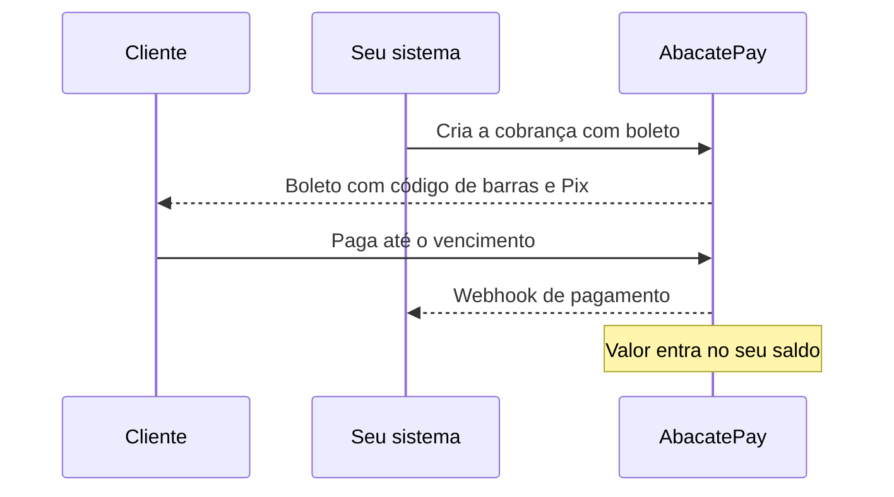

O boleto bancário é uma cobrança com data de vencimento que o cliente paga pelo código de barras, pela linha digitável ou pelo Pix que vem no próprio boleto. Na AbacatePay, você gera boletos no checkout, no link de pagamento e no checkout transparente.

## Quando usar o boleto

- **Cliente sem cartão** ou que prefere pagar depois, dentro de um prazo.
- **Faturas e mensalidades com data certa**, em que vale cobrar [juros e multa](/pages/pagamentos/juros-e-multa-boleto) pelo atraso.
- **Empresas que pagam por boleto** no fluxo de contas a pagar.

Se você precisa da confirmação na hora, prefira o [Pix](/pages/pagamentos/pix). Para parcelar, use o [cartão de crédito](/pages/pagamentos/cartao-de-credito). A comparação das três formas está em [Quando usar o Pix](/pages/pagamentos/pix#quando-usar-o-pix).

## Como funciona o boleto



- **Valor mínimo:** R$ 3,00 (`300` centavos). Abaixo disso, a API responde `O valor mínimo para boleto é R$ 3,00 (300 centavos)`. No checkout, o mínimo vale para o total dos itens.
- **Dados de quem paga:** o boleto exige nome e CPF/CNPJ. No checkout e no link, o cliente preenche. No checkout transparente, você envia em `customer`.
- **Liberação:** o boleto precisa estar liberado na sua conta. Sem isso, a API responde `BOLETO is not available for this store`.
- **Sem reembolso:** boleto pago não pode ser reembolsado. Veja [Reembolsos](/pages/vender/reembolsos).

## Vencimento do boleto

O vencimento vem do campo `dueDate`, no formato `AAAA-MM-DD` (ex.: `"2026-12-15"`).

- **Sem `dueDate`:** o boleto vence em 3 dias úteis, contados a partir do momento em que ele é gerado.
- **Data no passado:** recusada com `dueDate cannot be in the past`.
- **Prazo máximo:** 365 dias. Depois disso, a API responde `dueDate cannot be more than 365 days in the future`.
- **Formato errado:** recusado com `dueDate must be a valid date in YYYY-MM-DD format`.
- **Hora do vencimento:** o boleto vence no fim do dia, no horário de Brasília. A resposta traz esse momento em `expiresAt`.

No checkout e no link de pagamento, `dueDate` exige `"BOLETO"` em `methods`. Sem ele, a API responde **400** com `dueDate requires BOLETO in methods`. Isso vale também quando `methods` é omitido, porque o padrão é Pix e cartão.

### No link de pagamento, a data fica fixa

O `dueDate` de um checkout ou de um link vale para todo boleto gerado nele. Num link de pagamento, todos os clientes recebem boletos com a mesma data de vencimento. Depois dessa data, o link não gera mais boleto, e o cliente só consegue pagar pelas outras formas que o link aceita.

Para um link que fica no ar por muito tempo, deixe `dueDate` de fora: cada boleto vence 3 dias úteis depois de gerado.

### Depois do vencimento

- **Sem juros nem multa:** o boleto expira (`EXPIRED`) e não aceita mais pagamento.
- **Com juros ou multa:** o boleto continua aberto depois do vencimento, e o cliente paga com o acréscimo. Veja [Juros e multa no boleto](/pages/pagamentos/juros-e-multa-boleto).

## Pix no boleto

Todo boleto vem com um Pix para o mesmo valor. O cliente escolhe como pagar:

- **Pelo Pix do boleto:** a confirmação sai em segundos, e vale a taxa de Pix.
- **Pelo código de barras ou pela linha digitável:** vale a taxa de boleto, e a confirmação depende da compensação bancária, que leva até 3 dias úteis.

A taxa só é cobrada quando o boleto é pago. Os valores estão em [Taxas](/pages/comecar/taxas).

## Código de barras e linha digitável

A cobrança de boleto traz estes campos:

| Campo | O que é |
|---|---|
| `url` | Página do boleto, para ver, imprimir ou salvar em PDF. Mostra também o código Pix. |
| `barCode` | Código de barras, com 44 dígitos. É o número que vira as barras impressas e que o leitor do banco lê. |
| `identificationNumber` | Linha digitável, com 47 dígitos. É o número que o cliente digita no app do banco. |
| `brCode` | Pix copia e cola do boleto. |
| `brCodeBase64` | QR Code do Pix do boleto, em imagem PNG base64. |

Para mandar o boleto por e-mail ou WhatsApp, envie a `url` ou a linha digitável.

## Pelo dashboard

1. Em **Sua Loja → Cobranças**, clique em **Criar cobrança**. Para um link que vários clientes pagam, use **Sua Loja → Links de pagamento → Criar link de pagamento**.
2. Em **Métodos de pagamento**, marque **Boleto**. A opção só aparece se o boleto estiver liberado na sua conta.
3. Escolha produtos que somem pelo menos R$ 3,00.
4. Mande o link ao cliente. Ele escolhe Boleto, preenche os dados e clica em **Imprimir / Salvar Boleto**.

Pelo dashboard, o boleto vence no prazo padrão de 3 dias úteis. Outra data de vencimento, juros e multa só pela API.

## Pela API

### No checkout e no link de pagamento

Inclua `"BOLETO"` em `methods` e, se quiser, a data de vencimento. Os campos são os mesmos em [Criar um checkout](/pages/payment/create) e [Criar um link de pagamento](/pages/payment-links/create).

```json
{
  "methods": ["BOLETO", "PIX"],
  "dueDate": "2026-12-15",
  "items": [{ "id": "prod_abc123xyz", "quantity": 1 }]
}
```

A resposta e a consulta do checkout trazem `dueDate` (ou `null`, quando não foi definido).

### No checkout transparente

Chame [`POST /v2/transparents/create`](/pages/transparents/boleto) com `method: "BOLETO"`:

```json
{
  "method": "BOLETO",
  "data": {
    "amount": 5000,
    "dueDate": "2026-12-15",
    "description": "Fatura de dezembro",
    "externalId": "fatura-456",
    "customer": {
      "name": "Mariana Costa",
      "taxId": "987.654.321-00",
      "email": "mariana.costa@empresa.com.br",
      "cellphone": "(21) 99876-5432"
    },
    "metadata": { "faturaId": "fatura-456" }
  }
}
```

| Campo | Descrição |
|---|---|
| `amount` | Obrigatório. Valor em centavos, mínimo `300` (R$ 3,00). |
| `customer.name`, `customer.taxId` | Obrigatórios. Nome e CPF/CNPJ de quem paga. |
| `customer.email`, `customer.cellphone` | Opcionais. |
| `customer.address` | Opcional. Se enviar, só `complement` pode ficar de fora, e `state` é a UF com 2 letras. |
| `dueDate` | Vencimento. Sem ele, 3 dias úteis. |
| `description` | Descrição da cobrança, com até 500 caracteres. |
| `externalId` | Código da cobrança no seu sistema. |
| `interest`, `fine` | [Juros e multa](/pages/pagamentos/juros-e-multa-boleto). |
| `metadata`, `utm` | Dados seus e da campanha. Veja [UTM e metadados](/pages/vender/utm-e-metadados). |

A resposta traz o boleto e o Pix dele:

```json
{
  "data": {
    "id": "bole_k8pqr2mnvx",
    "amount": 5000,
    "status": "PENDING",
    "devMode": false,
    "barCode": "00191878900000050000000002759288002193297817",
    "identificationNumber": "00190000090275928800021932978170187890000005000",
    "url": "https://app.abacatepay.com/pay/bole_k8pqr2mnvx/boleto",
    "brCode": "00020101021226580014BR.GOV.BCB.PIX...",
    "brCodeBase64": "data:image/png;base64,iVBORw0KGgoAAAANSUhEUgAA...",
    "platformFee": 250,
    "interest": null,
    "fine": null,
    "receiptUrl": null,
    "expiresAt": "2026-12-16T02:58:59.000Z",
    "createdAt": "2026-12-01T14:22:10.381Z",
    "updatedAt": "2026-12-01T14:22:10.381Z",
    "metadata": { "faturaId": "fatura-456" }
  },
  "success": true,
  "error": null
}
```

Para consultar um boleto, use `GET /v2/transparents/get?id=bole_...` ou [Listar cobranças](/pages/transparents/list). A rota `/transparents/check` aceita só Pix.

## Notificações

| Evento | Quando dispara |
|---|---|
| `checkout.completed` | O cliente pagou o boleto de um checkout ou de um link de pagamento. |
| `transparent.completed` | O cliente pagou o boleto do checkout transparente (`status: "PAID"`). |

O conteúdo de cada evento está em [eventos de checkout](/pages/webhooks/events/checkout) e [eventos do checkout transparente](/pages/webhooks/events/transparent). Não há evento de vencimento: use `expiresAt` ou consulte o status. Para configurar, veja [Webhooks](/pages/notificacoes/webhooks).

## Testar no Modo Teste

- **Checkout e link de pagamento:** escolha Boleto na tela de pagamento e clique em **Simular Pagamento**.
- **Checkout transparente:** a API cria o boleto com código de barras e linha digitável de teste, que não pagam nada. A rota de simulação existe só para Pix.

Veja [Modo Teste](/pages/comecar/modo-teste).

## Perguntas frequentes

<AccordionGroup>
  <Accordion title="Qual o valor mínimo do boleto?">
    R$ 3,00 (`300` centavos), no checkout, no link de pagamento e no checkout transparente.
  </Accordion>

  <Accordion title="Qual o vencimento padrão do boleto?">
    3 dias úteis a partir do momento em que o boleto é gerado. Pela API, você define outra data com `dueDate`, até 365 dias à frente.
  </Accordion>

  <Accordion title="Posso reembolsar um boleto?">
    Não. Se precisar devolver o dinheiro, mande um Pix ao cliente pelo [Enviar Pix](/pages/dinheiro/enviar-pix).
  </Accordion>

  <Accordion title="O cliente pode pagar o boleto depois do vencimento?">
    Só se o boleto tiver juros ou multa. Sem eles, o boleto expira no vencimento. Veja [Juros e multa no boleto](/pages/pagamentos/juros-e-multa-boleto).
  </Accordion>

  <Accordion title="Posso mudar o vencimento de um boleto já gerado?">
    Não. Gere um boleto novo com a data certa.
  </Accordion>

  <Accordion title="Qual a diferença entre barCode e identificationNumber?">
    `barCode` é o código de barras (44 dígitos). `identificationNumber` é a linha digitável (47 dígitos), o número que o cliente digita no app do banco.
  </Accordion>

  <Accordion title="Pago taxa por boleto que não foi pago?">
    Não. A taxa só é cobrada quando o boleto é pago. Se o cliente pagar pelo Pix do boleto, vale a taxa de Pix.
  </Accordion>
</AccordionGroup>
