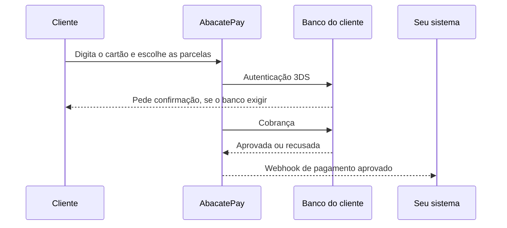
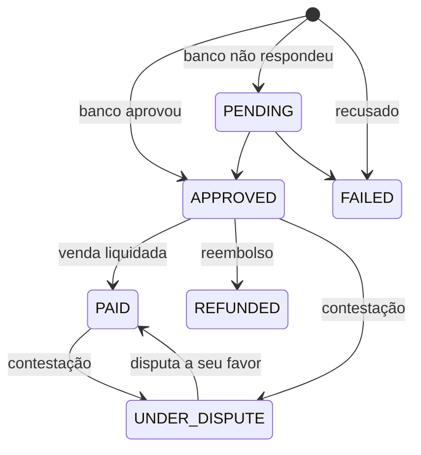
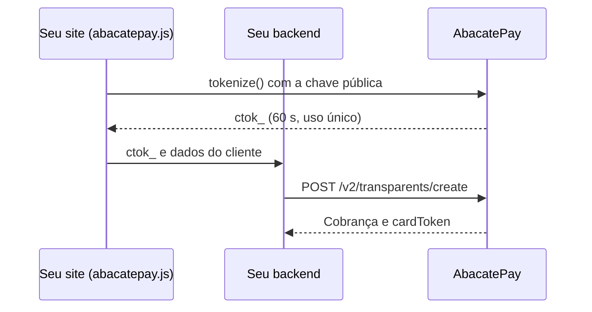

O cliente paga com cartão de crédito Visa ou Mastercard na página de pagamento da AbacatePay (o checkout) ou num formulário dentro do seu site (o checkout transparente). O valor entra no seu saldo no prazo de recebimento que você escolheu.

## Quando usar

| Você quer | Use |
|---|---|
| Mandar o cliente para uma página de pagamento pronta | [Checkout](/pages/cobrar/checkout) ou [link de pagamento](/pages/cobrar/link-de-pagamento), com cartão nos métodos |
| O formulário de cartão dentro do seu site | [Checkout transparente](/pages/cobrar/checkout-transparente), com o abacatepay.js |
| Dividir a compra em parcelas | [Parcelamento no cartão](/pages/pagamentos/parcelamento) |
| Que o cliente pague a taxa do cartão | [Repasse de taxa](/pages/pagamentos/repasse-de-taxa) |
| Cobrar de novo o mesmo cartão, sem o cliente digitar nada | [One click buy](/pages/pagamentos/one-click-buy) |
| Pagamento pelo celular, com o cartão salvo na carteira | [Apple Pay e Google Pay](/pages/pagamentos/apple-pay-google-pay) |
| Cobrar automaticamente a cada ciclo | [Assinaturas](/pages/cobrar/assinaturas) |

## Como ativar o cartão na sua conta

Para receber no cartão em produção, a sua conta precisa ter o cartão ativado. Quando o cartão está disponível para você, aparece no topo do dashboard a faixa **Você tem acesso a cartão no checkout**, com o botão **Ativar agora**.

<Steps>
  <Step title="Comece a ativação">
    Clique em **Ativar agora** e depois em **Ativar Cartão**.
  </Step>
  <Step title="Escolha o prazo de recebimento">
    Escolha quando quer receber as vendas no crédito e clique em **Continuar**. Veja [Prazo de recebimento](#prazo-de-recebimento).
  </Step>
  <Step title="Escolha o nome na fatura">
    Escreva o nome que o cliente vai ler na fatura do cartão. Veja [Nome na fatura](#nome-na-fatura).
  </Step>
  <Step title="Pronto">
    Com **Cartão ativado!**, seus clientes já podem pagar no cartão. Se aparecer **Recebimento configurado**, a adquirente ainda está analisando a sua conta: o cartão entra no checkout quando a análise terminar, sem nada a fazer.
  </Step>
</Steps>

Se a adquirente pedir mais informações, o dashboard mostra o aviso **Falta pouco pra liberar o cartão**. Clique em **Ver o que falta** e envie o que ela pediu.

A ativação libera, de uma vez: cartão, Apple Pay e Google Pay no checkout, parcelamento em até 12x, assinaturas no cartão e o checkout transparente pela API. Se a faixa não aparece e o cartão não está entre os métodos de pagamento, fale com o suporte.

## Como funciona o pagamento com cartão



### Bandeiras aceitas

A AbacatePay aceita cartões de crédito **Visa** e **Mastercard**. Um cartão de outra bandeira é recusado com a mesma mensagem de qualquer recusa.

### Autenticação 3DS

Toda compra com o cliente presente passa pela autenticação 3DS do banco emissor, no checkout e no checkout transparente. Quando o banco pede, o cliente confirma a compra (com um código por SMS ou uma aprovação no app do banco) numa janela que abre por cima da página e fecha sozinha. Você não precisa fazer nada.

A cobrança de um cartão salvo, sem o cliente presente, não passa pelo 3DS. Veja [One click buy](/pages/pagamentos/one-click-buy).

### Cartão recusado

Quando o banco recusa, a resposta é a mesma para qualquer motivo: `Não foi possível processar o pagamento com este cartão`. É de propósito: detalhar o motivo ajudaria quem testa cartões roubados. Peça ao cliente para conferir os dados ou usar outro cartão.

### Status do pagamento

Cada pagamento de cartão tem um `id` `card_...` e um destes status:



| `status` | O que significa | O que fazer |
|---|---|---|
| `APPROVED` | O banco aprovou | Libere o pedido |
| `PENDING` | O banco ainda não respondeu | Espere o webhook de pagamento aprovado |
| `PAID` | A adquirente liquidou a venda | Nada. Acontece sozinho depois da aprovação, sem novo webhook |
| `FAILED` | Recusado | Peça outro cartão |
| `REFUNDED` | Reembolsado | Nada |
| `UNDER_DISPUTE` | O titular contestou a compra no banco (chargeback) | Acompanhe em **Financeiro → Disputas** |

No checkout e no link de pagamento, a cobrança (`bill_...`) passa a `PAID` quando o cartão é aprovado. Os status da cobrança estão em [Checkout](/pages/cobrar/checkout).

Para devolver o dinheiro ao cliente, veja [Reembolsos](/pages/vender/reembolsos). As regras do cartão mudam depois que a venda é liquidada (`PAID`).

## Prazo de recebimento e nome na fatura

Depois da ativação, a página **Financeiro → Cartão** mostra como o seu cliente vê você na fatura e quando você recebe.

### Prazo de recebimento

É quando o dinheiro das vendas no crédito cai na sua conta. Você escolhe na ativação e pode trocar depois:

| Opção | Prazo |
|---|---|
| Em 1 dia útil | D+1 |
| Em 7 dias | D+7 |
| Em 15 dias | D+15 |
| Em 30 dias | D+30 |

A taxa muda com o prazo, e a tela mostra a taxa de cada opção. Prazos marcados como **Em breve** ainda não estão abertos.

Para trocar, escolha outro prazo e clique em **Salvar prazo**. Depois de uma troca, a próxima só fica liberada em 30 dias; a escolha feita na ativação não conta.

### Nome na fatura

É o que o cliente lê na fatura do cartão. Um nome que ele reconhece evita contestação.

- Até 15 caracteres. O banco imprime em maiúsculas, sem acento e sem espaço.
- Antes do nome vem a identificação fixa da adquirente.
- A tela mostra uma prévia de como fica na fatura.

Clique em **Salvar nome**. O nome novo vale para as próximas vendas; o que já foi cobrado continua com o nome de antes.

## Pelo dashboard

1. Vá em **Sua Loja → Cobranças** e clique em **Criar cobrança**. Para um link de pagamento, vá em **Sua Loja → Links de pagamento** e clique em **Criar link de pagamento**.
2. Em **Métodos de pagamento**, selecione **Cartão**.
3. Se quiser, escolha o máximo em **Parcelas no cartão** e ligue **Repassar a taxa do cartão ao cliente**.
4. Salve e mande o link para o cliente.

No checkout, o cliente escolhe **Crédito**, digita o cartão, escolhe as parcelas e clica em **Concluir pagamento**. Acompanhe as vendas em **Sua Loja → Cobranças**, ou dentro do link, em **Sua Loja → Links de pagamento**.

## Pela API

### No checkout

Inclua `CARD` em `methods` ao [criar o checkout](/pages/payment/create). Sem `methods`, o checkout já oferece Pix e cartão.

```json
{
  "items": [{ "id": "prod_abc123xyz", "quantity": 1 }],
  "methods": ["PIX", "CARD"],
  "card": { "maxInstallments": 6 }
}
```

O objeto `card` é opcional: ele define as [parcelas](/pages/pagamentos/parcelamento) e o [repasse de taxa](/pages/pagamentos/repasse-de-taxa). Para um link de pagamento, mande o mesmo corpo para [Criar link de pagamento](/pages/payment-links/create).

### No checkout transparente

O formulário de cartão fica no seu site, e o número do cartão nunca passa pelo seu servidor:



1. O abacatepay.js, o script de cartão da AbacatePay, mostra o formulário e devolve o token `ctok_`.
2. O seu backend cria a cobrança em [Criar cobrança Cartão](/pages/transparents/card), com o `ctok_` e a chave de API.
3. A resposta traz o status e o `cardToken`, que cobra o mesmo cartão depois, pelo [One click buy](/pages/pagamentos/one-click-buy).

Para consultar uma cobrança de cartão, use `GET /v2/transparents/get?id=card_...` (permissão `TRANSPARENT:READ`) ou a [listagem](/pages/transparents/list) com `method=CARD`. A rota `GET /v2/transparents/check` é só para Pix.

O checkout transparente de cartão precisa estar liberado na conta, também no Modo Teste. Sem a liberação, a API responde `CARD_TRANSPARENTS is not available for this store`.

O passo a passo completo, com página e backend prontos para copiar, está em [Checkout transparente com cartão](/pages/cobrar/checkout-transparente-cartao).

#### Chave pública e chave de API

O checkout transparente usa duas chaves:

| | Chave pública | Chave de API |
|---|---|---|
| Formato | `pk_...` | `abc_dev_...` ou `abc_prod_...` |
| Onde usar | No navegador, em `AbacatePay.create({ publicKey })` | Só no backend, no header `Authorization` |
| Pode aparecer no código do site? | Sim | Nunca |
| Mostra o formulário e gera o `ctok_` | Sim | Não |
| Cria e consulta cobranças | Não | Sim, conforme as [permissões](/pages/comecar/chaves-de-api) |
| Onde copiar | **Integração → Checkout próprio** | **Integração → API** |

Não há risco em expor a chave pública: quem copiar a sua `pk_` consegue no máximo gerar tokens, e um token só vira cobrança quando o seu backend chama a API com a sua chave de API.

Para copiar a chave pública, abra **Integração → Checkout próprio** e, em **Sua chave pública**, clique no olho para revelar ou no ícone de copiar. A página mostra a chave do ambiente em que o dashboard está, com o rótulo **Teste (DEV)** ou **Produção**.

Cada loja tem uma chave pública de teste e uma de produção, e as duas começam com `pk_`: pelo formato não dá para saber o ambiente. Use sempre a chave pública e a chave de API do mesmo ambiente. Um token gerado com a chave pública de teste não pode ser cobrado com a chave de API de produção, e vice-versa: a cobrança falha com `Invalid or expired card token`.

O ambiente vem da chave: se o seu site usa a chave pública de produção, o formulário é o de produção, mesmo com o Modo Teste ligado no dashboard. Para trocar de teste para produção sem mexer no código, guarde a chave pública numa variável de ambiente do backend e entregue ao navegador junto com o valor do pedido. Assim as duas chaves mudam juntas.

#### abacatepay.js

O abacatepay.js é o script que coloca o formulário de cartão no seu site:

- desenha os campos do cartão num iframe seguro, e o número e o CVV nunca passam pelo seu código;
- faz a autenticação 3DS quando o banco exige, numa janela com o título **Autenticação do cartão** que abre e fecha sozinha;
- devolve o token `ctok_`, que o seu backend usa para criar a cobrança.

Uso básico:

```html
<script src="https://abacatepay.com/abacatepay.js"></script>

<div id="cartao"></div>
<button id="pagar" disabled>Pagar</button>

<script type="module">
  // type="module" permite usar await fora de uma função
  const botao = document.getElementById('pagar')

  const checkout = AbacatePay.create({
    publicKey: 'pk_sua_chave_publica',
    amount: 10000, // centavos: o mesmo valor que o backend vai cobrar
    onCardChange: ({ canTokenize }) => {
      botao.disabled = !canTokenize
    },
  })

  await checkout.mount('#cartao')

  botao.addEventListener('click', async () => {
    botao.disabled = true
    const { token } = await checkout.tokenize({
      name: 'Maria Silva',
      email: 'maria@exemplo.com',
      taxId: '529.982.247-25',
    })
    // envie o token para o seu backend em até 60 segundos
  })
</script>
```

Se o cliente não confirmar o 3DS, o `tokenize()` rejeita com o erro `THREE_DS_FAILED`. Opções, métodos, eventos e erros do script estão na [referência do abacatepay.js](/pages/transparents/abacatepay-js).

<Accordion title="Exemplo em React">
  Coloque a tag do script no `index.html` (no Next.js, use `<Script src="https://abacatepay.com/abacatepay.js" strategy="beforeInteractive" />` no layout raiz). O componente cobra por um backend com a rota `POST /pagar`, como o do [tutorial](/pages/cobrar/checkout-transparente-cartao):

  ```jsx PagamentoCartao.jsx
  'use client'

  import { useEffect, useRef, useState } from 'react'

  export function PagamentoCartao({ publicKey, amount, cliente }) {
    const area = useRef(null)
    const checkout = useRef(null)
    const [podePagar, setPodePagar] = useState(false)
    const [mensagem, setMensagem] = useState('')

    useEffect(() => {
      let cancelado = false
      const host = area.current.appendChild(document.createElement('div')) // um por montagem (StrictMode)
      const instancia = window.AbacatePay.create({
        publicKey,
        amount,
        onCardChange: ({ canTokenize }) => setPodePagar(canTokenize),
      })
      checkout.current = instancia
      instancia.mount(host).catch((error) => !cancelado && setMensagem(error.message))
      return () => {
        cancelado = true
        instancia.destroy()
        host.remove()
      }
    }, [publicKey, amount])

    async function pagar() {
      setPodePagar(false) // evita cobrança em dobro
      try {
        const { token } = await checkout.current.tokenize(cliente)
        const resposta = await fetch('/pagar', {
          method: 'POST',
          headers: { 'Content-Type': 'application/json' },
          body: JSON.stringify({ token, cliente }),
        })
        const { success, status, error } = await resposta.json()
        setMensagem(success ? `Pagamento recebido (${status})` : error)
        if (success) return
      } catch (error) {
        setMensagem(error.message)
      }
      setPodePagar(checkout.current.canTokenize)
    }

    return (
      <div>
        <div ref={area} />
        <button type="button" onClick={pagar} disabled={!podePagar}>Pagar</button>
        {mensagem && <p role="alert">{mensagem}</p>}
      </div>
    )
  }
  ```

  Uso:

  ```jsx
  <PagamentoCartao
    publicKey="pk_sua_chave_publica"
    amount={10000}
    cliente={{ name: 'Maria Silva', email: 'maria@exemplo.com', taxId: '529.982.247-25', cellphone: '11999999999' }}
  />
  ```
</Accordion>

## Notificações

| Evento | Quando dispara |
|---|---|
| [`checkout.completed`](/pages/webhooks/events/checkout) | O cartão foi aprovado num checkout ou link de pagamento |
| [`transparent.completed`](/pages/webhooks/events/transparent) | O cartão foi aprovado no checkout transparente (`APPROVED`) |
| `checkout.disputed` e `transparent.disputed` | O titular contestou a compra |
| `checkout.refunded` e `transparent.refunded` | O pagamento foi reembolsado |

No pagamento com cartão, `payerInformation.method` vem como `"CARD"`, com a bandeira e o final do cartão em `payerInformation.CARD` (`brand` e `number`). A passagem de `APPROVED` para `PAID` não gera webhook. O `cardToken` não vem no webhook: guarde o que volta na resposta da cobrança. Veja como configurar em [Webhooks](/pages/notificacoes/webhooks).

## Testar no Modo Teste

No [Modo Teste](/pages/comecar/modo-teste), o cartão funciona no checkout mesmo antes da ativação, e nada é cobrado de verdade. Use os [cartões de teste](/pages/comecar/modo-teste#cartões-de-teste): o resultado depende dos 4 últimos dígitos.

Com a chave pública de teste, o abacatepay.js mostra um formulário de teste, já preenchido com o cartão `4242 4242 4242 4242` e sem 3DS. O `cardToken` das cobranças de teste é `dev_card_` mais os 4 últimos dígitos do cartão.

## Perguntas frequentes

<AccordionGroup>
  <Accordion title="Quais bandeiras de cartão a AbacatePay aceita?">
    Visa e Mastercard, no crédito. Um cartão de outra bandeira é recusado com a mensagem genérica de recusa.
  </Accordion>
  <Accordion title="Por que o cliente não vê o motivo da recusa?">
    A mensagem é a mesma para qualquer recusa, de propósito, para não ajudar quem testa cartões roubados. Peça para o cliente conferir os dados ou usar outro cartão.
  </Accordion>
  <Accordion title="O pagamento veio com status PENDING. O que faço?">
    O banco ainda não respondeu. Não libere o pedido nem tente cobrar de novo: espere o webhook de pagamento aprovado.
  </Accordion>
  <Accordion title="Quando recebo o dinheiro das vendas no cartão?">
    No prazo de recebimento que você escolheu (D+1, D+7, D+15 ou D+30). Ele fica em **Financeiro → Cartão**.
  </Accordion>
  <Accordion title="Posso mudar o nome que aparece na fatura do cliente?">
    Pode, em **Financeiro → Cartão → Nome na fatura**. O nome novo vale para as próximas vendas.
  </Accordion>
  <Accordion title="Posso reembolsar uma venda no cartão?">
    Pode. As regras, inclusive para a venda já liquidada, estão em [Reembolsos](/pages/vender/reembolsos).
  </Accordion>
  <Accordion title="Posso deixar a chave pública no código do meu site?">
    Pode. Ela foi feita para isso. O que nunca pode ir para o navegador é a chave de API.
  </Accordion>
  <Accordion title="Preciso de uma chave pública por site ou por domínio?">
    Não. É uma chave por ambiente da loja (teste e produção), e ela funciona em qualquer domínio.
  </Accordion>
  <Accordion title="A chave pública expira?">
    Não. Ela vale até ser trocada. Se precisar de uma chave nova, fale com o suporte.
  </Accordion>
  <Accordion title="Posso usar a chave pública para chamar a API?">
    Não. As rotas da API só aceitam a chave de API. A chave pública serve apenas para o abacatepay.js.
  </Accordion>
</AccordionGroup>
