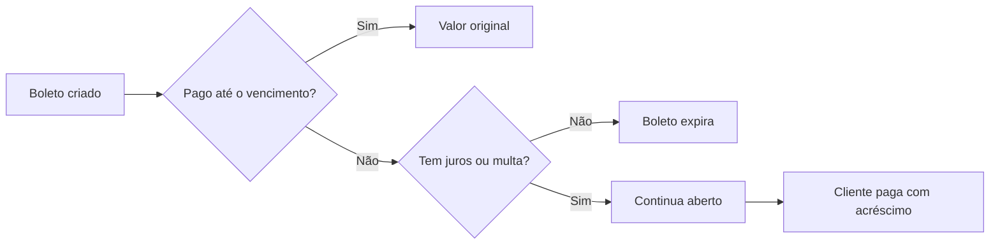

Juros e multa são os acréscimos que o cliente paga quando quita o [boleto](/pages/pagamentos/boleto) depois do vencimento. Na AbacatePay, você define os dois ao criar o boleto, e com eles o boleto continua aceitando pagamento depois da data de vencimento.

## Quando usar

- **Faturas, mensalidades e contas com data certa**, em que o atraso tem custo para você.
- **Quando quer aceitar pagamento atrasado.** Sem juros nem multa, o boleto expira no vencimento e não aceita mais pagamento.

Juros e multa existem só no boleto. Pix e cartão não têm vencimento.

## Como funcionam os juros e a multa



- **Juros (`interest`):** percentual **ao mês**, cobrado pro rata die, ou seja, proporcional aos dias de atraso. Cada dia de atraso cobra 1/30 da taxa mensal.
- **Multa (`fine`):** cobrada **uma única vez** depois do vencimento. Pode ser um percentual do valor do boleto (`PERCENTAGE`) ou um valor fixo (`FIXED`).
- Os dois são independentes: envie só `interest`, só `fine`, os dois ou nenhum. Valor `0` ou campo ausente quer dizer sem acréscimo.
- Com juros ou multa, o boleto continua aberto depois do vencimento.

### Unidades

Os percentuais vão em **centésimos de percentual**. Os valores em reais vão em **centavos**, como no resto da API.

| Campo | Unidade | Exemplo |
|---|---|---|
| `interest.value` | Centésimos de percentual, ao mês | `100` = 1% ao mês; `250` = 2,5% ao mês |
| `fine.value` com `fine.type: "PERCENTAGE"` | Centésimos de percentual | `200` = 2% |
| `fine.value` com `fine.type: "FIXED"` | Centavos | `1000` = R$ 10,00 |

### Exemplos de cálculo

Boleto de R$ 200,00, com juros de 3% ao mês (`interest.value: 300`) e multa de 2% (`fine.value: 200`, `PERCENTAGE`), pago 15 dias depois do vencimento:

| | Conta | Valor |
|---|---|---|
| Multa | 2% de R$ 200,00 | R$ 4,00 |
| Juros | 3% ÷ 30 = 0,1% ao dia × 15 dias = 1,5% de R$ 200,00 | R$ 3,00 |
| **Total** | | **R$ 207,00** |

Com multa fixa de R$ 10,00 (`fine.value: 1000`, `FIXED`) e sem juros, o mesmo boleto pago com atraso sai por R$ 210,00, qualquer que seja o número de dias.

O banco calcula o valor final no dia do pagamento.

### Regras

- Só com boleto. No checkout e no link de pagamento, `interest` ou `fine` sem `"BOLETO"` em `methods` dá **400** com `interest/fine requires BOLETO in methods`. Isso vale também quando `methods` é omitido, porque o padrão é Pix e cartão.
- No checkout e no link, valores negativos são recusados com `interest.value must be an integer >= 0` ou `fine.value must be an integer >= 0`.
- `fine.type` é obrigatório junto com `fine.value` e aceita `PERCENTAGE` ou `FIXED`.
- Juros e multa não mudam depois que o boleto é criado.

## Pelo dashboard

Juros e multa são configurados só pela API. No boleto gerado, o cliente vê a multa e os juros antes de pagar.

## Pela API

### No checkout e no link de pagamento

Envie `interest` e `fine` em [Criar um checkout](/pages/payment/create) ou [Criar um link de pagamento](/pages/payment-links/create), com `"BOLETO"` em `methods`:

```json
{
  "methods": ["BOLETO"],
  "dueDate": "2026-12-15",
  "items": [{ "id": "prod_abc123xyz", "quantity": 1 }],
  "interest": { "value": 100 },
  "fine": { "value": 200, "type": "PERCENTAGE" }
}
```

A resposta e a [consulta do checkout](/pages/payment/one) trazem `interest`, `fine` e `dueDate`. Os campos ficam `null` quando não foram definidos.

### No checkout transparente

Envie os mesmos objetos em `data`, com `method: "BOLETO"`. Veja [Criar cobrança Boleto](/pages/transparents/boleto).

```json
{
  "method": "BOLETO",
  "data": {
    "amount": 5000,
    "dueDate": "2026-12-15",
    "customer": {
      "name": "João Silva",
      "taxId": "111.444.777-35"
    },
    "interest": { "value": 100 },
    "fine": { "value": 1000, "type": "FIXED" }
  }
}
```

A resposta, `GET /v2/transparents/get` e [Listar cobranças](/pages/transparents/list) trazem `interest` e `fine` do boleto, ou `null` quando não foram definidos.

## Notificações

O boleto pago com atraso dispara os mesmos eventos do boleto pago em dia: `checkout.completed` no checkout e no link, e `transparent.completed` no checkout transparente. Veja [Boleto](/pages/pagamentos/boleto#notificações).

## Testar no Modo Teste

Crie o boleto com `interest` e `fine` e confira os campos na resposta. A simulação de pagamento paga o valor original, sem acréscimo, porque no Modo Teste não há atraso de verdade.

## Perguntas frequentes

<AccordionGroup>
  <Accordion title="Os juros são ao dia ou ao mês?">
    Ao mês. `interest.value` é sempre a taxa mensal, e o valor cobrado é proporcional aos dias de atraso.
  </Accordion>

  <Accordion title="Como escrevo 1% de juros e 2% de multa?">
    `"interest": { "value": 100 }` e `"fine": { "value": 200, "type": "PERCENTAGE" }`. Os percentuais vão em centésimos: `100` = 1%.
  </Accordion>

  <Accordion title="Posso cobrar juros e multa no Pix ou no cartão?">
    Não. Os campos só valem com boleto. Sem `"BOLETO"` em `methods`, a API responde 400.
  </Accordion>

  <Accordion title="O boleto com juros continua valendo depois do vencimento?">
    Sim. Com juros ou multa, o boleto continua aberto depois do vencimento, e o cliente paga com o acréscimo. Sem eles, o boleto expira.
  </Accordion>

  <Accordion title="Posso configurar juros e multa pelo dashboard?">
    Não. Use a API: `interest` e `fine` em `/checkouts/create`, `/payment-links/create` ou `/transparents/create`.
  </Accordion>
</AccordionGroup>
