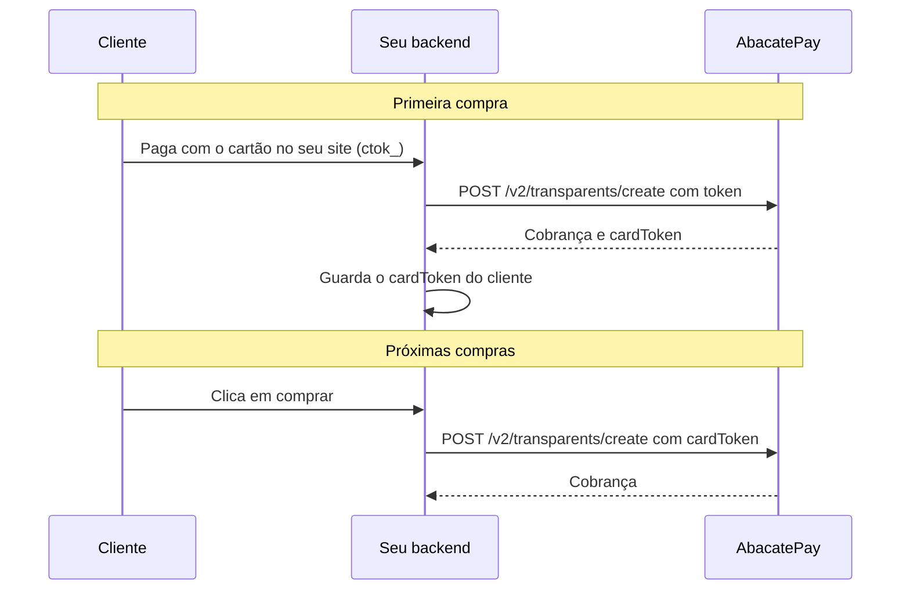

One click buy é a compra com um clique: depois da primeira compra no cartão, você cobra o mesmo cartão de novo direto do seu backend, sem formulário e sem o cliente presente. Serve para recompra, cobrança por uso e mensalidade com valor que muda.

## Quando usar

| Você quer | Use |
|---|---|
| Recompra com um clique, cobrança por uso ou valor diferente a cada vez, quando você decidir | One click buy, com o `cardToken` |
| Que a AbacatePay cobre sozinha a cada ciclo, sempre o mesmo valor | [Assinaturas](/pages/cobrar/assinaturas) |
| Oferecer um produto a mais logo depois do pagamento no checkout | [Upsell](/pages/vender/upsell) |

## Como funciona o one click buy



Toda cobrança de cartão do [checkout transparente](/pages/pagamentos/cartao-de-credito#no-checkout-transparente) devolve um `cardToken`. Com ele, a próxima cobrança é a mesma chamada da primeira, com `cardToken` no lugar de `token`:

| | `token` (`ctok_...`) | `cardToken` |
|---|---|---|
| De onde vem | Do `tokenize()` do abacatepay.js, no navegador | Da resposta da primeira cobrança (`data.cardToken`) |
| Validade | 60 segundos e uma cobrança | Sem prazo, quantas cobranças quiser |
| Valor | Igual ao do `AbacatePay.create` | Qualquer valor a partir de R$ 1,00 (`100`) |
| Cliente presente? | Sim | Não |
| Autenticação 3DS | Sim | Não |

- **Sem 3DS e sem o cliente presente.** A cobrança é feita pela sua loja, e o cliente não confirma nada no banco.
- **Qualquer valor**, a partir de R$ 1,00. Também dá para parcelar com `installmentCount`, com no mínimo R$ 10,00 por parcela. Veja [Parcelamento no cartão](/pages/pagamentos/parcelamento).
- **O `cardToken` vem na resposta da cobrança** e na consulta `GET /v2/transparents/get`. Ele não vem no webhook.
- **Vale só na sua loja e no mesmo ambiente.** Um `cardToken` do Modo Teste não funciona com a chave de produção.

## Pelo dashboard

O one click buy é só pela API. No checkout da AbacatePay, o [upsell](/pages/vender/upsell) faz a compra com um clique sozinho: se o cliente pagou no cartão, a oferta da tela de sucesso é cobrada no mesmo cartão, à vista, quando ele clica em **Aproveitar a oferta**, sem digitar nada.

## Pela API

<Steps>
  <Step title="Guarde o cardToken">
    Na resposta da primeira cobrança em [Criar cobrança Cartão](/pages/transparents/card), grave no seu banco, junto do cliente:

    - `cardToken`, exatamente como veio. Em produção é um identificador sem formato fixo, de até 200 caracteres;
    - `brand` e `lastFour`, para mostrar "Visa final 4242" ao cliente;
    - `name`, `email`, `taxId` e `cellphone` do cliente, porque a próxima cobrança também exige `customer`.

    Só salve o cartão com autorização do cliente, por exemplo num campo "Salvar este cartão", desmarcado por padrão. O `cardToken` fica no backend: nunca mande para o navegador.
  </Step>

  <Step title="Cobre o cartão salvo">
    É a mesma rota da primeira compra, com `cardToken` no lugar de `token`:

    <CodeGroup>
    ```bash cURL
    curl -X POST https://api.abacatepay.com/v2/transparents/create \
      -H "Authorization: Bearer $ABACATEPAY_API_KEY" \
      -H "Content-Type: application/json" \
      -d '{
        "method": "CARD",
        "data": {
          "amount": 4700,
          "cardToken": "dev_card_4242",
          "customer": {
            "name": "Maria Silva",
            "email": "maria@exemplo.com",
            "taxId": "529.982.247-25",
            "cellphone": "11999999999"
          }
        }
      }'
    ```

    ```js Node.js
    const resposta = await fetch('https://api.abacatepay.com/v2/transparents/create', {
      method: 'POST',
      headers: {
        Authorization: `Bearer ${process.env.ABACATEPAY_API_KEY}`,
        'Content-Type': 'application/json',
      },
      body: JSON.stringify({
        method: 'CARD',
        data: {
          amount: 4700,
          cardToken: 'dev_card_4242', // o cardToken salvo
          customer: { name: 'Maria Silva', email: 'maria@exemplo.com', taxId: '529.982.247-25', cellphone: '11999999999' },
        },
      }),
    })

    const { success, data, error } = await resposta.json()
    console.log(success ? data.status : error)
    ```

    ```python Python
    import os
    import requests  # pip install requests

    resposta = requests.post(
        "https://api.abacatepay.com/v2/transparents/create",
        headers={"Authorization": f"Bearer {os.environ['ABACATEPAY_API_KEY']}"},
        json={
            "method": "CARD",
            "data": {
                "amount": 4700,
                "cardToken": "dev_card_4242",  # o cardToken salvo
                "customer": {"name": "Maria Silva", "email": "maria@exemplo.com", "taxId": "529.982.247-25", "cellphone": "11999999999"},
            },
        },
        timeout=60,
    )

    resultado = resposta.json()
    print(resultado["data"]["status"] if resultado["success"] else resultado["error"])
    ```
    </CodeGroup>

    Libere o pedido com `status` `APPROVED`. Se vier `PENDING`, espere o webhook. Os status estão em [Cartão de crédito](/pages/pagamentos/cartao-de-credito#status-do-pagamento).
  </Step>

  <Step title="Trate as recusas">
    Um cartão salvo pode ser recusado depois: venceu, foi bloqueado ou está sem limite. A API responde `Não foi possível processar o pagamento com este cartão`, a mesma mensagem para qualquer motivo. Peça ao cliente para cadastrar o cartão de novo pelo formulário e troque o `cardToken` salvo pelo novo. Não insista no mesmo cartão várias vezes seguidas.

    Se a API responder `Card token not found`, o `cardToken` não existe nesta loja ou neste ambiente.
  </Step>

  <Step title="Não repita uma cobrança que deu timeout">
    Timeout ou erro de rede não é recusa: a cobrança pode ter sido aprovada mesmo sem resposta. Repetir na hora pode cobrar o cliente duas vezes. Confira na [listagem](/pages/transparents/list) ou espere o webhook antes de tentar de novo.
  </Step>
</Steps>

A API aceita qualquer `cardToken` da sua loja. Busque sempre o do cliente certo: a ligação entre cliente e cartão é sua.

## Notificações

Quando a cobrança é aprovada, chega o webhook [`transparent.completed`](/pages/webhooks/events/transparent), como na primeira compra. O `cardToken` não vem no webhook. Veja [Webhooks](/pages/notificacoes/webhooks).

## Testar no Modo Teste

No [Modo Teste](/pages/comecar/modo-teste), faça uma primeira compra com o cartão de teste `4242 4242 4242 4242`: o `cardToken` volta como `dev_card_4242`. Use esse `cardToken` com a sua chave de API do Modo Teste para cobrar de novo. Nada é cobrado de verdade.

## Perguntas frequentes

<AccordionGroup>
  <Accordion title="O cliente precisa confirmar no banco (3DS) de novo?">
    Não. A cobrança com `cardToken` é feita pela sua loja, sem o cliente presente.
  </Accordion>
  <Accordion title="O cardToken expira?">
    Não tem prazo. Ele para de funcionar quando o cartão vence, é cancelado ou é trocado pelo banco.
  </Accordion>
  <Accordion title="Existe valor mínimo?">
    O mínimo é R$ 1,00 (`100`). O valor não precisa ser igual ao da primeira compra.
  </Accordion>
  <Accordion title="O cliente digitou o mesmo cartão de novo. Qual cardToken eu uso?">
    Sempre o da resposta mais recente.
  </Accordion>
  <Accordion title="Consigo o cardToken de um cartão pago no checkout da AbacatePay?">
    Não. O `cardToken` vem nas cobranças do checkout transparente. No checkout, use o [upsell](/pages/vender/upsell) para vender de novo com um clique logo depois do pagamento.
  </Accordion>
  <Accordion title="Quero que a AbacatePay cobre todo mês sozinha. Uso o cardToken?">
    Com o `cardToken`, quem decide quando cobrar é você. Para que a cobrança recorrente aconteça sozinha, use [Assinaturas](/pages/cobrar/assinaturas).
  </Accordion>
</AccordionGroup>
