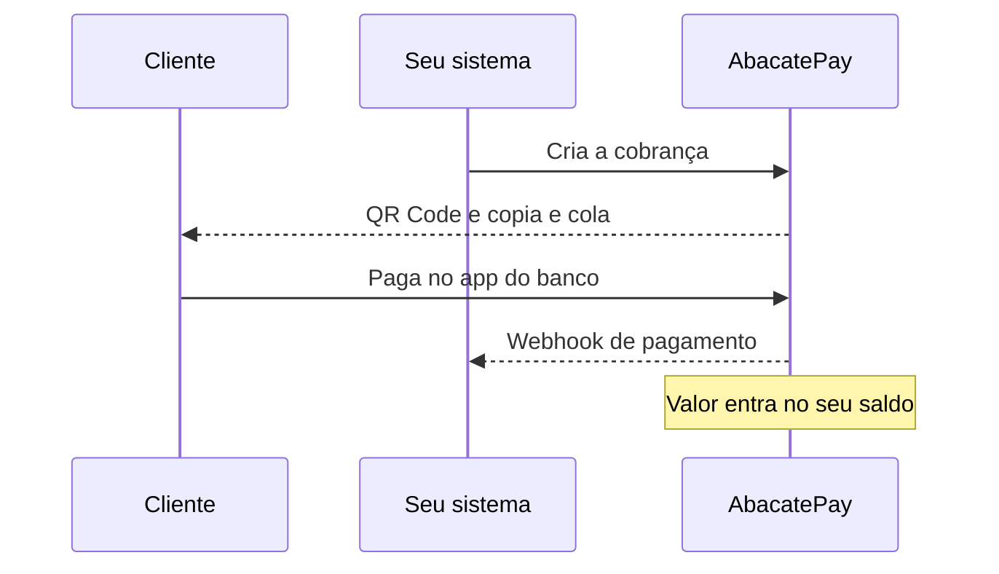
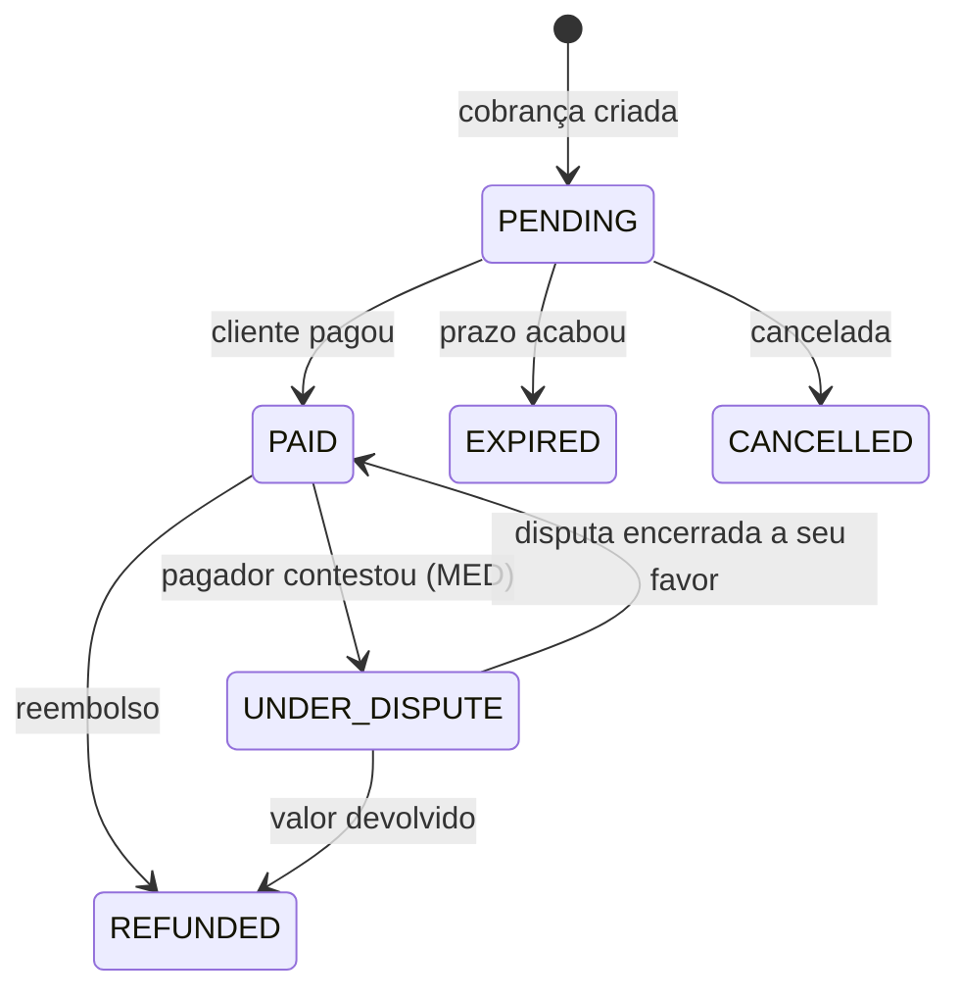

import { Video } from '/snippets/video.jsx'

O Pix é o pagamento instantâneo do Banco Central: funciona 24 horas por dia e confirma em segundos. Na AbacatePay, cada cobrança Pix tem um QR Code e um código copia e cola próprios, e o valor entra no seu saldo assim que o cliente paga.

<Video id="https://youtu.be/hwsKTG2M5M8" title="Cobrança PIX - AbacatePay" />

O vídeo também está em [Pix](/pages/videos/pix).

## Quando usar o Pix

| | Pix | Cartão de crédito | Boleto |
|---|---|---|---|
| **Confirmação** | Segundos | Segundos | Até 3 dias úteis (pelo Pix do boleto, segundos) |
| **Disponível** | 24 horas, todos os dias | 24 horas, todos os dias | Dias úteis |
| **Parcelamento** | Não | Até 12x | Não |
| **Taxa** | Menor | Maior | Intermediária |
| **Reembolso** | Sim | Sim | Não |

Os valores das taxas estão em [Taxas](/pages/comecar/taxas).

- **Venda de valor baixo ou que precisa de confirmação na hora:** Pix.
- **Venda de valor alto:** cartão, com [parcelamento](/pages/pagamentos/parcelamento).
- **Cliente sem cartão que quer pagar depois:** [boleto](/pages/pagamentos/boleto).
- **Cobrança recorrente por Pix:** [Pix Automático](/pages/cobrar/pix-automatico), em que o cliente autoriza uma vez e as cobranças da assinatura saem sozinhas.
- **Receber numa chave fixa, sem criar cobrança:** [Pix por chave](/pages/dinheiro/chave-pix).

## Como funciona o Pix



O Pix está disponível no [checkout](/pages/cobrar/checkout), no [link de pagamento](/pages/cobrar/link-de-pagamento) e no [checkout transparente](/pages/cobrar/checkout-transparente). No checkout e no link, o QR Code aparece na tela de pagamento da AbacatePay. No checkout transparente, você recebe o QR Code pela API e mostra no seu site.

- **Valor mínimo:** R$ 1,00 (`100` centavos). O banco de quem paga pode ter limites próprios de Pix.
- **QR Code e copia e cola:** o cliente escaneia o QR Code ou cola o código no app do banco. Os dois já trazem o valor, e o cliente não digita nada.
- **Saldo:** o valor, já sem a [taxa](/pages/comecar/taxas), entra no seu saldo na AbacatePay e fica disponível para [saque](/pages/dinheiro/saques).

Na API, o QR Code vem em `brCodeBase64` (imagem PNG em base64, pronta para usar num ``) e o copia e cola em `brCode` (texto, bom para mandar por WhatsApp, e-mail ou SMS).

## Quanto tempo o Pix vale

| Onde | Validade |
|---|---|
| Checkout e link de pagamento | 24 horas a partir do momento em que o cliente escolhe Pix. O checkout continua aberto: se o QR Code expirar, o cliente volta ao checkout e gera outro. |
| Checkout transparente | 24 horas por padrão. Para mudar, envie `expiresIn` em segundos, com no mínimo 300 (5 minutos). |
| Autorização do [Pix Automático](/pages/cobrar/pix-automatico) | 1 hora |

Depois do prazo, a cobrança passa para `EXPIRED` e o QR Code não aceita mais pagamento. A resposta da API traz o momento exato em `expiresAt`.

## Quem pagou

O banco informa à AbacatePay o nome e o CPF/CNPJ de quem fez o Pix. Esses dados chegam em `payerInformation`:

- nos webhooks `checkout.*` e `transparent.*`;
- na consulta do checkout, em [`GET /v2/checkouts/get`](/pages/payment/one), que também traz o banco de origem quando ele é informado.

O CPF/CNPJ vem mascarado. No webhook, `isSameAsCustomer` diz se quem pagou tem o mesmo CPF/CNPJ do cliente da cobrança:

```json
"payerInformation": {
  "method": "PIX",
  "PIX": {
    "name": "Maria Santos",
    "taxId": "529.***.247-**",
    "isSameAsCustomer": true
  }
}
```

Se o checkout não pedir os dados do cliente (flag `skip_customer`, veja [Checkout](/pages/cobrar/checkout)), a cobrança sai sem cliente, e quem pagou chega só por `payerInformation`.

## Exigir o mesmo CPF ou CNPJ do cliente

No checkout transparente, `ensureSameTaxId: true` faz o Pix só ser aceito se quem paga tiver o mesmo CPF/CNPJ de `customer.taxId`. Se outra pessoa tentar pagar o QR Code, o banco recusa o pagamento. Use em cobranças nominais, como mensalidades e faturas.

- Exige `customer` com `taxId`. Sem ele, a API responde `ensureSameTaxId requires a customer with taxId`.
- Vale só para Pix no checkout transparente.
- Nem toda conta tem a trava disponível. Quando não tem, a API responde `ensureSameTaxId is not supported by the current PIX provider`.
- No Modo Teste, a trava não é aplicada.

## Dividir o Pix com subcontas

Com `data.splits`, parte de um Pix do checkout transparente vai para o saldo das suas subcontas quando o cliente paga. As regras estão em [Subcontas e split](/pages/dinheiro/subcontas-e-split).

## Status do Pix



Esses são os status da cobrança Pix do checkout transparente (`pix_char_...`). No checkout e no link, o status do checkout acompanha o pagamento: veja [Checkout](/pages/cobrar/checkout).

O **MED** (Mecanismo Especial de Devolução) é o processo do Banco Central para o pagador contestar um Pix, em caso de fraude ou golpe. Enquanto a contestação está aberta, a cobrança fica `UNDER_DISPUTE`.

## Pelo dashboard

1. Em **Sua Loja → Links de pagamento**, clique em **Criar link de pagamento**. Para uma cobrança avulsa, use **Sua Loja → Cobranças → Criar cobrança**.
2. Em **Métodos de pagamento**, marque **Pix**.
3. Mande o link ao cliente. Ele escolhe Pix e paga com o QR Code ou com o botão **Copiar código PIX**.
4. Acompanhe os pagamentos em **Sua Loja → Cobranças**.

O Pix do checkout transparente só é criado pela API. As cobranças dele aparecem na aba **Checkout Transparente** de **Sua Loja → Cobranças**.

## Pela API

### No checkout e no link de pagamento

Inclua `"PIX"` em `methods`. Se você omitir `methods`, o checkout aceita Pix e cartão. Veja [Criar um checkout](/pages/payment/create) e [Criar um link de pagamento](/pages/payment-links/create).

```json
{
  "methods": ["PIX"],
  "items": [{ "id": "prod_abc123xyz", "quantity": 1 }]
}
```

### No checkout transparente

Chame [`POST /v2/transparents/create`](/pages/transparents/create) com `method: "PIX"`. Só `data.amount` é obrigatório:

```json
{
  "method": "PIX",
  "data": {
    "amount": 10000,
    "description": "Pedido 123",
    "expiresIn": 3600,
    "externalId": "pedido-123",
    "customer": {
      "name": "Daniel Lima",
      "email": "daniel_lima@abacatepay.com",
      "taxId": "111.444.777-35",
      "cellphone": "(11) 4002-8922"
    },
    "metadata": { "pedidoId": "pedido-123" }
  }
}
```

| Campo | Descrição |
|---|---|
| `amount` | Valor em centavos. Mínimo `100` (R$ 1,00). |
| `expiresIn` | Validade em segundos. Padrão de 24 horas, mínimo `300`. |
| `description` | Descrição do Pix, com até 140 caracteres. Emoji e alguns caracteres especiais são recusados. |
| `customer` | Opcional. Se enviar, mande os quatro campos: `name`, `email`, `taxId` e `cellphone`. |
| `ensureSameTaxId` | Exige que quem paga tenha o CPF/CNPJ de `customer.taxId`. |
| `externalId` | Código do pedido no seu sistema. Se já houver uma cobrança Pix pendente com o mesmo `externalId`, a API devolve ela em vez de criar outra. |
| `metadata`, `utm` | Dados seus e da campanha. Veja [UTM e metadados](/pages/vender/utm-e-metadados). |
| `splits` | Partes do Pix para [subcontas](/pages/dinheiro/subcontas-e-split). |

A resposta traz o QR Code, o copia e cola e a validade:

```json
{
  "data": {
    "id": "pix_char_abc123xyz",
    "amount": 10000,
    "status": "PENDING",
    "devMode": false,
    "brCode": "00020101021226950014br.gov.bcb.pix...",
    "brCodeBase64": "data:image/png;base64,iVBORw0KG...",
    "platformFee": 80,
    "receiptUrl": null,
    "createdAt": "2026-11-10T18:38:28.573Z",
    "updatedAt": "2026-11-10T18:38:28.573Z",
    "expiresAt": "2026-11-10T19:38:28.573Z",
    "metadata": { "pedidoId": "pedido-123" }
  },
  "success": true,
  "error": null
}
```

### Consultar o status

Para saber se um Pix do checkout transparente foi pago, use [`GET /v2/transparents/check`](/pages/transparents/check). Ele devolve só `id`, `status` e `expiresAt`, e aceita apenas Pix: com um id de boleto ou de cartão, a resposta é `Pix QR Code not found`. Para ver a cobrança completa, use `GET /v2/transparents/get`.

Prefira os webhooks a consultar a API em intervalos: a confirmação chega assim que o cliente paga.

## Notificações

| Evento | Quando dispara |
|---|---|
| `checkout.completed` | O cliente pagou o Pix de um checkout ou de um link de pagamento. |
| `transparent.completed` | O cliente pagou o Pix do checkout transparente (`status: "PAID"`). |
| `checkout.refunded`, `transparent.refunded` | O Pix foi [reembolsado](/pages/vender/reembolsos). |
| `checkout.disputed`, `transparent.disputed` | O pagador contestou o Pix (MED). |

O conteúdo de cada evento está em [eventos de checkout](/pages/webhooks/events/checkout) e [eventos do checkout transparente](/pages/webhooks/events/transparent). Não há evento de expiração: use `expiresAt` ou consulte o status. Para configurar, veja [Webhooks](/pages/notificacoes/webhooks).

## Testar no Modo Teste

- **Checkout e link de pagamento:** na tela do Pix, clique em **Simular Pagamento**.
- **Checkout transparente:** chame [`POST /v2/transparents/simulate-payment`](/pages/transparents/simulate-payment) com o `id` da cobrança. A simulação existe só para Pix e só no [Modo Teste](/pages/comecar/modo-teste).
- **Expiração:** no Modo Teste, a cobrança expira de verdade no prazo de `expiresIn`, que aceita a partir de 60 segundos. Use um prazo curto para testar o `EXPIRED`.

## Perguntas frequentes

<AccordionGroup>
  <Accordion title="Quanto tempo o QR Code Pix vale?">
    24 horas. No checkout transparente, você muda o prazo com `expiresIn`. O QR Code de autorização do Pix Automático vale 1 hora.
  </Accordion>

  <Accordion title="Qual o valor mínimo de um Pix?">
    R$ 1,00 (`100` centavos). Para boleto, o mínimo é R$ 3,00.
  </Accordion>

  <Accordion title="O dinheiro do Pix cai na hora?">
    Sim. Assim que o cliente paga, o valor entra no seu saldo na AbacatePay. Para mandar para a sua conta bancária, faça um [saque](/pages/dinheiro/saques).
  </Accordion>

  <Accordion title="Como sei que o cliente pagou?">
    Pelo webhook `checkout.completed` ou `transparent.completed`, pelo dashboard em **Sua Loja → Cobranças** ou, no checkout transparente, pela rota `/transparents/check`.
  </Accordion>

  <Accordion title="O cliente pode pagar um QR Code expirado?">
    Não. No checkout e no link, ele volta à tela de pagamento e gera outro QR Code. No checkout transparente, crie uma cobrança nova.
  </Accordion>

  <Accordion title="Posso impedir que outra pessoa pague o Pix?">
    Sim, no checkout transparente. Envie `ensureSameTaxId: true` com o `customer.taxId`. Veja [Exigir o mesmo CPF ou CNPJ do cliente](#exigir-o-mesmo-cpf-ou-cnpj-do-cliente).
  </Accordion>

  <Accordion title="Posso reembolsar um Pix?">
    Sim. O reembolso devolve o valor ao pagador. Veja [Reembolsos](/pages/vender/reembolsos).
  </Accordion>
</AccordionGroup>
