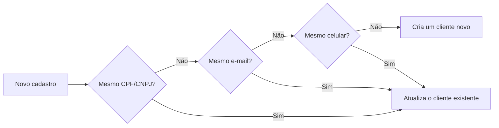

O cadastro de clientes guarda os dados de quem compra de você: nome, e-mail, CPF/CNPJ, celular e endereço. Com o cliente cadastrado, você cria cobranças para ele sem pedir os mesmos dados de novo.

## Por que cadastrar um cliente

- **Checkout mais curto.** Crie o [checkout](/pages/cobrar/checkout) com o `customerId`. Se o cadastro tem nome, e-mail e CPF/CNPJ, o checkout pula a etapa de dados pessoais e cobra esse cliente. Com cadastro incompleto, o cliente preenche os dados no checkout.
- **Endereço já resolvido.** Numa assinatura com Pix, um cadastro completo com endereço completo também pula a etapa de endereço.
- **Histórico por cliente.** No dashboard, cada cliente mostra as cobranças e as assinaturas dele.
- **Portal do cliente.** O link do [Portal do cliente](/pages/vender/portal-do-cliente) é gerado para um cliente e um checkout.

Quem paga informando os dados no checkout também entra na sua lista de clientes, sem você cadastrar.

## Campos do cadastro

Só o `email` é obrigatório. O corpo é plano: os campos ficam na raiz, sem `data`.

| Campo | Obrigatório | Regra |
|---|---|---|
| `email` | Sim | E-mail válido. É guardado em minúsculas. |
| `name` | Não | Nome completo. |
| `taxId` | Não | CPF ou CNPJ válido. Pode vir com ou sem pontuação; é guardado só com os números. |
| `cellphone` | Não | Celular com DDD. É guardado só com os números. |
| `zipCode` | Não | CEP com 8 dígitos. É guardado só com os números. |
| `address` | Não | Se enviar, todos os campos são obrigatórios menos `complement`: `zipCode`, `street`, `number`, `neighborhood`, `city` e `state` (a UF, com 2 letras). |
| `metadata` | Não | Dados extras da sua aplicação. Os valores precisam ser texto: `{ "pedidos": "3" }` é aceito e `{ "pedidos": 3 }` é recusado. Veja [UTM e metadados](/pages/vender/utm-e-metadados). |

## Como a AbacatePay evita clientes duplicados

Ao criar um cliente pela API, a AbacatePay procura um cadastro igual antes de criar outro:



- A busca segue esta ordem: CPF/CNPJ, depois e-mail, depois celular. Clientes excluídos ficam de fora. Se houver mais de um, vale o mais antigo.
- Pelo e-mail ou pelo celular, a busca só aproveita um cadastro sem CPF/CNPJ ou com o mesmo CPF/CNPJ que você enviou. Um cliente com outro CPF/CNPJ nunca é reaproveitado.
- Quando acha, a API devolve o cliente existente, com o mesmo `id`, e atualiza nome, e-mail, celular, CPF/CNPJ, CEP e endereço com o que você enviou. Os campos que você não enviou ficam como estavam.
- O `metadata` do cliente existente não muda.

O cadastro manual pelo dashboard funciona diferente: ele recusa um e-mail ou CPF/CNPJ que já está em outro cliente, para você decidir se edita o que já existe.

## Pelo dashboard

<Steps>
  <Step title="Abra a lista de clientes">
    No menu, vá em **Sua Loja → Clientes**. A lista mostra os clientes que você cadastrou e os que vieram dos pagamentos.
  </Step>

  <Step title="Cadastre um cliente">
    Clique em **Novo cliente** e preencha **Nome completo**, **E-mail** (obrigatório), **CPF ou CNPJ** e **Telefone**. Clique em **Cadastrar**.
  </Step>

  <Step title="Veja os detalhes">
    Clique no cliente para ver o ID, os dados de contato, as cobranças e as assinaturas dele. O ID (`cust_...`) é o `customerId` que você usa na API.
  </Step>
</Steps>

## Pela API

<Steps>
  <Step title="Cadastre o cliente">
    Use uma [chave de API](/pages/comecar/chaves-de-api) com a permissão `CUSTOMER:CREATE`.

    ```bash
    curl -X POST https://api.abacatepay.com/v2/customers/create \
      -H "Authorization: Bearer SUA_CHAVE" \
      -H "Content-Type: application/json" \
      --data '{
        "email": "joao@exemplo.com",
        "name": "João Silva",
        "taxId": "111.444.777-35",
        "cellphone": "(11) 99999-9999"
      }'
    ```

    ```json Resposta
    {
      "data": {
        "id": "cust_abc123xyz",
        "devMode": true,
        "email": "joao@exemplo.com",
        "taxId": "11144477735",
        "country": null,
        "name": "João Silva",
        "cellphone": "11999999999",
        "zipCode": null,
        "address": null,
        "metadata": {}
      },
      "success": true,
      "error": null
    }
    ```
  </Step>

  <Step title="Cobre o cliente">
    Guarde o `data.id` e envie como `customerId` ao criar o [checkout](/pages/payment/create):

    ```json
    {
      "customerId": "cust_abc123xyz",
      "items": [{ "id": "prod_abc123xyz", "quantity": 1 }]
    }
    ```
  </Step>
</Steps>

Para achar um cliente depois, use [Buscar cliente](/pages/client/get) com o `id`, o `email` ou o `taxId`, ou [Listar clientes](/pages/client/list) com filtros.

<CardGroup cols={2}>
  <Card title="Criar um cliente" icon="plus" href="/pages/client/create">
    `POST /customers/create`
  </Card>
  <Card title="Listar clientes" icon="list" href="/pages/client/list">
    `GET /customers/list`
  </Card>
  <Card title="Buscar um cliente" icon="magnifying-glass" href="/pages/client/get">
    `GET /customers/get`
  </Card>
  <Card title="Excluir um cliente" icon="trash" href="/pages/client/delete">
    `POST /customers/delete`
  </Card>
</CardGroup>

## Testar no Modo Teste

Clientes criados no [Modo Teste](/pages/comecar/modo-teste) ficam separados dos de produção. Um `customerId` de teste só funciona com uma chave de teste.

## Perguntas frequentes

<AccordionGroup>
  <Accordion title="O que acontece se eu cadastrar o mesmo cliente duas vezes?">
    Pela API, nada é duplicado: a AbacatePay acha o cadastro pelo CPF/CNPJ, pelo e-mail ou pelo celular, atualiza os dados e devolve o mesmo `id`. Veja [como funciona](#como-a-abacatepay-evita-clientes-duplicados).
  </Accordion>

  <Accordion title="Por que o checkout pediu os dados mesmo com customerId?">
    O cadastro está incompleto. O checkout só pula a etapa de dados pessoais quando o cliente tem nome, e-mail e CPF/CNPJ.
  </Accordion>

  <Accordion title="Como atualizo o metadata de um cliente?">
    Um novo cadastro com o mesmo CPF/CNPJ atualiza os dados pessoais, mas não o `metadata`. O `metadata` fica com o valor do primeiro cadastro.
  </Accordion>

  <Accordion title="Excluir um cliente cancela as cobranças dele?">
    Não. Excluir tira o cliente da lista, mas as cobranças e as assinaturas dele continuam valendo.
  </Accordion>

  <Accordion title="Por que o celular e o CEP voltam sem a máscara?">
    A AbacatePay guarda celular, CEP e CPF/CNPJ só com os números. Você pode enviar com pontuação, mas a resposta sempre traz os dígitos.
  </Accordion>
</AccordionGroup>
