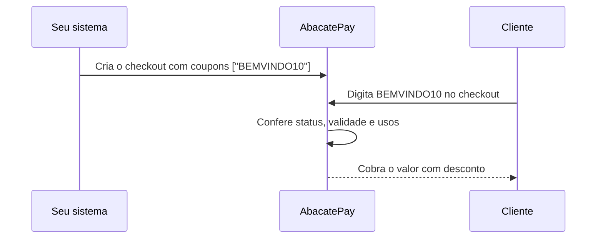
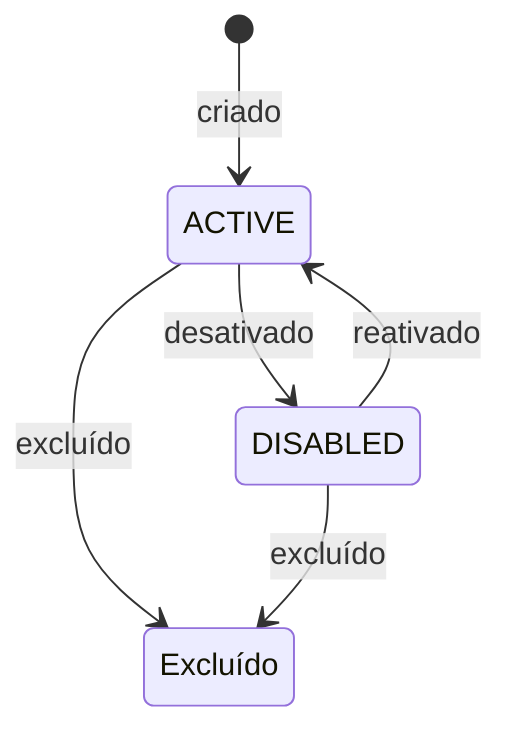

import { Video } from '/snippets/video.jsx'

Um cupom de desconto é um código que o cliente digita no checkout para pagar menos. O desconto pode ser uma porcentagem ou um valor fixo, com limite de usos e prazo de validade.

<Video id="https://youtu.be/uFY4UXXt0Rc" title="Cupons - AbacatePay" />

O vídeo também está em [Cupons](/pages/videos/cupons).

## Desconto percentual ou valor fixo

| `discountKind` | Como ler o `discount` | Exemplo |
|---|---|---|
| `PERCENTAGE` | Centésimos de ponto percentual: `100` = 1%. O máximo é `10000` (100%). | `1000` = 10% de desconto |
| `FIXED` | Centavos. O mínimo é `100` (R$ 1,00). | `2000` = R$ 20,00 de desconto |

Depois do desconto, o total precisa ficar em pelo menos R$ 1,00 ou zerar. Um cupom que deixaria o total entre R$ 0,01 e R$ 0,99 é recusado no checkout.

## Como funciona o cupom no checkout



- **O cupom só vale onde foi aceito.** Envie o código em `coupons` ao criar o [checkout](/pages/payment/create) ou o [link de pagamento](/pages/payment-links/create). Sem `coupons`, o campo de cupom nem aparece para o cliente. Cabem até 50 códigos, e um código que não existe faz a criação falhar com `Could not find coupons <código>`.
- **Um cupom por pagamento.** O cliente aplica um código de cada vez.
- **A validação é na hora de pagar.** O cupom precisa estar `ACTIVE`, dentro da validade e com usos sobrando.
- **Cada pagamento conta um uso.** O `redeemsCount` sobe a cada pagamento feito com o cupom. Num link de pagamento, o cupom vale para cada pagamento do link.

### Limite de usos (`maxRedeems`)

`maxRedeems` é obrigatório. Use `-1` para usos ilimitados ou um inteiro positivo para limitar o total de pagamentos com o cupom. `0` é recusado com `maxRedeems must be -1 or a positive integer`.

### Validade (`startsAt` e `expiresAt`)

As duas datas são opcionais. Sem `startsAt`, o cupom vale assim que é criado. Sem `expiresAt`, ele não expira.

- Envie data e hora em ISO 8601 com o fuso, por exemplo `2026-12-31T23:59:59-03:00`, para o cupom valer até o fim do dia no horário de Brasília.
- As duas datas precisam cair a partir do dia seguinte ao da criação, no horário de Brasília.
- `startsAt` não pode ser depois de `expiresAt`.

### Status: ativo, desativado e excluído



| Ação | O que acontece | Volta atrás? |
|---|---|---|
| **Desativar** ([Alternar status](/pages/coupons/toggle)) | O cupom passa a `DISABLED` e o checkout recusa o código. | Sim: alterne de novo para `ACTIVE`. |
| **Excluir** ([Excluir cupom](/pages/coupons/delete)) | O cupom some da listagem, e os checkouts que aceitavam o código passam a recusá-lo. | Não. |

Para pausar uma promoção, desative. Exclua só o que não vai voltar.

### Código repetido devolve o cupom existente

Criar um cupom com um `code` que já existe na loja não dá erro: a API responde com o cupom existente e ignora os valores novos. Não há edição de cupom. Para mudar o desconto, o limite ou a validade, crie um cupom com outro código.

### Cupom de 100%

Um cupom que zera o valor fecha o checkout sem cobrança:

- No Pix, o cliente vai direto para a tela de sucesso. No cartão, ele informa o cartão, mas nada é cobrado.
- O checkout passa a `REDEEMED`, e o webhook [`checkout.completed`](/pages/webhooks/events/checkout) chega com esse status e `amount: 0`.
- Num link de pagamento, o link continua `ACTIVE` para os próximos clientes.

### Cupom em assinatura

Na [assinatura](/pages/cobrar/assinaturas), o cupom só vale quando ela é cobrada só no cartão e o produto não tem período de teste.

### Sem `metadata`

Cupom não tem `metadata`: o campo não é gravado nem volta na resposta. Para uma descrição interna, use `notes`.

## Pelo dashboard

<Steps>
  <Step title="Crie o cupom">
    Vá em **Sua Loja → Cupons** e clique em **Criar cupom**. Preencha o **Código do Cupom**, o **Tipo de desconto** (**Fixo** ou **Percentual**) e o **Desconto**. No dashboard, o percentual é digitado em porcentagem inteira: `20` = 20%.
  </Step>

  <Step title="Defina limite e validade">
    Marque **Esse cupom tem número máximo de utilizações** para informar o **Número máximo de utilizações**. Marque **Esse cupom tem prazo de validade** para informar a **Data de início** (opcional) e o **Fim**. Clique em **Criar cupom**.
  </Step>

  <Step title="Aceite o cupom na cobrança">
    Ao criar um link em **Sua Loja → Links de pagamento** ou um checkout em **Sua Loja → Cobranças**, escolha os cupons em **Cupons (opcional)**. Num link que já existe, use **Editar cupons** na página do link.
  </Step>
</Steps>

Na lista de cupons, a chave de cada linha ativa ou desativa o cupom, e o menu da linha tem a opção **Excluir**.

## Pela API

<Steps>
  <Step title="Crie o cupom">
    Use uma [chave de API](/pages/comecar/chaves-de-api) com a permissão `COUPON:CREATE`.

    ```bash
    curl -X POST https://api.abacatepay.com/v2/coupons/create \
      -H "Authorization: Bearer SUA_CHAVE" \
      -H "Content-Type: application/json" \
      --data '{
        "code": "BEMVINDO10",
        "discountKind": "PERCENTAGE",
        "discount": 1000,
        "maxRedeems": -1,
        "notes": "Cupom de boas-vindas"
      }'
    ```

    ```json Resposta
    {
      "data": {
        "id": "BEMVINDO10",
        "redeemsCount": 0,
        "maxRedeems": -1,
        "discountKind": "PERCENTAGE",
        "status": "ACTIVE",
        "notes": "Cupom de boas-vindas",
        "discount": 1000,
        "createdAt": "2026-11-10T12:00:00.000Z",
        "updatedAt": "2026-11-10T12:00:00.000Z",
        "devMode": true
      },
      "success": true,
      "error": null
    }
    ```

    O `id` do cupom é o próprio código. É ele que você usa para buscar, alternar o status e excluir.
  </Step>

  <Step title="Aceite o cupom no checkout">
    ```json
    {
      "items": [{ "id": "prod_abc123xyz", "quantity": 1 }],
      "coupons": ["BEMVINDO10"]
    }
    ```
  </Step>
</Steps>

**R$ 20,00 de desconto, 50 usos, válido em dezembro:**

```json
{
  "code": "NATAL20",
  "discountKind": "FIXED",
  "discount": 2000,
  "maxRedeems": 50,
  "startsAt": "2026-12-01T00:00:00-03:00",
  "expiresAt": "2026-12-31T23:59:59-03:00"
}
```

<CardGroup cols={2}>
  <Card title="Criar um cupom" icon="plus" href="/pages/coupons/create">
    `POST /coupons/create`
  </Card>
  <Card title="Listar cupons" icon="list" href="/pages/coupons/list">
    `GET /coupons/list`
  </Card>
  <Card title="Buscar um cupom" icon="magnifying-glass" href="/pages/coupons/get">
    `GET /coupons/get`
  </Card>
  <Card title="Alternar status" icon="toggle-on" href="/pages/coupons/toggle">
    `POST /coupons/toggle`
  </Card>
  <Card title="Excluir um cupom" icon="trash" href="/pages/coupons/delete">
    `POST /coupons/delete`
  </Card>
</CardGroup>

## Mensagens no checkout

Quando o cliente aplica um código que não pode ser usado, o checkout mostra uma destas mensagens:

| Mensagem | Quando acontece |
|---|---|
| `Cannot apply this coupon` | O código não está em `coupons` do checkout. |
| `Coupon is not active` | O cupom foi desativado ou excluído. |
| `Coupon is not valid yet` | Ainda não chegou o `startsAt`. |
| `Coupon has expired` | Já passou o `expiresAt`. |
| `Coupon usage limit reached` | Os usos do `maxRedeems` acabaram. |
| `Price after coupon must be more than 100 or free.` | O total com desconto ficaria entre R$ 0,01 e R$ 0,99. |
| `Coupons cannot be applied to subscription checkouts` | Assinatura que aceita Pix ou boleto. |
| `Coupons cannot be applied to subscription checkouts with a free trial` | Assinatura de produto com período de teste. |

## Testar no Modo Teste

Cupons criados no [Modo Teste](/pages/comecar/modo-teste) só valem em checkouts de teste. Crie o cupom e um checkout com ele em `coupons`, abra o checkout e aplique o código antes de clicar em **Simular Pagamento**.

## Perguntas frequentes

<AccordionGroup>
  <Accordion title="O cliente pode usar dois cupons na mesma compra?">
    Não. Cada pagamento aceita um cupom.
  </Accordion>

  <Accordion title="Por que o cupom esgotou antes de chegar no limite?">
    Quando o cliente gera a cobrança com o cupom, o uso fica reservado, e os usos reservados contam para o `maxRedeems`. Se o cliente não pagar, a reserva expira em 30 minutos e a vaga volta.
  </Accordion>

  <Accordion title="Criei o cupom, mas o campo não aparece no checkout. Por quê?">
    O checkout foi criado sem o código em `coupons`. O cupom só aparece nos checkouts e links que aceitam ele.
  </Accordion>

  <Accordion title="Posso editar um cupom?">
    Não. Você pode desativar, reativar ou excluir. Para outro desconto, outro limite ou outra validade, crie um cupom com um novo código.
  </Accordion>

  <Accordion title="Um cupom de 100% gera cobrança?">
    Não. O checkout fecha com `status: "REDEEMED"` e `amount: 0`, e você recebe o `checkout.completed` do mesmo jeito.
  </Accordion>
</AccordionGroup>
