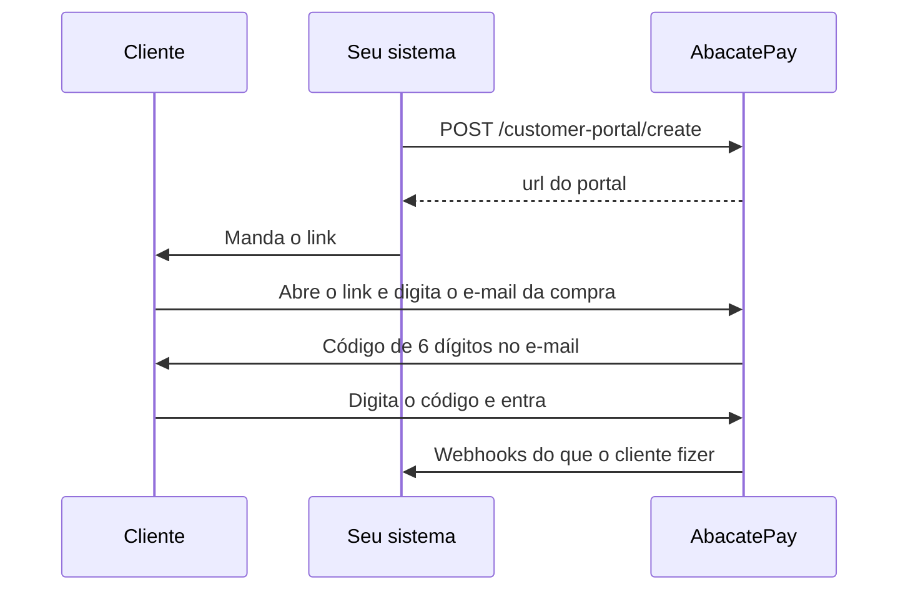

O portal do cliente, também chamado de área do cliente, é uma página pronta da AbacatePay onde o seu cliente resolve sozinho o que comprou: vê os pagamentos, pede reembolso, cancela a assinatura e troca o cartão. Você gera um link pela API e manda para ele.

Você não precisa montar tela nenhuma. É uma chamada de API e um link.

## Quando usar o portal do cliente

Use para tirar do seu suporte os pedidos mais comuns: cancelar a assinatura, trocar o cartão e pedir reembolso. Mande o link na sua área logada, num botão como "Gerenciar assinatura", ou por e-mail.

No portal, o reembolso é automático. Se você quer aprovar cada reembolso antes, não mande o portal e faça os reembolsos você mesmo. Veja [Reembolsos](/pages/vender/reembolsos).

## O que o cliente pode fazer no portal

| Ação | Como funciona |
|---|---|
| Ver os pagamentos | Lista as cobranças daquele checkout, com data, forma de pagamento, status e valor. |
| Pedir reembolso | Automático e no valor cheio, para pagamentos confirmados por Pix ou cartão. Boleto não tem reembolso. O valor sai do seu saldo. |
| Cancelar a assinatura | Vale no fim do ciclo já pago: não há cobrança nova e o acesso segue até essa data. |
| Trocar o cartão da assinatura | O próximo ciclo é cobrado no cartão novo. Se houver uma cobrança em atraso, ela é cobrada no cartão novo na hora. Se for recusada, o cartão não é trocado. |

<Warning>
  O reembolso pelo portal não passa por aprovação sua. Com o link, o cliente reembolsa sozinho qualquer pagamento confirmado por Pix ou cartão daquele checkout. Reembolsar uma cobrança de assinatura também cancela a assinatura na hora.
</Warning>

## Como funciona o portal do cliente



### Regras do link

- **Um link por cliente e checkout.** O `checkoutId` pode ser de um checkout, de um link de pagamento ou de um checkout de assinatura. Chamar de novo com os mesmos IDs devolve o mesmo link, então você pode gerar na hora do clique, sem guardar a `url`.
- **Só depois do pagamento.** O link só sai se o cliente pagou aquele checkout. Na assinatura, se a assinatura dele já existe.
- **Só aquela compra.** O portal mostra o que aquele cliente pagou naquele checkout, nessa loja. Ele não vê outras compras nem outras lojas.
- **Entrada com código.** O cliente digita o e-mail da compra e, se bater com o do cadastro, recebe um código de 6 dígitos, válido por 10 minutos. Cada link aceita até 5 pedidos de código por hora, contando os feitos com e-mail errado, e 5 tentativas erradas invalidam o código. Quem tem só o link, sem acesso ao e-mail, não entra.
- **Sessão de 1 hora.** Depois disso, o cliente pede outro código.
- **O link não expira.** E não há como desativá-lo: a proteção é o código enviado ao e-mail.

### Cancelamento da assinatura pelo portal

O cliente escolhe um motivo (**Preço muito alto**, **Não estou usando o suficiente**, **Encontrei uma alternativa melhor** ou **Outro motivo**) e pode deixar um comentário.

O cancelamento vale no fim do ciclo já pago. O webhook `subscription.cancelled` chega na hora do pedido, com `status: "CANCELLED"` e `cancelPolicy: "NEXT_CYCLE"`, mas o cliente tem acesso até o fim do ciclo que já pagou. Não corte o acesso quando o evento chegar: corte no fim do ciclo, a data em `currentPeriodEnd` de [Buscar assinatura](/pages/subscriptions/get). O motivo vem em `cancelledDueTo`.

No dashboard e pela API, o cancelamento vale na hora, com `cancelPolicy: "NOW"`. Veja [Assinaturas](/pages/cobrar/assinaturas).

### Troca de cartão pelo portal

A troca aparece só em assinatura ativa paga com cartão, e só em contas com o cartão de crédito liberado. Cada link aceita até 5 tentativas de troca por hora.

## Pelo dashboard

O portal do cliente só existe pela API: não há tela no dashboard para gerar o link.

## Como gerar o link do portal pela API

<Steps>
  <Step title="Guarde o customerId e o checkoutId">
    O link é sempre de um cliente num checkout. Os dois IDs chegam no webhook do pagamento:

    | Webhook | `customerId` | `checkoutId` |
    |---|---|---|
    | `checkout.completed` (checkout e link de pagamento) | `data.customer.id` | `data.checkout.id` |
    | `subscription.completed` | `data.customer.id` | `data.checkout.id` |

    Grave os dois junto do pedido ou da assinatura no seu banco.
  </Step>

  <Step title="Gere o link">
    Use uma chave com a permissão `CHECKOUT:CREATE`, `SUBSCRIPTION:CREATE` ou `CUSTOMER:CREATE` e chame [Criar um link do portal](/pages/customer-portal/create):

    <CodeGroup>
    ```bash cURL
    curl -X POST https://api.abacatepay.com/v2/customer-portal/create \
      -H "Authorization: Bearer $ABACATEPAY_API_KEY" \
      -H "Content-Type: application/json" \
      -d '{
        "customerId": "cust_abc123xyz",
        "checkoutId": "bill_abc123xyz"
      }'
    ```

    ```js Node.js
    const response = await fetch('https://api.abacatepay.com/v2/customer-portal/create', {
      method: 'POST',
      headers: {
        Authorization: `Bearer ${process.env.ABACATEPAY_API_KEY}`,
        'Content-Type': 'application/json',
      },
      body: JSON.stringify({
        customerId: 'cust_abc123xyz',
        checkoutId: 'bill_abc123xyz',
      }),
    })

    const { data, error } = await response.json()
    if (error) throw new Error(error)

    // Redirecione o cliente ou mande por e-mail
    console.log(data.url) // https://portal.abacatepay.com/k3J9xQ2m...
    ```
    </CodeGroup>

    A resposta traz o `id` do link (`cpl_...`) e a `url`, no formato `https://portal.abacatepay.com/<token>`.
  </Step>

  <Step title="Mande o cliente para o link">
    Redirecione, abra numa aba nova ou mande por e-mail. O cliente precisa ter e-mail no cadastro, porque o código de acesso vai para lá.
  </Step>
</Steps>

## Notificações

O que o cliente faz no portal chega para você pelos mesmos webhooks de sempre, como se fosse feito pelo dashboard:

| No portal | Webhook |
|---|---|
| Reembolso | `checkout.refunded` |
| Cancelamento da assinatura | `subscription.cancelled`, com `cancelPolicy: "NEXT_CYCLE"` |
| Reembolso de cobrança de assinatura | `checkout.refunded` e `subscription.cancelled`, com `cancelPolicy: "NOW"` |

Use esses eventos para liberar ou cortar o acesso no seu produto. Os exemplos estão em [Eventos de checkout](/pages/webhooks/events/checkout) e [Eventos de assinatura](/pages/webhooks/events/subscriptions).

## Testar no Modo Teste

Gere o link com uma chave do [Modo Teste](/pages/comecar/modo-teste), para um checkout pago com **Simular Pagamento**. O código de acesso chega no e-mail do cliente, e a troca de cartão usa cartões simulados.

## Perguntas frequentes

<AccordionGroup>
  <Accordion title="Área do cliente e portal do cliente são a mesma coisa?">
    Sim. É a mesma página, que a AbacatePay chama de portal do cliente.
  </Accordion>

  <Accordion title="O link do portal expira?">
    Não. Mas a sessão do cliente dura 1 hora e, a cada entrada, ele precisa de um código novo no e-mail.
  </Accordion>

  <Accordion title="O cliente vê outras compras dele?">
    Não. O link mostra só o checkout que você passou, nessa loja.
  </Accordion>

  <Accordion title="Por que deu `Customer has no payment for this checkout`?">
    O cliente ainda não pagou esse checkout. Gere o link depois do `checkout.completed` ou do `subscription.completed`.
  </Accordion>

  <Accordion title="Por que a troca de cartão não aparece?">
    Ela só aparece em assinatura ativa paga com cartão, em contas com o cartão de crédito liberado.
  </Accordion>

  <Accordion title="O cliente consegue reembolsar um boleto pelo portal?">
    Não. Boleto não tem reembolso pelo portal. O reembolso vale para pagamentos confirmados por Pix ou cartão.
  </Accordion>

  <Accordion title="Consigo gerar o link pelo dashboard?">
    Não. O portal do cliente só existe pela API.
  </Accordion>
</AccordionGroup>
