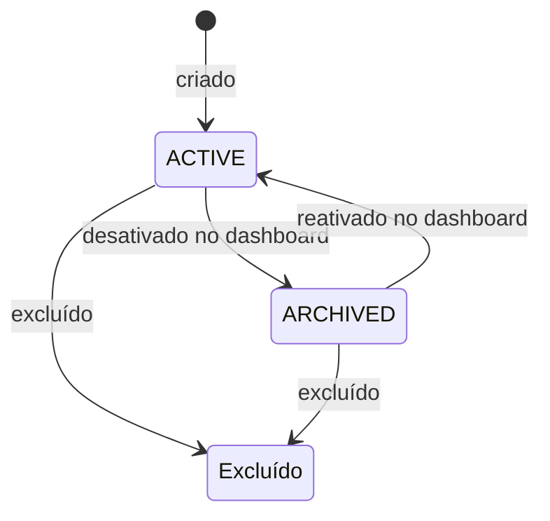

import { Video } from '/snippets/video.jsx'

Um produto é o que você vende: um curso, um plano, um e-book. Você cadastra uma vez, com nome e preço, e usa o mesmo produto em checkouts, links de pagamento e assinaturas.

<Video id="https://youtu.be/kOrNSA-hXF4" title="Produtos - AbacatePay" />

O vídeo também está em [Produtos](/pages/videos/produtos).

## Produto avulso ou de assinatura

| Tipo | Como cadastrar | Onde usar |
|---|---|---|
| Avulso (pagamento único) | Sem `cycle` | [Checkout](/pages/cobrar/checkout), [link de pagamento](/pages/cobrar/link-de-pagamento) e [upsell](/pages/vender/upsell) |
| Assinatura | Com `cycle`: `WEEKLY` (semanal), `MONTHLY` (mensal), `QUARTERLY` (trimestral), `SEMIANNUALLY` (semestral) ou `ANNUALLY` (anual) | [Assinaturas](/pages/cobrar/assinaturas) |

O ciclo define de quanto em quanto tempo o cliente é cobrado. Depois de criado, o produto não muda de tipo.

## Como funciona um produto

### Preço em centavos

O `price` é um número inteiro em centavos: `4990` = R$ 49,90. O mínimo é `1`. A moeda (`currency`) é sempre `BRL`. O preço não pode ser alterado depois que o produto é criado: para vender por outro valor, crie outro produto.

### `externalId`: o código do produto no seu sistema

O `externalId` é obrigatório e único entre os produtos da loja. Use o código que você já tem (SKU, slug, id do seu banco). Criar outro produto com o mesmo `externalId` falha com `Product with externalId already exists`, então ele também protege contra produto duplicado quando a sua chamada é repetida.

Na hora de cobrar, o `items[].id` do [checkout](/pages/payment/create) e do [link de pagamento](/pages/payment-links/create) aceita o `id` do produto (`prod_...`) ou o `externalId`. Produtos criados pelo dashboard recebem um `externalId` automático.

### Imagem do produto

Envie em `imageUrl` a URL pública de uma imagem PNG, JPEG, GIF ou WebP de até 5 MB. A AbacatePay baixa a imagem e guarda uma cópia, que aparece na tela de pagamento. O campo `image` não existe: use `imageUrl`.

### Arquivo para download

Para vender um e-book, um ingresso ou um material em PDF, envie em `fileUrl` a URL pública de um PDF de até 20 MB. A AbacatePay baixa e guarda o arquivo, e o link original nunca aparece na API. Na resposta, `hasFile: true` confirma que o produto tem arquivo.

Depois do pagamento, a tela de confirmação do checkout mostra o botão **Baixar arquivo**. O link de download é de uso único.

### Período de teste (`trialDays`)

`trialDays` dá de 1 a 90 dias grátis antes da primeira cobrança da assinatura. Ele só tem efeito em produto com `cycle`: num produto avulso, o campo é aceito e não faz nada. Assinatura com período de teste não aceita [cupom](/pages/vender/cupons).

### Status do produto



| Status | O que significa |
|---|---|
| `ACTIVE` | Produto disponível para vender. |
| `ARCHIVED` | Produto desativado. O histórico é mantido e você pode reativá-lo pelo dashboard. Produto `ARCHIVED` não pode ser usado como [upsell](/pages/vender/upsell). |

## Como excluir ou desativar um produto

- **Desativar** (só pelo dashboard): o produto passa a `ARCHIVED` e pode ser reativado depois. Desativar não interrompe as cobranças recorrentes: para parar de cobrar, cancele as assinaturas.
- **Excluir**: o produto é arquivado de vez e some da listagem e da busca. A resposta de [Excluir produto](/pages/products/delete) traz o produto com `status: "ARCHIVED"`. As cobranças já feitas continuam no histórico.

Excluir não cancela as assinaturas nem desativa os links de pagamento que usam o produto. No dashboard, o botão **Excluir produto** fica bloqueado enquanto o produto tem assinatura ativa ou pendente, link de pagamento ativo ou cobrança aguardando pagamento. A API não faz essa checagem.

## Como criar um produto pelo dashboard

<Steps>
  <Step title="Abra o formulário">
    No menu, vá em **Sua Loja → Produtos** e clique em **Novo produto**.
  </Step>

  <Step title="Preencha os dados básicos">
    Informe o **Nome do produto** e a **Descrição**, que aparecem na tela de pagamento. Se quiser, adicione a **Imagem do produto**, a **Marca** (produtos da mesma marca aparecem juntos quando o cliente troca de plano) e o **Arquivo PDF para download**. Clique em **Continuar**.
  </Step>

  <Step title="Defina o pagamento">
    Em **Tipo de cobrança**, escolha **Compra única** e informe o **Valor**, ou **Assinatura** e ative o **Período de cobrança** (Mensal, Trimestral, Anual ou Semanal) com o preço. A opção **Assinatura** só aparece quando a sua conta tem assinaturas liberadas.
  </Step>

  <Step title="Salve">
    Clique em **Cadastrar**. Depois, abra o produto para copiar o ID ou editar nome, descrição, imagem e arquivo. O tipo de cobrança e o preço não mudam depois da criação.
  </Step>
</Steps>

O período de teste (`trialDays`) só pode ser definido pela API.

## Como criar um produto pela API

<Steps>
  <Step title="Crie o produto">
    Use uma [chave de API](/pages/comecar/chaves-de-api) com a permissão `PRODUCT:CREATE`.

    ```bash
    curl -X POST https://api.abacatepay.com/v2/products/create \
      -H "Authorization: Bearer SUA_CHAVE" \
      -H "Content-Type: application/json" \
      --data '{
        "externalId": "curso-python",
        "name": "Curso de Python",
        "price": 19700,
        "currency": "BRL",
        "description": "Acesso vitalício às aulas"
      }'
    ```

    ```json Resposta
    {
      "data": {
        "id": "prod_abc123xyz",
        "externalId": "curso-python",
        "name": "Curso de Python",
        "description": "Acesso vitalício às aulas",
        "imageUrl": null,
        "hasFile": false,
        "price": 19700,
        "currency": "BRL",
        "status": "ACTIVE",
        "cycle": null,
        "trialDays": null,
        "devMode": true,
        "createdAt": "2026-11-10T12:00:00.000Z",
        "updatedAt": "2026-11-10T12:00:00.000Z"
      },
      "success": true,
      "error": null
    }
    ```

    Sem `description`, o campo volta como texto vazio (`""`).
  </Step>

  <Step title="Cobre com o produto">
    Passe o `id` ou o `externalId` em `items` ao criar um [checkout](/pages/payment/create):

    ```json
    {
      "items": [{ "id": "curso-python", "quantity": 1 }]
    }
    ```
  </Step>
</Steps>

**Produto de assinatura mensal com 7 dias grátis:**

```json
{
  "externalId": "plano-mensal",
  "name": "Plano Mensal",
  "price": 4990,
  "currency": "BRL",
  "cycle": "MONTHLY",
  "trialDays": 7
}
```

**Produto com arquivo para download:**

```json
{
  "externalId": "ebook-guia",
  "name": "E-book: Guia Completo",
  "price": 2990,
  "currency": "BRL",
  "fileUrl": "https://exemplo.com/guia-completo.pdf"
}
```

<CardGroup cols={2}>
  <Card title="Criar um produto" icon="plus" href="/pages/products/create">
    `POST /products/create`
  </Card>
  <Card title="Listar produtos" icon="list" href="/pages/products/list">
    `GET /products/list`
  </Card>
  <Card title="Buscar um produto" icon="magnifying-glass" href="/pages/products/get">
    `GET /products/get`
  </Card>
  <Card title="Excluir um produto" icon="trash" href="/pages/products/delete">
    `POST /products/delete`
  </Card>
</CardGroup>

## Testar no Modo Teste

Produtos criados no [Modo Teste](/pages/comecar/modo-teste) ficam separados dos de produção e só aparecem nas cobranças de teste. Quando a sua conta é aprovada, o dashboard oferece **Reutilizar produtos**, para escolher quais produtos do Modo Teste levar para produção.

## Perguntas frequentes

<AccordionGroup>
  <Accordion title="Posso mudar o preço de um produto?">
    Não. O preço e o tipo de cobrança ficam fixos depois da criação. Crie outro produto com o novo preço e use ele nas próximas cobranças. No dashboard você ainda pode editar nome, descrição, imagem e arquivo.
  </Accordion>

  <Accordion title="Posso usar o código do meu sistema em vez do id da AbacatePay?">
    Sim. No `items[].id` do checkout e do link de pagamento, envie o `externalId` do produto no lugar do `prod_...`.
  </Accordion>

  <Accordion title="Excluir um produto cancela as assinaturas dele?">
    Não. As assinaturas continuam ativas. Para parar de cobrar, cancele cada assinatura em **Sua Loja → Assinaturas**.
  </Accordion>

  <Accordion title="Quais formatos de imagem e arquivo são aceitos?">
    Imagem: PNG, JPEG, GIF ou WebP, até 5 MB, em `imageUrl`. Arquivo para download: PDF de até 20 MB, em `fileUrl`. As duas URLs precisam ser públicas, porque a AbacatePay baixa o conteúdo na criação.
  </Accordion>

  <Accordion title="Posso vender vários produtos no mesmo checkout?">
    Sim. Envie um item por produto em `items`, com a quantidade de cada um. Veja [Checkout](/pages/cobrar/checkout).
  </Accordion>
</AccordionGroup>
