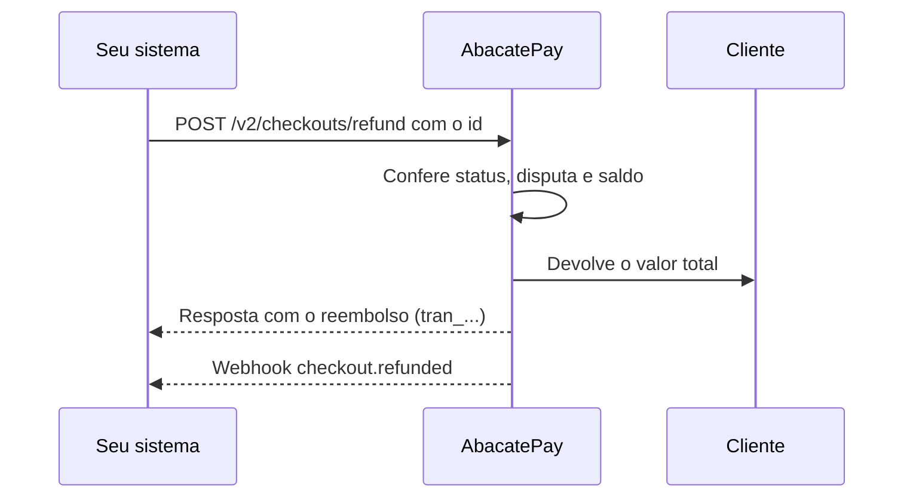
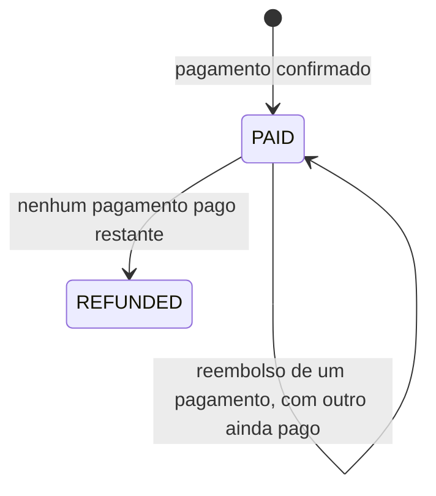

import { Video } from '/snippets/video.jsx'

O reembolso devolve ao cliente o valor de um pagamento feito por Pix ou cartão. Ele é sempre do valor total, sai do seu saldo e pode ser feito pelo dashboard ou pela API.

<Video id="https://youtu.be/YBwg0A1ib1o" title="Reembolso - AbacatePay" />

O vídeo também está em [Reembolso](/pages/videos/reembolso).

## O que pode ser reembolsado

| Cobrança | Pelo dashboard | Pela API | `id` aceito |
|---|---|---|---|
| [Checkout](/pages/cobrar/checkout) | Sim | [`POST /checkouts/refund`](/pages/payment/refund) | `bill_` do checkout, ou o id do pagamento (`char_`, `pix_char_`, `card_`) |
| Pagamento de [link de pagamento](/pages/cobrar/link-de-pagamento) | Sim | [`POST /payment-links/refund`](/pages/payment-links/refund) | Id do pagamento (`char_`, `pix_char_`, `card_`) |
| [Checkout transparente](/pages/cobrar/checkout-transparente) | Sim | [`POST /transparents/refund`](/pages/transparents/refund) | Id da cobrança (`char_`, `pix_char_`, `card_`) |
| [Assinatura](/pages/cobrar/assinaturas) | Sim | Não | Não se aplica |
| Pix recebido na [chave Pix](/pages/dinheiro/chave-pix) | Sim | Não | Não se aplica |
| [Boleto](/pages/pagamentos/boleto) | Não | Não | Não se aplica |

Cada rota só aceita o seu tipo de cobrança. Se você usar a rota errada, a mensagem de erro diz qual usar.

## Como funciona o reembolso



### Regras

- **Só o valor total.** Não existe reembolso parcial: o valor devolvido é sempre o do pagamento.
- **Só Pix e cartão.** Boleto não tem reembolso.
- **Só pagamento confirmado.** No Pix, o pagamento precisa estar pago. No cartão, aprovado ou pago.
- **Sem disputa.** Um pagamento em disputa não pode ser reembolsado.
- **Sai do seu saldo.** Sem saldo suficiente, o reembolso é recusado.
- **A taxa não volta.** A [taxa](/pages/comecar/taxas) cobrada na venda não é devolvida a você.
- **Parcelado é estornado inteiro.** Numa venda [parcelada](/pages/pagamentos/parcelamento) no cartão, todas as parcelas são canceladas de uma vez, e o extrato mostra um estorno por parcela.
- **Prazo para o cliente.** O valor chega ao cliente em até 10 dias úteis, dependendo do meio de pagamento.

### Cartão já liquidado

Depois que a venda no cartão é liquidada, o estorno no cartão deixa de existir. A API recusa com a mensagem `Não é possível reembolsar pelo cartão porque essa venda já foi liquidada. Faça um Pix para o comprador final.`

Pelo dashboard, o reembolso dessa venda sai por Pix, do seu saldo, para o titular do cartão. Ele é confirmado com o código do autenticador (2FA), como no saque. Se o 2FA não estiver ativo, o dashboard pede para ativar antes.

### Cobrança de assinatura

A API não reembolsa cobranças de assinatura. Reembolse pelo dashboard, em **Sua Loja → Assinaturas**, ou mande o [Portal do cliente](/pages/vender/portal-do-cliente) para o próprio cliente pedir. Pelo portal, o reembolso de uma cobrança de assinatura também cancela a assinatura na hora.

### O que muda no status



- **Pagamento:** o pagamento reembolsado (`char_`, `pix_char_` ou `card_`) passa a `REFUNDED`.
- **Checkout:** passa a `REFUNDED` quando não sobra nenhum pagamento pago nele, venha o pedido pelo `bill_` ou pelo id do pagamento. O [upsell](/pages/vender/upsell) é um segundo pagamento no mesmo `bill_`: reembolsar só um dos dois deixa o checkout `PAID`.
- **Link de pagamento:** o link continua `ACTIVE` e segue aceitando pagamentos. Só o pagamento reembolsado muda.
- **Checkout transparente:** a cobrança passa a `REFUNDED`.

## Como reembolsar pelo dashboard

<Steps>
  <Step title="Ache a cobrança">
    - **Checkout ou checkout transparente:** vá em **Sua Loja → Cobranças**, na aba **Checkout Abacate** ou **Checkout Transparente**.
    - **Link de pagamento:** vá em **Sua Loja → Links de pagamento** e abra o link. Os pagamentos aparecem na lista de transações dele.
    - **Assinatura:** vá em **Sua Loja → Assinaturas** e abra a assinatura. As cobranças aparecem por parcela.
    - **Pix na chave fixa:** vá em **Sua Loja → Cobranças**, na aba **Chave Pix**.
  </Step>

  <Step title="Peça o reembolso">
    Abra o menu da linha e clique em **Reembolsar**. A opção só aparece em pagamentos que podem ser reembolsados.
  </Step>

  <Step title="Confirme">
    Confira o cliente e o valor e clique em **Confirmar reembolso**. Numa venda parcelada, a tela avisa que o parcelamento inteiro será estornado. Depois, **Ver comprovante** abre o comprovante do reembolso.
  </Step>
</Steps>

O Pix recebido na chave fixa só é reembolsado pelo dashboard e dispara o webhook `pix_key.refunded`. Veja [Chave Pix](/pages/dinheiro/chave-pix).

## Como reembolsar pela API

Use uma [chave de API](/pages/comecar/chaves-de-api) com a permissão `REFUND:CREATE` e envie o `id` na rota do tipo de cobrança. O `reason` é opcional, com até 500 caracteres.

```bash
curl -X POST https://api.abacatepay.com/v2/checkouts/refund \
  -H "Authorization: Bearer SUA_CHAVE" \
  -H "Content-Type: application/json" \
  --data '{
    "id": "bill_abc123xyz",
    "reason": "Pedido cancelado pelo cliente."
  }'
```

```json Resposta
{
  "data": {
    "id": "tran_abc123xyz",
    "status": "COMPLETE",
    "amount": 10000,
    "reason": "Pedido cancelado pelo cliente.",
    "originalId": "bill_abc123xyz",
    "createdAt": "2026-11-10T14:30:00.000Z"
  },
  "success": true,
  "error": null
}
```

- `id`: a transação do reembolso.
- `amount`: o valor devolvido, em centavos.
- `originalId`: o `id` que você enviou.
- `reason`: o motivo que você enviou, ou `null`.

### Qual `id` enviar

- **Checkout:** o `bill_` do checkout. Pelo `bill_`, a API reembolsa o pagamento principal. Para reembolsar o upsell, envie o id do pagamento dele.
- **Link de pagamento:** o id do pagamento. A rota recusa o `bill_` do link, porque cada pagamento é reembolsado separado. O id de cada pagamento aparece no dashboard, na lista de transações do link.
- **Checkout transparente:** o `id` que voltou na criação da cobrança, como `pix_char_...` ou `card_...`.

### Idempotência

Repetir o pedido de um pagamento já reembolsado não cria outro reembolso. A API responde HTTP 400 com `Esta cobrança já foi reembolsada.`. Trate essa resposta como "já reembolsado".

<CardGroup cols={3}>
  <Card title="Reembolsar checkout" icon="rotate-left" href="/pages/payment/refund">
    `POST /checkouts/refund`
  </Card>
  <Card title="Reembolsar link" icon="rotate-left" href="/pages/payment-links/refund">
    `POST /payment-links/refund`
  </Card>
  <Card title="Reembolsar transparente" icon="rotate-left" href="/pages/transparents/refund">
    `POST /transparents/refund`
  </Card>
</CardGroup>

## Mensagens de erro

Os erros de reembolso respondem HTTP 400, com a mensagem em português no campo `error`:

```json
{
  "data": null,
  "success": false,
  "error": "Cobrança está em disputa e não pode ser reembolsada."
}
```

| Mensagem em `error` | Quando acontece |
|---|---|
| `Cobrança não encontrada.` | O `id` não existe nesta loja ou é de outro ambiente (Modo Teste ou produção). |
| `Esta cobrança já foi reembolsada.` | O pagamento já foi reembolsado. |
| `Só é possível reembolsar cobranças pagas. O status atual desta cobrança não permite reembolso.` | O pagamento ainda não foi confirmado. |
| `Método de pagamento não suportado para reembolso.` | O pagamento não é Pix nem cartão, como um boleto. |
| `Cobrança está em disputa e não pode ser reembolsada.` | O pagamento está em disputa. |
| `Saldo insuficiente para realizar o reembolso.` | O seu saldo é menor que o valor do pagamento. |
| `Cobranças de assinatura não podem ser reembolsadas pela API v2.` | O pagamento é de assinatura. Use o dashboard ou o Portal do cliente. |
| `Não é possível reembolsar pelo cartão porque essa venda já foi liquidada. Faça um Pix para o comprador final.` | A venda no cartão já foi liquidada. Reembolse pelo dashboard, que devolve por Pix. |
| `Não foi possível reembolsar porque a liquidação desta cobrança já está em andamento.` | A venda está sendo liquidada neste momento. |
| `Não é possível reembolsar esta cobrança porque o prazo de reembolso expirou.` | O prazo do meio de pagamento para devolver o valor acabou. |
| `Outro reembolso está em andamento para esta loja. Tente novamente em instantes.` | Já existe um reembolso sendo processado. Tente de novo. |
| `Falha ao processar o reembolso.` | O reembolso não foi processado. Tente de novo e, se repetir, fale com o suporte. |
| `Falha ao confirmar o reembolso.` | O reembolso não foi confirmado. Fale com o suporte. |
| `Não foi possível identificar o Pix desta cobrança para reembolso. Entre em contato com o suporte.` | Falta a identificação do Pix original. Fale com o suporte. |

Mensagens de rota e de `id`:

| Mensagem em `error` | Quando acontece |
|---|---|
| `Identificador inválido para esta rota. Use bill_, char_, pix_char_ ou card_.` | Prefixo de `id` não aceito em `/checkouts/refund`. |
| `Identificador inválido para esta rota. Use char_, pix_char_ ou card_.` | Prefixo de `id` não aceito em `/payment-links/refund` ou `/transparents/refund`. |
| `Use o publicId da cobrança individual (char_, pix_char_ ou card_), não do link de pagamento.` | Um `bill_` em `/payment-links/refund`. |
| `Use a rota /v2/payment-links/refund para reembolsar pagamentos de links de pagamento.` | O `bill_` de um link, ou um pagamento de link, em `/checkouts/refund`. |
| `Use a rota /v2/checkouts/refund para reembolsar cobranças únicas.` | Um pagamento de checkout em `/payment-links/refund`. |
| `Use a rota /v2/transparents/refund para reembolsar cobranças transparentes.` | Uma cobrança do checkout transparente em `/checkouts/refund` ou `/payment-links/refund`. |
| `Use a rota /v2/checkouts/refund ou /v2/payment-links/refund para esta cobrança.` | Um checkout ou pagamento de link em `/transparents/refund`. |

## Notificações

| Evento | Quando dispara |
|---|---|
| [`checkout.refunded`](/pages/webhooks/events/checkout) | Reembolso de um pagamento de checkout, de link de pagamento ou de assinatura. |
| [`transparent.refunded`](/pages/webhooks/events/transparent) | Reembolso de uma cobrança do checkout transparente. |
| [`pix_key.refunded`](/pages/webhooks/events/pix-key) | Reembolso de um Pix recebido na chave fixa. |

O evento sai quando o reembolso é confirmado. Veja como receber em [Webhooks](/pages/notificacoes/webhooks).

## Testar no Modo Teste

No [Modo Teste](/pages/comecar/modo-teste), o reembolso é confirmado na hora, sem dinheiro real. Simule um pagamento, reembolse pelo dashboard ou com uma chave de teste e confira o webhook.

## Perguntas frequentes

<AccordionGroup>
  <Accordion title="Posso devolver só parte do valor?">
    Não. O reembolso é sempre do valor total do pagamento. Para devolver uma parte, combine com o cliente e envie o valor por [Pix](/pages/dinheiro/enviar-pix).
  </Accordion>

  <Accordion title="A taxa da venda volta quando eu reembolso?">
    Não. O cliente recebe o valor total que pagou, e a taxa cobrada na venda não é devolvida.
  </Accordion>

  <Accordion title="Quanto tempo o cliente leva para receber?">
    Até 10 dias úteis, dependendo do meio de pagamento.
  </Accordion>

  <Accordion title="O cliente pode pedir o reembolso sozinho?">
    Sim, pelo [Portal do cliente](/pages/vender/portal-do-cliente). O reembolso pelo portal é automático, do valor total, e não passa por aprovação sua.
  </Accordion>

  <Accordion title="Como devolvo o valor de um boleto?">
    Boleto não tem reembolso na AbacatePay. Combine a devolução com o cliente e envie o valor por [Pix](/pages/dinheiro/enviar-pix).
  </Accordion>

  <Accordion title="Reembolsei e o checkout continua PAID. Por quê?">
    O checkout ainda tem outro pagamento pago, como o do [upsell](/pages/vender/upsell). Ele só passa a `REFUNDED` quando todos os pagamentos dele forem reembolsados.
  </Accordion>
</AccordionGroup>
