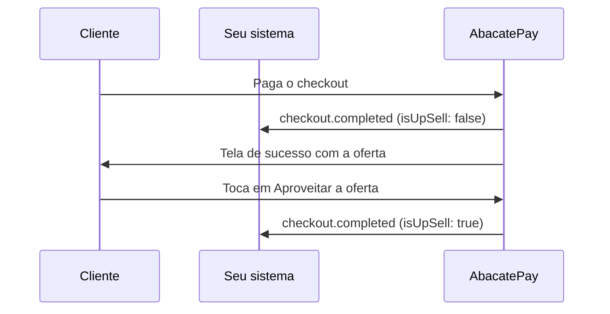

Upsell é a oferta de um produto a mais logo depois do pagamento. Você escolhe o produto ao criar o checkout, a AbacatePay mostra a oferta na tela de sucesso e cobra se o cliente aceitar.

Você não precisa montar tela nenhuma. É um campo a mais no checkout e um cuidado no webhook.

## Quando usar o upsell

Use para oferecer um complemento no momento em que o cliente acabou de comprar: um e-book junto com o curso, uma mentoria, um acessório. Ele aumenta o ticket médio sem um novo checkout.

O upsell só existe no [checkout](/pages/cobrar/checkout) criado pela API, com `POST /checkouts/create`. Ele não vale em [link de pagamento](/pages/cobrar/link-de-pagamento), em [assinatura](/pages/cobrar/assinaturas) nem no [checkout transparente](/pages/cobrar/checkout-transparente).

## Como funciona o upsell



A tela de sucesso mostra a imagem, o nome e o preço do produto, com o botão **Aproveitar a oferta**. Se o cliente aceitar, o upsell é cobrado no mesmo meio de pagamento da compra:

| Pagou com | O upsell |
|---|---|
| Cartão | É cobrado na hora, à vista, no mesmo cartão. O cliente não digita nada. |
| Pix | Gera um novo QR Code na tela. |
| Boleto | Gera um novo boleto. |

Quando o upsell é pago, chega um segundo `checkout.completed` do mesmo checkout.

### Regras

- **Produto avulso e ativo.** O produto da oferta não pode ter `cycle` e precisa estar com status `ACTIVE`. Produto excluído fica `ARCHIVED` e não serve. Veja [Produtos](/pages/vender/produtos).
- **`id` ou `externalId`.** Em `upSellProductId`, use o `id` (`prod_...`) ou o `externalId` do produto. A resposta do checkout traz o `id` em `upSellProductId`, ou `null` quando não há upsell.
- **Preço cheio, à vista.** O upsell é cobrado pelo preço do produto, sem cupom e sem parcelamento.
- **Mesmo checkout.** O pagamento do upsell entra no mesmo checkout (`bill_...`), e `paidAmount` passa a somar a compra e o upsell.
- **Dados do cliente.** O upsell cobra o cliente da compra e usa o nome, o e-mail, o CPF/CNPJ e o celular dele.
- **Redirecionamento.** Com `completionUrl`, a tela de sucesso só leva o cliente para a sua página quando ele toca em **Continuar**, para dar tempo de ver a oferta. Sem upsell, o redirecionamento acontece sozinho em 5 segundos.

A oferta não aparece quando:

- o link do checkout tem `skip_customer=true`, porque a compra sai sem os dados do cliente;
- a compra foi fechada com um cupom de 100%, porque não houve pagamento;
- o produto da oferta foi arquivado ou ganhou ciclo depois que o checkout foi criado.

## Pelo dashboard

O upsell só existe pela API. O formulário de **Criar cobrança** do dashboard não tem esse campo.

## Como criar um upsell pela API

### Passo 1: crie o produto da oferta

Preencha `imageUrl`: a imagem aparece na oferta, junto com o nome e o preço.

<CodeGroup>
```bash cURL
curl -X POST https://api.abacatepay.com/v2/products/create \
  -H "Authorization: Bearer $ABACATEPAY_API_KEY" \
  -H "Content-Type: application/json" \
  -d '{
    "externalId": "ebook-receitas",
    "name": "E-book de receitas",
    "description": "50 receitas para usar com o curso",
    "price": 2990,
    "currency": "BRL",
    "imageUrl": "https://seusite.com/ebook.png"
  }'
```

```js Node.js
const response = await fetch('https://api.abacatepay.com/v2/products/create', {
  method: 'POST',
  headers: {
    Authorization: `Bearer ${process.env.ABACATEPAY_API_KEY}`,
    'Content-Type': 'application/json',
  },
  body: JSON.stringify({
    externalId: 'ebook-receitas',
    name: 'E-book de receitas',
    description: '50 receitas para usar com o curso',
    price: 2990,
    currency: 'BRL',
    imageUrl: 'https://seusite.com/ebook.png',
  }),
})

const { data, error } = await response.json()
if (error) throw new Error(error)

console.log(data.id) // prod_...
```
</CodeGroup>

Você cria o produto uma vez e usa em quantos checkouts quiser.

### Passo 2: crie o checkout com `upSellProductId`

Passe o `id` ou o `externalId` do produto da oferta em [Criar um checkout](/pages/payment/create):

```json
POST /v2/checkouts/create
{
  "items": [{ "id": "prod_curso", "quantity": 1 }],
  "methods": ["PIX", "CARD"],
  "upSellProductId": "ebook-receitas"
}
```

Se o produto não servir, a API recusa o checkout com `Up sell product not found`, `Up sell product must be active` ou `Up sell product cannot have cycle`.

### Passo 3: trate o segundo `checkout.completed`

Quando o upsell é pago, chega outro `checkout.completed` com o **mesmo `checkout.id`** da compra e `checkout.isUpSell: true`:

| Campo | Evento da compra | Evento do upsell |
|---|---|---|
| `id` do evento | `log_...` | Outro `log_...` |
| `checkout.id` | `bill_abc123xyz` | `bill_abc123xyz`, o mesmo |
| `checkout.isUpSell` | `false` | `true` |
| `checkout.amount` | Valor da compra | Preço do produto de upsell |
| `checkout.items` | Itens da compra | Só o produto de upsell |
| `checkout.paidAmount` | Valor da compra | Compra + upsell |

```js Node.js
app.post('/webhooks/abacatepay', async (req, res) => {
  const event = req.body
  if (event.event !== 'checkout.completed') return res.sendStatus(200)

  // Duplicidade pelo id do evento, nunca pelo id do checkout
  if (await jaProcessado(event.id)) return res.sendStatus(200)

  const { checkout } = event.data
  const pedido = await buscarPedidoPorCheckout(checkout.id)

  if (checkout.isUpSell) {
    await liberarProdutos(pedido, checkout.items) // o produto de upsell
  } else {
    await liberarCompra(pedido)
  }

  await marcarProcessado(event.id)
  res.sendStatus(200)
})
```

<Warning>
  Se você trata duplicidade pelo `checkout.id`, o upsell é descartado como repetição e o cliente paga sem receber. Use o `id` do evento, que só se repete nas retentativas da mesma entrega.
</Warning>

## Notificações

O upsell pago gera um `checkout.completed` com `isUpSell: true`. Nos outros eventos, `isUpSell` vem `false`. Veja o exemplo em [Eventos de checkout](/pages/webhooks/events/checkout#casos-especiais).

## Testar no Modo Teste

Crie o produto e o checkout com uma chave do [Modo Teste](/pages/comecar/modo-teste). Abra o link, pague com **Simular Pagamento** e aceite a oferta na tela de sucesso. Confira se o seu webhook recebe os dois `checkout.completed`.

## Perguntas frequentes

<AccordionGroup>
  <Accordion title="Funciona em link de pagamento ou assinatura?">
    Não. O upsell só vale no checkout de pagamento único, criado pela API.
  </Accordion>

  <Accordion title="O cliente pode parcelar o upsell?">
    Não. No cartão, o upsell sai à vista.
  </Accordion>

  <Accordion title="O cupom da compra vale no upsell?">
    Não. O upsell é cobrado pelo preço do produto.
  </Accordion>

  <Accordion title="Por que a oferta não apareceu?">
    O link tinha `skip_customer=true`, a compra foi fechada com um cupom de 100% ou o produto da oferta foi arquivado ou ganhou ciclo. Sem pagamento ou sem os dados do cliente, não há oferta.
  </Accordion>

  <Accordion title="Por que deu erro quando o cliente aceitou?">
    O upsell usa o nome, o e-mail, o CPF/CNPJ e o celular do cliente da compra. Se você criou o checkout com o `customerId` de um cliente sem celular, por exemplo, a cobrança do upsell falha. Complete o cadastro do [cliente](/pages/vender/clientes).
  </Accordion>

  <Accordion title="Dá para oferecer mais de um produto?">
    Não. Cada checkout tem um produto de upsell, o de `upSellProductId`.
  </Accordion>
</AccordionGroup>
