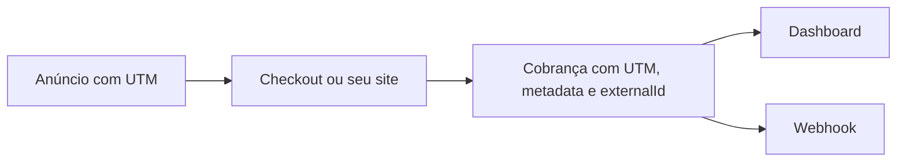

UTM, `metadata` e `externalId` ligam cada venda da AbacatePay à origem dela e ao seu sistema. As UTMs dizem de qual anúncio ou canal veio a venda, `metadata` guarda dados seus junto com a cobrança, e `externalId` é o código do pedido no seu sistema.

## Quando usar

| Você quer | Use |
|---|---|
| Saber de qual anúncio, canal ou campanha veio a venda | [UTM](#utm) |
| Guardar o id do pedido, do usuário ou do plano junto com a cobrança | [`metadata`](#metadata) |
| Achar a cobrança pelo seu código e não criar cobrança duplicada | [`externalId`](#externalid) |

Nenhum dos três muda valor, vencimento ou status da cobrança.

## Como funciona



Os dados entram quando a cobrança é criada e ficam guardados no pagamento. Depois, aparecem no dashboard, nas respostas da API e nos webhooks.

## UTM

### No checkout e no link de pagamento

Acrescente os parâmetros UTM à `url` do checkout ou do link. A tela de pagamento lê `utm_source`, `utm_medium`, `utm_campaign`, `utm_term` e `utm_content` e guarda os valores no pagamento:

```
https://app.abacatepay.com/pay/bill_abc123xyz?utm_source=instagram&utm_medium=social&utm_campaign=black-friday
```

Use a mesma `url` com UTMs diferentes em cada canal para comparar as campanhas.

### No checkout transparente

No Pix e no boleto do checkout transparente, envie o objeto `data.utm` em [`POST /v2/transparents/create`](/pages/transparents/create). Todos os campos são texto e opcionais:

| Campo | Equivale a |
|---|---|
| `source` | `utm_source`: origem, como `google` ou `instagram` |
| `medium` | `utm_medium`: mídia, como `cpc` ou `email` |
| `campaign` | `utm_campaign`: nome da campanha |
| `term` | `utm_term`: termo ou palavra-chave |
| `content` | `utm_content`: variação do anúncio |
| `src` | Código de rastreamento extra, usado por ferramentas de atribuição de vendas |
| `sck` | Código de rastreamento extra, usado por ferramentas de atribuição de vendas |

```json
{
  "method": "PIX",
  "data": {
    "amount": 10000,
    "utm": {
      "source": "newsletter",
      "medium": "email",
      "campaign": "lancamento",
      "content": "botao-topo"
    }
  }
}
```

O cartão do checkout transparente não recebe `utm`.

### Onde ver as UTMs

- **Dashboard:** em **Sua Loja → Cobranças**, abra o pagamento. Os valores aparecem em **Parâmetros UTM**.
- **Webhook:** os eventos `checkout.*` e `transparent.*` trazem `payerInformation.utms`, com `source`, `medium`, `campaign`, `term` e `content`. Os campos sem valor vêm `null`. `src` e `sck` não vão no webhook.
- **UTMify:** com o plugin ativo em **Integração → Plugins**, a AbacatePay manda as UTMs, `src` e `sck` de cada venda para a UTMify. O plugin não funciona no Modo Teste.

```json
"payerInformation": {
  "method": "PIX",
  "utms": {
    "source": "instagram",
    "medium": "social",
    "campaign": "black-friday",
    "term": null,
    "content": null
  }
}
```

## Metadata

`metadata` é um objeto de chave e valor que você envia ao criar o recurso. A AbacatePay guarda o objeto e devolve igual nas respostas. No dashboard, ele aparece em **Metadados**, no detalhe do pagamento.

Use para guardar o que o seu sistema precisa para reconhecer a venda: o id do pedido, do usuário ou do plano. Não guarde senhas nem dados de cartão.

O tipo dos valores muda conforme o recurso:

| Recurso | Valores aceitos |
|---|---|
| Checkout, link de pagamento e assinatura | Qualquer JSON: texto, número, booleano ou objeto |
| Pix e boleto do checkout transparente | Qualquer JSON |
| Cartão do checkout transparente | Só texto |
| Cliente | Só texto |
| Subconta | Só texto |

Onde só texto é aceito, `{ "pedidos": 3 }` é recusado. Envie `{ "pedidos": "3" }`.

```json
{
  "metadata": {
    "pedidoId": "pedido-123",
    "plano": "pro"
  }
}
```

## externalId

`externalId` é o código do pedido, da fatura ou do cadastro no seu sistema. Com ele, você busca a cobrança pelo seu código, sem guardar o id da AbacatePay, e evita criar a mesma cobrança duas vezes.

O que acontece quando você repete um `externalId`:

| Onde | Ao repetir |
|---|---|
| [Checkout](/pages/cobrar/checkout) e [link de pagamento](/pages/cobrar/link-de-pagamento) | A API devolve o que já existe com esse `externalId` e não cria outro. Os itens novos da requisição são ignorados. |
| [Assinatura](/pages/cobrar/assinaturas) | A API devolve o checkout que já existe com esse `externalId`. |
| [Pix do checkout transparente](/pages/pagamentos/pix) | Se houver uma cobrança Pix **pendente** com o mesmo `externalId`, a API devolve ela. Depois que ela é paga ou expira, um novo pedido cria outra cobrança. |
| [Boleto do checkout transparente](/pages/pagamentos/boleto) | O `externalId` fica guardado na cobrança como o seu identificador. |
| [Subconta](/pages/dinheiro/subcontas-e-split) | O `externalId` é único. Repetir é recusado com `externalId já usado por outra subconta`. |

Por isso, numa nova tentativa de pagamento do mesmo pedido, reenvie o mesmo `externalId`: você recebe a cobrança que já existe.

Para buscar pelo seu código, passe `externalId` em [`GET /v2/checkouts/get`](/pages/payment/one), [`GET /v2/checkouts/list`](/pages/payment/list) ou [`GET /v2/transparents/list`](/pages/transparents/list). O `externalId` também vem nos webhooks, em `checkout.externalId` e `transparent.externalId`.

## Pelo dashboard

As UTMs e os metadados aparecem no detalhe de cada pagamento, em **Sua Loja → Cobranças**. Para gravar UTMs numa venda feita pelo dashboard, acrescente os parâmetros à `url` do link de pagamento ou da cobrança antes de mandar ao cliente. `metadata` e `externalId` só podem ser enviados pela API.

## Testar no Modo Teste

Crie uma cobrança com `utm`, `metadata` e `externalId`, ou abra um checkout com UTMs na `url`, e simule o pagamento. Os valores aparecem no dashboard e no webhook do teste. Veja [Modo Teste](/pages/comecar/modo-teste).

## Perguntas frequentes

<AccordionGroup>
  <Accordion title="Quais parâmetros UTM a AbacatePay aceita?">
    `utm_source`, `utm_medium`, `utm_campaign`, `utm_term` e `utm_content` na `url` do checkout e do link. No checkout transparente, o objeto `utm` aceita também `src` e `sck`.
  </Accordion>

  <Accordion title="As UTMs aparecem no webhook?">
    Sim, em `payerInformation.utms`, com `source`, `medium`, `campaign`, `term` e `content`.
  </Accordion>

  <Accordion title="Posso mandar números em metadata?">
    No checkout, no link, na assinatura e no Pix ou boleto do checkout transparente, sim. Em cliente, cartão e subconta, os valores precisam ser texto.
  </Accordion>

  <Accordion title="O que acontece se eu criar dois checkouts com o mesmo externalId?">
    O segundo pedido devolve o primeiro checkout, sem criar outro e sem mudar os itens.
  </Accordion>
</AccordionGroup>
