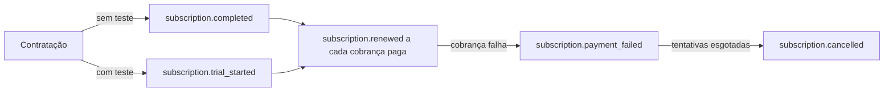

Os eventos `subscription.*` acompanham a vida de uma [assinatura](/pages/cobrar/assinaturas): contratação, período de teste, renovações, falhas de cobrança, troca de plano e cancelamento. A entrega, as retentativas e a verificação estão em [Webhooks](/pages/notificacoes/webhooks).

| Evento | Quando dispara |
|---|---|
| `subscription.completed` | Uma assinatura sem período de teste é contratada e a primeira cobrança é paga. |
| `subscription.trial_started` | Uma assinatura com período de teste é contratada. Nada é cobrado nesse momento. |
| `subscription.renewed` | Uma cobrança recorrente é paga. Também sai na primeira cobrança depois do período de teste. |
| `subscription.payment_failed` | Uma tentativa de cobrança falha. Sai a cada tentativa. |
| `subscription.plan_changed` | Você pede uma troca de plano e, de novo, quando a troca é aplicada na cobrança seguinte. |
| `subscription.cancelled` | A assinatura é cancelada, por você, pelo cliente no [Portal do cliente](/pages/vender/portal-do-cliente) ou automaticamente. |

## Em que ordem os eventos chegam



- **Com período de teste, `subscription.completed` não sai.** Libere o acesso no `subscription.trial_started` e acompanhe a primeira cobrança pelo `subscription.renewed`.
- **Cada cobrança paga também dispara `checkout.completed`**, com `frequency: "SUBSCRIPTION"`. Libere o acesso por um evento só. Veja [Eventos de checkout](/pages/webhooks/events/checkout).
- **A ordem de chegada não é garantida.** Use o `status` da assinatura que vem no payload.

## O que vem em `data`

| Campo | O que traz |
|---|---|
| `subscription` | A assinatura: `id`, `amount`, `currency`, `method` (`PIX` ou `CARD`), `status` (`ACTIVE` ou `CANCELLED`), `frequency` (o ciclo, como `MONTHLY`), `createdAt`, `updatedAt`, `canceledAt`, `cancelPolicy` (`NOW` ou `NEXT_CYCLE`) e `cancelledDueTo` (o motivo do cancelamento). |
| `customer` | O assinante, com o CPF ou CNPJ mascarado. |
| `checkout` | O checkout da contratação. O `checkout.id` é o mesmo em todas as renovações. |
| `payment` | A cobrança mais recente da assinatura. No cartão, o `status` de uma cobrança paga é `APPROVED`; no Pix, `PAID`. |
| `payerInformation` | O método da cobrança mais recente, as UTMs e quem pagou. |

Alguns eventos trazem campos a mais, descritos em cada aba.

<Tabs>
  <Tab title="subscription.completed">
    Disparado quando uma assinatura sem período de teste é contratada e a primeira cobrança é paga.

    <Tabs>
      <Tab title="Cartão">
        ```json
        {
          "id": "log_taQArRTApemxwcbw5EJeF3hS",
          "event": "subscription.completed",
          "apiVersion": 2,
          "devMode": false,
          "data": {
            "subscription": {
              "id": "subs_tAFqDWBhcEYTjQh2K0ZYDHau",
              "amount": 2990,
              "currency": "BRL",
              "method": "CARD",
              "status": "ACTIVE",
              "frequency": "MONTHLY",
              "createdAt": "2026-10-01T12:00:04.512Z",
              "updatedAt": "2026-10-01T12:00:04.512Z",
              "canceledAt": null,
              "cancelPolicy": null,
              "cancelledDueTo": null
            },
            "customer": {
              "id": "cust_aB3dE5fG7hJ9kL1mN3pQ5rS7",
              "name": "Maria Santos",
              "email": "maria@exemplo.com",
              "taxId": "529.***.247-**"
            },
            "checkout": {
              "id": "bill_Nm8bV6cX4zL2kJ0hG8fD6sA4",
              "externalId": "assinatura-789",
              "url": "https://app.abacatepay.com/pay/bill_Nm8bV6cX4zL2kJ0hG8fD6sA4",
              "amount": 2990,
              "paidAmount": 2990,
              "platformFee": 133,
              "frequency": "SUBSCRIPTION",
              "items": [{ "id": "prod_Wq3eR5tY7uI9oP1aS3dF5gH7", "quantity": 1 }],
              "status": "PAID",
              "methods": ["CARD"],
              "customerId": "cust_aB3dE5fG7hJ9kL1mN3pQ5rS7",
              "receiptUrl": "https://app.abacatepay.com/receipt/...",
              "metadata": null,
              "createdAt": "2026-10-01T12:00:00.000Z",
              "updatedAt": "2026-10-01T12:00:04.512Z"
            },
            "payment": {
              "id": "card_Jh7gF5dS3aZ1xC9vB7nM5qW3",
              "externalId": "assinatura-789",
              "amount": 2990,
              "paidAmount": 2990,
              "platformFee": 133,
              "status": "APPROVED",
              "methods": ["CARD"],
              "receiptUrl": "https://app.abacatepay.com/receipt/...",
              "createdAt": "2026-10-01T12:00:03.880Z",
              "updatedAt": "2026-10-01T12:00:04.512Z",
              "metadata": {}
            },
            "payerInformation": {
              "method": "CARD",
              "utms": { "source": null, "medium": null, "campaign": null, "term": null, "content": null },
              "CARD": {
                "number": "4242",
                "brand": "VISA"
              }
            }
          }
        }
        ```
      </Tab>

      <Tab title="Pix">
        ```json
        {
          "id": "log_Ws2eD4rF6tG8yH0uJ2iK4oL6",
          "event": "subscription.completed",
          "apiVersion": 2,
          "devMode": false,
          "data": {
            "subscription": {
              "id": "subs_Lk9jH7gF5dS3aZ1xC9vB7nM5",
              "amount": 2990,
              "currency": "BRL",
              "method": "PIX",
              "status": "ACTIVE",
              "frequency": "MONTHLY",
              "createdAt": "2026-10-01T12:05:10.210Z",
              "updatedAt": "2026-10-01T12:05:10.210Z",
              "canceledAt": null,
              "cancelPolicy": null,
              "cancelledDueTo": null
            },
            "customer": {
              "id": "cust_aB3dE5fG7hJ9kL1mN3pQ5rS7",
              "name": "Maria Santos",
              "email": "maria@exemplo.com",
              "taxId": "529.***.247-**"
            },
            "checkout": {
              "id": "bill_Pq1wE3rT5yU7iO9pA1sD3fG5",
              "externalId": null,
              "url": "https://app.abacatepay.com/pay/bill_Pq1wE3rT5yU7iO9pA1sD3fG5",
              "amount": 2990,
              "paidAmount": 2990,
              "platformFee": 80,
              "frequency": "SUBSCRIPTION",
              "items": [{ "id": "prod_Wq3eR5tY7uI9oP1aS3dF5gH7", "quantity": 1 }],
              "status": "PAID",
              "methods": ["PIX"],
              "customerId": "cust_aB3dE5fG7hJ9kL1mN3pQ5rS7",
              "receiptUrl": "https://app.abacatepay.com/receipt/...",
              "metadata": null,
              "createdAt": "2026-10-01T12:03:00.000Z",
              "updatedAt": "2026-10-01T12:05:09.874Z"
            },
            "payment": {
              "id": "char_Xc4vB6nM8qW0eR2tY4uI6oP8",
              "externalId": null,
              "amount": 2990,
              "paidAmount": 2990,
              "platformFee": 80,
              "status": "PAID",
              "methods": ["PIX"],
              "receiptUrl": "https://app.abacatepay.com/receipt/...",
              "createdAt": "2026-10-01T12:03:01.004Z",
              "updatedAt": "2026-10-01T12:05:09.874Z",
              "metadata": {}
            },
            "payerInformation": {
              "method": "PIX",
              "utms": { "source": null, "medium": null, "campaign": null, "term": null, "content": null },
              "PIX": {
                "name": "Maria Santos",
                "taxId": "529.***.247-**",
                "isSameAsCustomer": true
              }
            }
          }
        }
        ```
      </Tab>
    </Tabs>
  </Tab>

  <Tab title="subscription.trial_started">
    Disparado quando uma assinatura com período de teste é contratada. Nada é cobrado agora: o `payment` é a validação do cartão, com `amount: 0`, e a primeira cobrança acontece no fim do teste, como `subscription.renewed`.

    ```json
    {
      "id": "log_trQ1wE3rT5yU7iO9pA1sD3fG",
      "event": "subscription.trial_started",
      "apiVersion": 2,
      "devMode": false,
      "data": {
        "subscription": {
          "id": "subs_tAFqDWBhcEYTjQh2K0ZYDHau",
          "amount": 4990,
          "currency": "BRL",
          "method": "CARD",
          "status": "ACTIVE",
          "frequency": "MONTHLY",
          "createdAt": "2026-11-04T18:38:28.573Z",
          "updatedAt": "2026-11-04T18:38:28.573Z",
          "canceledAt": null,
          "cancelPolicy": null,
          "cancelledDueTo": null
        },
        "customer": {
          "id": "cust_aB3dE5fG7hJ9kL1mN3pQ5rS7",
          "name": "Maria Santos",
          "email": "maria@exemplo.com",
          "taxId": "529.***.247-**"
        },
        "checkout": {
          "id": "bill_Nm8bV6cX4zL2kJ0hG8fD6sA4",
          "externalId": "assinatura-789",
          "url": "https://app.abacatepay.com/pay/bill_Nm8bV6cX4zL2kJ0hG8fD6sA4",
          "amount": 4990,
          "paidAmount": null,
          "platformFee": null,
          "frequency": "SUBSCRIPTION",
          "items": [{ "id": "prod_Wq3eR5tY7uI9oP1aS3dF5gH7", "quantity": 1 }],
          "status": "PAID",
          "methods": ["CARD"],
          "customerId": "cust_aB3dE5fG7hJ9kL1mN3pQ5rS7",
          "receiptUrl": null,
          "metadata": null,
          "createdAt": "2026-11-04T18:37:50.000Z",
          "updatedAt": "2026-11-04T18:38:28.573Z"
        },
        "payment": {
          "id": "card_Rf4tG6yH8uJ0iK2oL4pZ6xC8",
          "externalId": "assinatura-789",
          "amount": 0,
          "paidAmount": null,
          "status": "APPROVED",
          "methods": ["CARD"],
          "receiptUrl": null,
          "createdAt": "2026-11-04T18:38:27.902Z",
          "updatedAt": "2026-11-04T18:38:28.573Z",
          "metadata": {}
        },
        "payerInformation": {
          "method": "CARD",
          "utms": { "source": null, "medium": null, "campaign": null, "term": null, "content": null },
          "CARD": {
            "number": "4242",
            "brand": "VISA"
          }
        }
      }
    }
    ```
  </Tab>

  <Tab title="subscription.renewed">
    Disparado a cada cobrança recorrente paga, inclusive a primeira depois do período de teste. O `checkout` é o da contratação, e o `payment` é a cobrança deste ciclo.

    <Tabs>
      <Tab title="Cartão">
        ```json
        {
          "id": "log_Gt5hY7jU9kI1lO3pA5sD7fG9",
          "event": "subscription.renewed",
          "apiVersion": 2,
          "devMode": false,
          "data": {
            "subscription": {
              "id": "subs_tAFqDWBhcEYTjQh2K0ZYDHau",
              "amount": 2990,
              "currency": "BRL",
              "method": "CARD",
              "status": "ACTIVE",
              "frequency": "MONTHLY",
              "createdAt": "2026-10-01T12:00:04.512Z",
              "updatedAt": "2026-11-01T12:00:06.330Z",
              "canceledAt": null,
              "cancelPolicy": null,
              "cancelledDueTo": null
            },
            "customer": {
              "id": "cust_aB3dE5fG7hJ9kL1mN3pQ5rS7",
              "name": "Maria Santos",
              "email": "maria@exemplo.com",
              "taxId": "529.***.247-**"
            },
            "checkout": {
              "id": "bill_Nm8bV6cX4zL2kJ0hG8fD6sA4",
              "externalId": "assinatura-789",
              "url": "https://app.abacatepay.com/pay/bill_Nm8bV6cX4zL2kJ0hG8fD6sA4",
              "amount": 2990,
              "paidAmount": 2990,
              "platformFee": 133,
              "frequency": "SUBSCRIPTION",
              "items": [{ "id": "prod_Wq3eR5tY7uI9oP1aS3dF5gH7", "quantity": 1 }],
              "status": "PAID",
              "methods": ["CARD"],
              "customerId": "cust_aB3dE5fG7hJ9kL1mN3pQ5rS7",
              "receiptUrl": "https://app.abacatepay.com/receipt/...",
              "metadata": null,
              "createdAt": "2026-10-01T12:00:00.000Z",
              "updatedAt": "2026-10-01T12:00:04.512Z"
            },
            "payment": {
              "id": "card_Ty8uI0oP2aS4dF6gH8jK0lZ2",
              "externalId": "assinatura-789",
              "amount": 2990,
              "paidAmount": 2990,
              "platformFee": 133,
              "status": "APPROVED",
              "methods": ["CARD"],
              "receiptUrl": "https://app.abacatepay.com/receipt/...",
              "createdAt": "2026-11-01T12:00:05.118Z",
              "updatedAt": "2026-11-01T12:00:06.330Z",
              "metadata": {}
            },
            "payerInformation": {
              "method": "CARD",
              "utms": { "source": null, "medium": null, "campaign": null, "term": null, "content": null },
              "CARD": {
                "number": "4242",
                "brand": "VISA"
              }
            }
          }
        }
        ```
      </Tab>

      <Tab title="Pix">
        ```json
        {
          "id": "log_Aq2sW4eD6rF8tG0yH2uJ4iK6",
          "event": "subscription.renewed",
          "apiVersion": 2,
          "devMode": false,
          "data": {
            "subscription": {
              "id": "subs_Lk9jH7gF5dS3aZ1xC9vB7nM5",
              "amount": 2990,
              "currency": "BRL",
              "method": "PIX",
              "status": "ACTIVE",
              "frequency": "MONTHLY",
              "createdAt": "2026-10-01T12:05:10.210Z",
              "updatedAt": "2026-11-01T09:00:12.441Z",
              "canceledAt": null,
              "cancelPolicy": null,
              "cancelledDueTo": null
            },
            "customer": {
              "id": "cust_aB3dE5fG7hJ9kL1mN3pQ5rS7",
              "name": "Maria Santos",
              "email": "maria@exemplo.com",
              "taxId": "529.***.247-**"
            },
            "checkout": {
              "id": "bill_Pq1wE3rT5yU7iO9pA1sD3fG5",
              "externalId": null,
              "url": "https://app.abacatepay.com/pay/bill_Pq1wE3rT5yU7iO9pA1sD3fG5",
              "amount": 2990,
              "paidAmount": 2990,
              "platformFee": 80,
              "frequency": "SUBSCRIPTION",
              "items": [{ "id": "prod_Wq3eR5tY7uI9oP1aS3dF5gH7", "quantity": 1 }],
              "status": "PAID",
              "methods": ["PIX"],
              "customerId": "cust_aB3dE5fG7hJ9kL1mN3pQ5rS7",
              "receiptUrl": "https://app.abacatepay.com/receipt/...",
              "metadata": null,
              "createdAt": "2026-10-01T12:03:00.000Z",
              "updatedAt": "2026-10-01T12:05:09.874Z"
            },
            "payment": {
              "id": "pix_char_Zx1cV3bN5mL7kJ9hG1fD3sA5",
              "externalId": null,
              "amount": 2990,
              "paidAmount": 2990,
              "platformFee": 80,
              "status": "PAID",
              "methods": ["PIX"],
              "receiptUrl": "https://app.abacatepay.com/receipt/...",
              "createdAt": "2026-11-01T09:00:00.512Z",
              "updatedAt": "2026-11-01T09:00:12.441Z",
              "metadata": {}
            },
            "payerInformation": {
              "method": "PIX",
              "utms": { "source": null, "medium": null, "campaign": null, "term": null, "content": null },
              "PIX": {
                "name": "Maria Santos",
                "taxId": "529.***.247-**",
                "isSameAsCustomer": true
              }
            }
          }
        }
        ```
      </Tab>
    </Tabs>
  </Tab>

  <Tab title="subscription.payment_failed">
    Disparado a cada tentativa de cobrança que falha. Além dos campos de sempre, chegam:

    - `installmentId` e `installmentNumber`: a cobrança do ciclo que falhou e o número dela;
    - `retryNumber`: o número da tentativa. No Pix Automático, quando o banco do cliente recusa a cobrança, chega `rejectCode` no lugar dele.

    Quando as tentativas acabam, a assinatura é cancelada e sai um `subscription.cancelled` com `cancelledDueTo: "max_payment_retries_exceeded"`. Quantas tentativas são feitas e o intervalo entre elas estão em [Assinaturas](/pages/cobrar/assinaturas).

    ```json
    {
      "id": "log_Fr3tG5yH7uJ9iK1oL3pZ5xC7",
      "event": "subscription.payment_failed",
      "apiVersion": 2,
      "devMode": false,
      "data": {
        "subscription": {
          "id": "subs_tAFqDWBhcEYTjQh2K0ZYDHau",
          "amount": 2990,
          "currency": "BRL",
          "method": "CARD",
          "status": "ACTIVE",
          "frequency": "MONTHLY",
          "createdAt": "2026-10-01T12:00:04.512Z",
          "updatedAt": "2026-10-01T12:00:04.512Z",
          "canceledAt": null,
          "cancelPolicy": null,
          "cancelledDueTo": null
        },
        "customer": {
          "id": "cust_aB3dE5fG7hJ9kL1mN3pQ5rS7",
          "name": "Maria Santos",
          "email": "maria@exemplo.com",
          "taxId": "529.***.247-**"
        },
        "checkout": {
          "id": "bill_Nm8bV6cX4zL2kJ0hG8fD6sA4",
          "externalId": "assinatura-789",
          "url": "https://app.abacatepay.com/pay/bill_Nm8bV6cX4zL2kJ0hG8fD6sA4",
          "amount": 2990,
          "paidAmount": 2990,
          "platformFee": 133,
          "frequency": "SUBSCRIPTION",
          "items": [{ "id": "prod_Wq3eR5tY7uI9oP1aS3dF5gH7", "quantity": 1 }],
          "status": "PAID",
          "methods": ["CARD"],
          "customerId": "cust_aB3dE5fG7hJ9kL1mN3pQ5rS7",
          "receiptUrl": "https://app.abacatepay.com/receipt/...",
          "metadata": null,
          "createdAt": "2026-10-01T12:00:00.000Z",
          "updatedAt": "2026-10-01T12:00:04.512Z"
        },
        "payment": {
          "id": "card_Uy7tR5eW3qA1sD9fG7hJ5kL3",
          "externalId": "assinatura-789",
          "amount": 2990,
          "paidAmount": 2990,
          "status": "FAILED",
          "methods": ["CARD"],
          "receiptUrl": null,
          "createdAt": "2026-11-01T12:00:05.118Z",
          "updatedAt": "2026-11-01T12:00:05.118Z",
          "metadata": {}
        },
        "payerInformation": {
          "method": "CARD",
          "utms": { "source": null, "medium": null, "campaign": null, "term": null, "content": null },
          "CARD": {
            "number": "4242",
            "brand": "VISA"
          }
        },
        "installmentId": "intl_Op9iU7yT5rE3wQ1aS9dF7gH5",
        "installmentNumber": 2,
        "retryNumber": 1
      }
    }
    ```
  </Tab>

  <Tab title="subscription.plan_changed">
    Disparado duas vezes numa troca de plano feita por [Alterar plano da assinatura](/pages/subscriptions/change-plan): quando você pede a troca e quando ela é aplicada, na cobrança seguinte.

    <Tabs>
      <Tab title="Troca pedida">
        A troca fica pendente até a próxima cobrança. O evento traz o pedido:

        - `changeSource`: de onde veio a troca (`API_CHANGE_PLAN`);
        - `pendingUpdateId`: o identificador da troca pendente;
        - `items`: os produtos do plano novo, com `productId`, `quantity` e `newAmount`;
        - `productId` e `quantity`: o primeiro item;
        - `newAmount`: o valor novo da assinatura, em centavos;
        - `status`: `PENDING`;
        - `requestedAt`: quando a troca foi pedida.

        A `subscription` ainda mostra o valor atual.

        ```json
        {
          "id": "log_Pc2xZ4vB6nM8qW0eR2tY4uI6",
          "event": "subscription.plan_changed",
          "apiVersion": 2,
          "devMode": false,
          "data": {
            "subscription": {
              "id": "subs_tAFqDWBhcEYTjQh2K0ZYDHau",
              "amount": 2990,
              "currency": "BRL",
              "method": "CARD",
              "status": "ACTIVE",
              "frequency": "MONTHLY",
              "createdAt": "2026-10-01T12:00:04.512Z",
              "updatedAt": "2026-11-01T12:00:06.330Z",
              "canceledAt": null,
              "cancelPolicy": null,
              "cancelledDueTo": null
            },
            "customer": {
              "id": "cust_aB3dE5fG7hJ9kL1mN3pQ5rS7",
              "name": "Maria Santos",
              "email": "maria@exemplo.com",
              "taxId": "529.***.247-**"
            },
            "checkout": {
              "id": "bill_Nm8bV6cX4zL2kJ0hG8fD6sA4",
              "externalId": "assinatura-789",
              "url": "https://app.abacatepay.com/pay/bill_Nm8bV6cX4zL2kJ0hG8fD6sA4",
              "amount": 2990,
              "paidAmount": 2990,
              "platformFee": 133,
              "frequency": "SUBSCRIPTION",
              "items": [{ "id": "prod_Wq3eR5tY7uI9oP1aS3dF5gH7", "quantity": 1 }],
              "status": "PAID",
              "methods": ["CARD"],
              "customerId": "cust_aB3dE5fG7hJ9kL1mN3pQ5rS7",
              "receiptUrl": "https://app.abacatepay.com/receipt/...",
              "metadata": null,
              "createdAt": "2026-10-01T12:00:00.000Z",
              "updatedAt": "2026-10-01T12:00:04.512Z"
            },
            "payment": {
              "id": "card_Ty8uI0oP2aS4dF6gH8jK0lZ2",
              "externalId": "assinatura-789",
              "amount": 2990,
              "paidAmount": 2990,
              "platformFee": 133,
              "status": "APPROVED",
              "methods": ["CARD"],
              "receiptUrl": "https://app.abacatepay.com/receipt/...",
              "createdAt": "2026-11-01T12:00:05.118Z",
              "updatedAt": "2026-11-01T12:00:06.330Z",
              "metadata": {}
            },
            "payerInformation": {
              "method": "CARD",
              "utms": { "source": null, "medium": null, "campaign": null, "term": null, "content": null },
              "CARD": {
                "number": "4242",
                "brand": "VISA"
              }
            },
            "changeSource": "API_CHANGE_PLAN",
            "pendingUpdateId": "subu_Mk5jN7hB9gV1fC3dX5sZ7aQ9",
            "items": [{ "productId": "prod_Ed4rF6tG8yH0uJ2iK4oL6pZ8", "quantity": 1, "newAmount": 4990 }],
            "productId": "prod_Ed4rF6tG8yH0uJ2iK4oL6pZ8",
            "quantity": 1,
            "newAmount": 4990,
            "status": "PENDING",
            "requestedAt": "2026-11-10T14:02:33.120Z"
          }
        }
        ```
      </Tab>

      <Tab title="Troca aplicada">
        Na cobrança seguinte, a troca é aplicada e o evento sai de novo, sem os campos do pedido. A `subscription` já vem com o valor novo, e o `payment` é a cobrança com o plano novo.

        ```json
        {
          "id": "log_Lm3nB5vC7xZ9aS1dF3gH5jK7",
          "event": "subscription.plan_changed",
          "apiVersion": 2,
          "devMode": false,
          "data": {
            "subscription": {
              "id": "subs_tAFqDWBhcEYTjQh2K0ZYDHau",
              "amount": 4990,
              "currency": "BRL",
              "method": "CARD",
              "status": "ACTIVE",
              "frequency": "MONTHLY",
              "createdAt": "2026-10-01T12:00:04.512Z",
              "updatedAt": "2026-12-01T12:00:03.002Z",
              "canceledAt": null,
              "cancelPolicy": null,
              "cancelledDueTo": null
            },
            "customer": {
              "id": "cust_aB3dE5fG7hJ9kL1mN3pQ5rS7",
              "name": "Maria Santos",
              "email": "maria@exemplo.com",
              "taxId": "529.***.247-**"
            },
            "checkout": {
              "id": "bill_Nm8bV6cX4zL2kJ0hG8fD6sA4",
              "externalId": "assinatura-789",
              "url": "https://app.abacatepay.com/pay/bill_Nm8bV6cX4zL2kJ0hG8fD6sA4",
              "amount": 2990,
              "paidAmount": 2990,
              "platformFee": 210,
              "frequency": "SUBSCRIPTION",
              "items": [{ "id": "prod_Wq3eR5tY7uI9oP1aS3dF5gH7", "quantity": 1 }],
              "status": "PAID",
              "methods": ["CARD"],
              "customerId": "cust_aB3dE5fG7hJ9kL1mN3pQ5rS7",
              "receiptUrl": "https://app.abacatepay.com/receipt/...",
              "metadata": null,
              "createdAt": "2026-10-01T12:00:00.000Z",
              "updatedAt": "2026-10-01T12:00:04.512Z"
            },
            "payment": {
              "id": "card_Qa1zW3sX5eD7cR9fV1tG3bY5",
              "externalId": "assinatura-789",
              "amount": 4990,
              "paidAmount": 2990,
              "platformFee": 210,
              "status": "APPROVED",
              "methods": ["CARD"],
              "receiptUrl": "https://app.abacatepay.com/receipt/...",
              "createdAt": "2026-12-01T12:00:02.140Z",
              "updatedAt": "2026-12-01T12:00:03.002Z",
              "metadata": {}
            },
            "payerInformation": {
              "method": "CARD",
              "utms": { "source": null, "medium": null, "campaign": null, "term": null, "content": null },
              "CARD": {
                "number": "4242",
                "brand": "VISA"
              }
            }
          }
        }
        ```
      </Tab>
    </Tabs>
  </Tab>

  <Tab title="subscription.cancelled">
    Disparado quando a assinatura é cancelada. `cancelPolicy` diz quando o cancelamento vale, e `cancelledDueTo` diz por quê:

    | Como foi cancelada | `cancelPolicy` | `cancelledDueTo` |
    |---|---|---|
    | Por você, no dashboard ou pela [API](/pages/subscriptions/cancel) | `NOW` | `null` |
    | Pelo cliente, no Portal do cliente | `NEXT_CYCLE` | `"Cancelada pelo cliente no portal: ..."`, com o motivo escolhido |
    | Pelo cliente, ao pedir reembolso no Portal do cliente | `NOW` | `"Cancelada pelo reembolso pedido pelo cliente no portal"` |
    | Tentativas de cobrança esgotadas | `NOW` | `"max_payment_retries_exceeded"` |
    | Disputa aberta numa cobrança no cartão | `NOW` | `"dispute_opened"` |
    | Autorização do Pix Automático recusada | `NOW` | `"pix_automatic_authorization_refused"` |
    | Encerramento da conta da loja | `NOW` | `"Conta encerrada"` |

    Com `NEXT_CYCLE`, o evento chega na hora do pedido, já com `status: "CANCELLED"`, mas o cliente mantém o acesso até o fim do ciclo pago. Não corte o acesso antes disso.

    <Tabs>
      <Tab title="Cancelada por você">
        ```json
        {
          "id": "log_Nh6gT4fR2eW0qA8sZ6xC4vB2",
          "event": "subscription.cancelled",
          "apiVersion": 2,
          "devMode": false,
          "data": {
            "subscription": {
              "id": "subs_tAFqDWBhcEYTjQh2K0ZYDHau",
              "amount": 2990,
              "currency": "BRL",
              "method": "CARD",
              "status": "CANCELLED",
              "frequency": "MONTHLY",
              "createdAt": "2026-10-01T12:00:04.512Z",
              "updatedAt": "2026-11-15T10:20:00.000Z",
              "canceledAt": "2026-11-15T10:20:00.000Z",
              "cancelPolicy": "NOW",
              "cancelledDueTo": null
            },
            "customer": {
              "id": "cust_aB3dE5fG7hJ9kL1mN3pQ5rS7",
              "name": "Maria Santos",
              "email": "maria@exemplo.com",
              "taxId": "529.***.247-**"
            },
            "checkout": {
              "id": "bill_Nm8bV6cX4zL2kJ0hG8fD6sA4",
              "externalId": "assinatura-789",
              "url": "https://app.abacatepay.com/pay/bill_Nm8bV6cX4zL2kJ0hG8fD6sA4",
              "amount": 2990,
              "paidAmount": 2990,
              "platformFee": 133,
              "frequency": "SUBSCRIPTION",
              "items": [{ "id": "prod_Wq3eR5tY7uI9oP1aS3dF5gH7", "quantity": 1 }],
              "status": "PAID",
              "methods": ["CARD"],
              "customerId": "cust_aB3dE5fG7hJ9kL1mN3pQ5rS7",
              "receiptUrl": "https://app.abacatepay.com/receipt/...",
              "metadata": null,
              "createdAt": "2026-10-01T12:00:00.000Z",
              "updatedAt": "2026-10-01T12:00:04.512Z"
            },
            "payment": {
              "id": "card_Ty8uI0oP2aS4dF6gH8jK0lZ2",
              "externalId": "assinatura-789",
              "amount": 2990,
              "paidAmount": 2990,
              "platformFee": 133,
              "status": "APPROVED",
              "methods": ["CARD"],
              "receiptUrl": "https://app.abacatepay.com/receipt/...",
              "createdAt": "2026-11-01T12:00:05.118Z",
              "updatedAt": "2026-11-01T12:00:06.330Z",
              "metadata": {}
            },
            "payerInformation": {
              "method": "CARD",
              "utms": { "source": null, "medium": null, "campaign": null, "term": null, "content": null },
              "CARD": {
                "number": "4242",
                "brand": "VISA"
              }
            }
          }
        }
        ```
      </Tab>

      <Tab title="Cancelada pelo cliente no portal">
        ```json
        {
          "id": "log_Vf5cD3xS1zA9qW7eR5tY3uI1",
          "event": "subscription.cancelled",
          "apiVersion": 2,
          "devMode": false,
          "data": {
            "subscription": {
              "id": "subs_Lk9jH7gF5dS3aZ1xC9vB7nM5",
              "amount": 2990,
              "currency": "BRL",
              "method": "PIX",
              "status": "CANCELLED",
              "frequency": "MONTHLY",
              "createdAt": "2026-10-01T12:05:10.210Z",
              "updatedAt": "2026-11-12T16:45:21.000Z",
              "canceledAt": "2026-11-12T16:45:21.000Z",
              "cancelPolicy": "NEXT_CYCLE",
              "cancelledDueTo": "Cancelada pelo cliente no portal: Preço muito alto"
            },
            "customer": {
              "id": "cust_aB3dE5fG7hJ9kL1mN3pQ5rS7",
              "name": "Maria Santos",
              "email": "maria@exemplo.com",
              "taxId": "529.***.247-**"
            },
            "checkout": {
              "id": "bill_Pq1wE3rT5yU7iO9pA1sD3fG5",
              "externalId": null,
              "url": "https://app.abacatepay.com/pay/bill_Pq1wE3rT5yU7iO9pA1sD3fG5",
              "amount": 2990,
              "paidAmount": 2990,
              "platformFee": 80,
              "frequency": "SUBSCRIPTION",
              "items": [{ "id": "prod_Wq3eR5tY7uI9oP1aS3dF5gH7", "quantity": 1 }],
              "status": "PAID",
              "methods": ["PIX"],
              "customerId": "cust_aB3dE5fG7hJ9kL1mN3pQ5rS7",
              "receiptUrl": "https://app.abacatepay.com/receipt/...",
              "metadata": null,
              "createdAt": "2026-10-01T12:03:00.000Z",
              "updatedAt": "2026-10-01T12:05:09.874Z"
            },
            "payment": {
              "id": "pix_char_Zx1cV3bN5mL7kJ9hG1fD3sA5",
              "externalId": null,
              "amount": 2990,
              "paidAmount": 2990,
              "platformFee": 80,
              "status": "PAID",
              "methods": ["PIX"],
              "receiptUrl": "https://app.abacatepay.com/receipt/...",
              "createdAt": "2026-11-01T09:00:00.512Z",
              "updatedAt": "2026-11-01T09:00:12.441Z",
              "metadata": {}
            },
            "payerInformation": {
              "method": "PIX",
              "utms": { "source": null, "medium": null, "campaign": null, "term": null, "content": null },
              "PIX": {
                "name": "Maria Santos",
                "taxId": "529.***.247-**",
                "isSameAsCustomer": true
              }
            }
          }
        }
        ```
      </Tab>

      <Tab title="Tentativas esgotadas">
        Chega logo depois do último `subscription.payment_failed`. O `payment` é a última tentativa, que falhou.

        ```json
        {
          "id": "log_Cx7vB9nM1qW3eR5tY7uI9oP1",
          "event": "subscription.cancelled",
          "apiVersion": 2,
          "devMode": false,
          "data": {
            "subscription": {
              "id": "subs_tAFqDWBhcEYTjQh2K0ZYDHau",
              "amount": 2990,
              "currency": "BRL",
              "method": "CARD",
              "status": "CANCELLED",
              "frequency": "MONTHLY",
              "createdAt": "2026-10-01T12:00:04.512Z",
              "updatedAt": "2026-11-03T12:00:07.415Z",
              "canceledAt": "2026-11-03T12:00:07.415Z",
              "cancelPolicy": "NOW",
              "cancelledDueTo": "max_payment_retries_exceeded"
            },
            "customer": {
              "id": "cust_aB3dE5fG7hJ9kL1mN3pQ5rS7",
              "name": "Maria Santos",
              "email": "maria@exemplo.com",
              "taxId": "529.***.247-**"
            },
            "checkout": {
              "id": "bill_Nm8bV6cX4zL2kJ0hG8fD6sA4",
              "externalId": "assinatura-789",
              "url": "https://app.abacatepay.com/pay/bill_Nm8bV6cX4zL2kJ0hG8fD6sA4",
              "amount": 2990,
              "paidAmount": 2990,
              "platformFee": 133,
              "frequency": "SUBSCRIPTION",
              "items": [{ "id": "prod_Wq3eR5tY7uI9oP1aS3dF5gH7", "quantity": 1 }],
              "status": "PAID",
              "methods": ["CARD"],
              "customerId": "cust_aB3dE5fG7hJ9kL1mN3pQ5rS7",
              "receiptUrl": "https://app.abacatepay.com/receipt/...",
              "metadata": null,
              "createdAt": "2026-10-01T12:00:00.000Z",
              "updatedAt": "2026-10-01T12:00:04.512Z"
            },
            "payment": {
              "id": "card_Iu6yT4rE2wQ0aS8dF6gH4jK2",
              "externalId": "assinatura-789",
              "amount": 2990,
              "paidAmount": 2990,
              "status": "FAILED",
              "methods": ["CARD"],
              "receiptUrl": null,
              "createdAt": "2026-11-03T12:00:06.902Z",
              "updatedAt": "2026-11-03T12:00:06.902Z",
              "metadata": {}
            },
            "payerInformation": {
              "method": "CARD",
              "utms": { "source": null, "medium": null, "campaign": null, "term": null, "content": null },
              "CARD": {
                "number": "4242",
                "brand": "VISA"
              }
            }
          }
        }
        ```
      </Tab>
    </Tabs>
  </Tab>
</Tabs>
